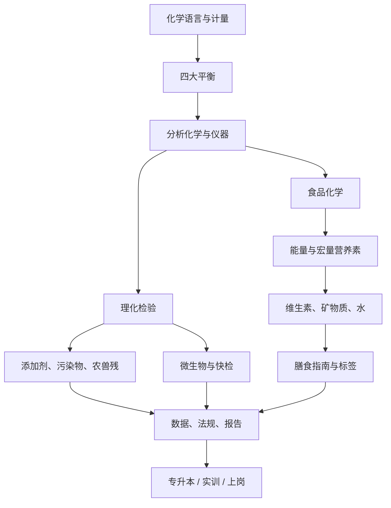

# 食品类大方向学习系统

## 这个主题在讲什么

这套书解决一个具体问题：食品检验检测技术专业的学生，化学几乎零基础，要同时面对专升本、实训和上岗。材料把无机化学、分析化学、食品化学、食品营养、理化检验、微生物与快检、数据法规串成一条线，不是把七门课堆在一起。

## 全书心智模型

## 学习路径

| 步骤 | 章节 | 主题 | 前置 | 检查点 |
|---|---|---|---|---|
| 01 | ch01 | 专业地图 | 无 | 说出检验三问 |
| 02 | ch02 | 化学语言与计量 | ch01 | 自测 ≥4/5 |
| 03 | ch03 | 四大平衡 | ch02 | 自测 ≥4/5 |
| 04 | ch04 | 分析化学与仪器 | ch02、ch03 | 自测 ≥4/5 |
| 05 | ch05 | 食品化学 | ch03 | 自测 ≥4/5 |
| 06 | ch06 | 能量与宏量营养素 | ch05 | 自测 ≥4/5 |
| 07 | ch07 | 维生素、矿物质、水 | ch06 | 自测 ≥4/5 |
| 08 | ch08 | 膳食指南与标签 | ch06、ch07 | 自测 ≥4/5 |
| 09 | ch09 | 理化检验 | ch02、ch04 | 自测 ≥4/5 |
| 10 | ch10 | 添加剂与污染物 | ch09 | 自测 ≥4/5 |
| 11 | ch11 | 微生物与快检 | ch09 | 自测 ≥4/5 |
| 12 | ch12 | 数据、法规、专升本 | ch04、ch09、ch10、ch11 | 自测 ≥4/5 |

## 章节索引

- 第 1 章 食品专业的地图（★☆☆）→ `chapters/ch01-专业地图.md`
- 第 2 章 化学语言与计量（★☆☆）→ `chapters/ch02-化学计量.md`
- 第 3 章 无机化学四大平衡（★★☆）→ `chapters/ch03-四大平衡.md`
- 第 4 章 分析化学与仪器（★★☆）→ `chapters/ch04-分析化学.md`
- 第 5 章 食品化学（★★☆）→ `chapters/ch05-食品化学.md`
- 第 6 章 能量与宏量营养素（★★☆）→ `chapters/ch06-能量与宏量营养素.md`
- 第 7 章 维生素、矿物质与水（★★☆）→ `chapters/ch07-维生素矿物质水.md`
- 第 8 章 膳食指南、营养标签与特殊人群（★★☆）→ `chapters/ch08-膳食指南与标签.md`
- 第 9 章 食品检验总论与理化检验（★★☆）→ `chapters/ch09-理化检验.md`
- 第 10 章 添加剂、污染物与农兽药残留（★★☆）→ `chapters/ch10-添加剂与污染物.md`
- 第 11 章 微生物检验与快速检测（★★☆）→ `chapters/ch11-微生物与快检.md`
- 第 12 章 数据、法规、实验室管理与专升本（★★☆）→ `chapters/ch12-数据法规与专升本.md`

## 前置知识缺口

| 缺口 | 补讲位置 | 学完标志 |
|---|---|---|
| 化学式、化合价、物质的量 | 第 2 章；配套《化学知枢》01/02 | 能独立完成浓度和滴定计算 |
| 酸碱、沉淀、氧化还原、配位 | 第 3 章；配套《化学知枢》03 | 能判断平衡移动和电极电势 |
| 误差、滴定、分光、色谱 | 第 4 章；配套《化学知枢》03/04 | 能读标准曲线和方法验证指标 |
| 食品营养基础 | 第 6—8 章 | 能算能量、读营养标签 |

## 术语表 / 模式库 / 速查表

- 术语表：`glossary.md`
- 模式库：`patterns.md`
- 速查表：`cheatsheet.md`
- 题库：配套《食品类大方向题库》12 章，144 题
- 化学深化：配套《无机及分析化学》13 章、130 题
