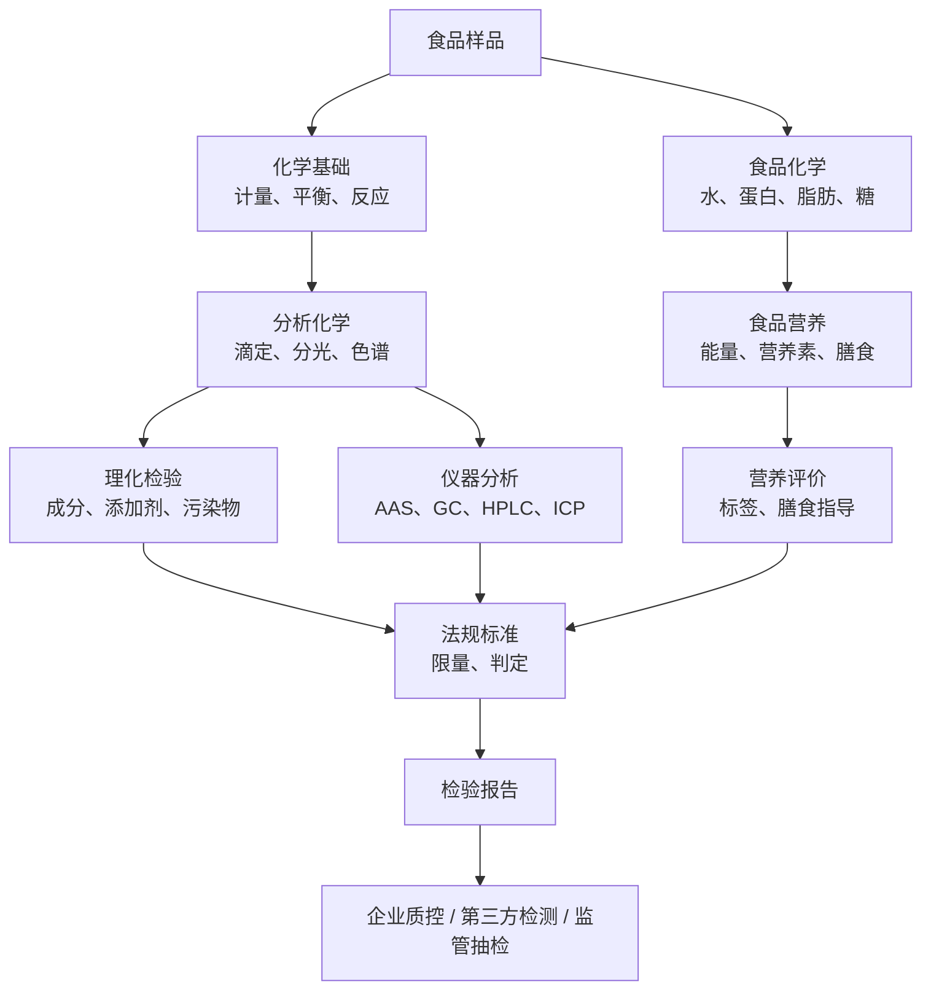

# 第 1 章：食品专业的地图：化学、营养、检测怎么连起来

- **难度**：★☆☆ | **预估学时**：1.5 小时 | **前置**：无
- **本章作用**：先把“学这些课到底有什么用”讲清楚。后面 11 章都挂在这张地图上，迷路时回来看这一页。

## 学习目标
学完本章，你能：
1. 说清食品检验检测技术专业的四条主线：化学基础、食品营养、检验检测、法规质控；
2. 拿到一个食品样品，知道该问哪三个问题：有什么、有多少、合不合规；
3. 看懂“理化检验、微生物检验、仪器分析、快速检测”各自解决什么问题；
4. 给自己排一条从零基础到专升本、实训、上岗的学习顺序。

## 一句话核心
食品检验不是“拿着瓶子做实验”，它是一条链：先懂食品里有什么，再懂怎么测出来，最后判断结果合不合标准。

## 1.1 食品里到底在测什么

把一块面包拆开看，里面有几类东西：

- **营养成分**：水、蛋白质、脂肪、碳水化合物、维生素、矿物质。
- **食品添加剂**：防腐剂、着色剂、甜味剂、抗氧化剂、增稠剂。
- **可能存在的危害物**：重金属、农药残留、兽药残留、真菌毒素、致病菌。
- **决定口感和保存的指标**：水分活度、酸度、过氧化值、质构、色泽。

检验人员做的事，就是把这些东西从“看不见”变成“有数字”。数字出来以后，还要回答三个问题：

1. **有什么**：这个样品里检出的是蛋白质、苯甲酸，还是铅？
2. **有多少**：含量是 0.02 g/100 g，还是 2.0 g/100 g？
3. **合不合规**：这个数字有没有超过 GB 2760、GB 2762、GB 2763 或产品标准里的限量？

这三个问题，分别对应定性、定量、合规判定。只测出“有”不够，只报一个数字也不够。

## 1.2 四条主线

### 1.2.1 化学基础：看懂反应和平衡

食品检验的底层语言是化学。你要会写化学式、配平方程式、算物质的量浓度，还要理解四类平衡：

- 酸碱平衡：食醋的总酸、牛奶的 pH、缓冲溶液。
- 沉淀平衡：重金属沉淀、灰化、样品前处理。
- 氧化还原：维生素 C 的还原性、油脂氧化、高锰酸钾滴定。
- 配位平衡：EDTA 滴定钙镁、金属离子的掩蔽。

这些内容不是“背公式”，而是解释“为什么这个前处理不能那样做”“为什么这个滴定突跃在这个 pH”。

### 1.2.2 食品营养：知道成分的生理意义

食品化学告诉你“蛋白质会变性、脂肪会氧化”；食品营养告诉你“蛋白质吃多少、脂肪酸怎么分类、维生素缺了会怎样”。这两块经常被混在一起，考试也常混着考。

食品营养的骨架是：

- 能量：蛋白质 4 kcal/g、脂肪 9 kcal/g、碳水 4 kcal/g；
- 宏量营养素：蛋白质、脂类、碳水化合物；
- 微量营养素：维生素、矿物质；
- 膳食指导：中国居民膳食指南、营养标签、特殊人群；
- 营养相关疾病：贫血、骨质疏松、肥胖、高血压、糖尿病。

### 1.2.3 检验检测：把化学原理变成方法

检验方法分四类，不要混：

| 类别 | 主要做什么 | 典型项目 | 常用方法 |
|---|---|---|---|
| 理化检验 | 测成分、物理指标、添加剂 | 水分、蛋白质、脂肪、酸价、苯甲酸 | 干燥法、凯氏定氮、索氏提取、滴定、HPLC |
| 微生物检验 | 测菌落、致病菌、霉菌 | 菌落总数、大肠菌群、沙门氏菌 | 平板计数、MPN、显色培养基、PCR |
| 仪器分析 | 测微量、痕量成分 | 重金属、农残、兽残、维生素 | AAS、ICP-MS、GC-MS、LC-MS/MS |
| 快速检测 | 现场初筛 | 农残、亚硝酸盐、甲醛、ATP | 酶抑制、免疫层析、比色、生物传感器 |

这里有一个关键顺序：**快检负责初筛，标准法负责确证**。快检阳性不等于最终不合格，必须用标准方法复检；快检阴性也不能排除所有风险，因为它只覆盖设定目标。

### 1.2.4 法规质控：把数字变成结论

同一个 0.5 mg/kg，对不同食品、不同项目，结论可能完全不同。你需要知道：

- 食品安全国家标准怎么编号：GB 2760 添加剂、GB 2762 污染物、GB 2763 农残、GB 29921 致病菌限量；
- 产品标准里的指标和检测方法；
- 实验室质控：空白、平行、加标回收、标准物质、控制图；
- 报告怎么写：样品信息、方法依据、结果、单位、限量、判定。

## 1.3 一张图看懂整个专业

看图说明：这张图的起点是样品，终点是报告。中间的每门课都不是孤立的。化学基础断了，分析化学学不动；食品化学断了，理化检验只能背操作；法规断了，结果不会判。

## 1.4 专升本、实训、上岗三条路

### 1.4.1 专升本

食品大类专升本的专业课通常围绕 **无机化学、分析化学、食品营养与健康** 出题。不同省份、年份的科目和分值会变，具体以当年招生文件为准。复习时不要把三科割裂：

- 无机化学提供平衡和计算；
- 分析化学提供误差、滴定和仪器；
- 食品营养提供成分、功能和膳食结论。

常见的计算题集中在：物质的量浓度、稀释、滴定结果计算、误差与有效数字、能量与营养素折算。常见的简答题集中在：平衡移动、缓冲溶液、滴定条件、营养缺乏、膳食指南。

### 1.4.2 实训

实训考的不是“知道”，是“做得出来”：

- 样品怎么采、怎么分、怎么保存；
- 天平怎么称、容量瓶怎么定容、滴定管怎么读数；
- 空白、平行、加标回收怎么做；
- 数据怎么记、结果怎么算、报告怎么填。

这套系统每章后面的自测和题库，就是为实训前的理论检查准备的。做错不可怕，怕的是错了不知道回哪一章。

### 1.4.3 上岗

上岗后你会遇到三类任务：

1. **常规批量检测**：水分、蛋白质、脂肪、酸价、菌落总数。要求快、稳、可重复。
2. **专项检测**：添加剂、农残、兽残、重金属、真菌毒素。要求懂标准、懂仪器、懂质控。
3. **异常与投诉处理**：结果超出预期时，能回查采样、前处理、仪器、标准品、计算，找到问题出在哪。

## 1.5 这套系统怎么用

推荐顺序：

1. 先看本章，建立地图；
2. 第 2—4 章补化学与分析化学；
3. 第 5—8 章学食品化学与营养；
4. 第 9—11 章学检验方法；
5. 第 12 章学数据、法规与考试；
6. 每章做完自测，再去题库做“母题 + 变式”；
7. 错题回到对应章节，不要只背答案。

如果你化学几乎零基础，先不要硬啃第 3 章。可以先去配套的《化学知枢》把“物质的量、酸碱、氧化还原”补一遍，再回来。这里的第 2—4 章是食品应用视角，不是完整化学教材。

## 例题

**例 1**：某饮料标注“蛋白质 0.6 g/100 mL”，检测结果写“0.58 g/100 mL”。这属于哪一步？

解：这是定量结果。接下来还要看产品标准或营养标签允许误差，才能判断合不合规。只报 0.58 不够。

**例 2**：某蔬菜快检有机磷农药“阳性”，能不能直接判不合格？

解：不能。快检是初筛，阳性的样品要用气相色谱或液相色谱-质谱标准方法复检，以复检结果为准。

## 常见误解

- 别以为“仪器越贵结果越准”——方法不对、样品前处理不对，再贵的仪器也测不出真值。
- 别以为“检出就是超标”——检出只说明有，超标要看限量和基质。
- 别以为“微生物检验没有数值就不重要”——菌落总数、大肠菌群、致病菌都是判定项。
- 别以为“营养标签上的数字就是实测值”——标签有允许误差和修约规则，检验判定要按标准来。

## 自测题（答案）

1. 食品检验要回答的三个核心问题是（ ）
   A. 颜色、气味、口感
   B. 有什么、有多少、合不合规
   C. 原料、工艺、包装
   D. 价格、品牌、产地
   **答案：B**。解析：定性、定量、合规判定是检验结果的三层。

2. 下列哪一项属于微生物检验项目（ ）
   A. 水分
   B. 菌落总数
   C. 酸价
   D. 铅含量
   **答案：B**。解析：菌落总数是指示菌指标；水分、酸价属理化，铅属重金属。

3. 快检阳性的正确处置是（ ）
   A. 直接出不合格报告
   B. 直接销毁样品
   C. 用标准方法复检确证
   D. 忽略结果
   **答案：C**。解析：快检用于初筛，标准法用于确证。

4. 食品营养中，脂肪的能量系数是（ ）
   A. 4 kcal/g
   B. 7 kcal/g
   C. 9 kcal/g
   D. 10 kcal/g
   **答案：C**。解析：蛋白质和碳水约 4 kcal/g，脂肪约 9 kcal/g，酒精约 7 kcal/g。

5. 下列哪组标准与项目对应正确（ ）
   A. GB 2760—农药残留
   B. GB 2762—食品添加剂
   C. GB 2763—农药残留
   D. GB 29921—污染物
   **答案：C**。解析：GB 2760 添加剂、GB 2762 污染物、GB 2763 农残、GB 29921 致病菌限量。

## 复习锚点

- 检验链：样品 → 前处理 → 测定 → 数据 → 限量判定 → 报告。
- 四条主线：化学基础、食品营养、检验检测、法规质控。
- 快检初筛，标准法确证；检出不等于超标。
- 学不会时先回本章地图，找到断在哪条线上。
