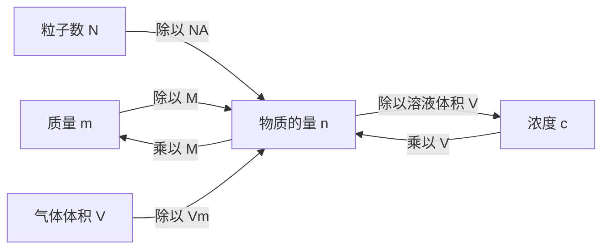

# 第 2 章：化学语言与计量：从元素到溶液浓度

- **难度**：★☆☆ | **预估学时**：2.5 小时 | **前置**：第 1 章
- **本章作用**：化学式计算、物质的量、浓度换算是后面所有计算题的地基。这一章不过关，滴定、分光、营养折算都会卡。

## 学习目标
学完本章，你能：
1. 根据化学式判断物质类别、算出式量和元素质量分数；
2. 用物质的量把质量、粒子数、气体体积、溶液浓度连起来；
3. 完成溶液配制、稀释、质量分数与物质的量浓度的换算；
4. 用滴定关系式算待测物含量，并处理有效数字。

## 一句话核心
化学计算只有一条主线：先把“多少克、多少毫升”换成“多少摩尔”，再按方程式里的系数比例换成目标物质的摩尔，最后换回质量或浓度。

## 2.1 物质分类与化学式

### 2.1.1 分类

- **混合物**：空气、盐水、牛奶、土壤。组成不固定，各组分保持自己的性质。
- **纯净物**：蒸馏水、纯蔗糖、纯铜。只由一种物质组成。
- **单质**：O₂、Fe、C。只由一种元素组成。
- **化合物**：H₂O、NaCl、C₆H₁₂O₆。由两种或多种元素组成。

食品里大多数样品是混合物。检测时先要明确“测的是哪个组分”，比如牛奶测蛋白质，不是测“牛奶”这个整体。

### 2.1.2 化学式

化学式用元素符号和下标表示组成。写法：

- 金属在前，非金属在后：NaCl；
- 正价元素在前，负价元素在后：Al₂O₃；
- 原子团要加括号：Ca(OH)₂、Al₂(SO₄)₃；
- 结晶水用“·”表示：CuSO₄·5H₂O。

式量是化学式中各原子相对原子质量的总和。比如：

- H₂O：2×1 + 16 = 18；
- NaCl：23 + 35.5 = 58.5；
- C₆H₁₂O₆：6×12 + 12×1 + 6×16 = 180。

元素质量分数：

$$w(\text{元素})=\frac{\text{该元素原子总质量}}{\text{式量}}\times100\%$$

例：求 NH₄NO₃ 中氮的质量分数。式量 = 14+4×1+14+3×16 = 80；氮 = 2×14 = 28；w(N)=28/80=35.0%。

## 2.2 化合价与氧化数

化合价是元素在化合物中的氧化数。常见规则：

- H 通常 +1，金属氢化物中 −1；
- O 通常 −2，过氧化物中 −1；
- Na、K 为 +1；Ca、Mg、Ba 为 +2；Al 为 +3；
- 单质中元素氧化数为 0；
- 化合物中各元素氧化数代数和为 0；离子中各元素代数和等于离子电荷。

例：KMnO₄ 中 Mn 的氧化数。K 为 +1，O 为 −2，设 Mn 为 x：

$$1+x+4(-2)=0 \Rightarrow x=+7$$

例：Fe₃O₄ 中 Fe 的平均氧化数。O 为 −2，总 −8，Fe 总 +8，3 个 Fe 平均 +8/3。Fe₃O₄ 里有 Fe²⁺ 和 Fe³⁺，平均价不是整数。

## 2.3 物质的量

### 2.3.1 四个基本关系

$$n=\frac{m}{M}$$

$$n=\frac{N}{N_A},\quad N_A=6.022\times10^{23}\ \text{mol}^{-1}$$

$$n=\frac{V}{V_m}\quad(\text{气体，标准状况 }V_m=22.4\ \text{L/mol})$$

$$c=\frac{n}{V}\quad(\text{溶液，}V\text{ 单位 L})$$

其中 n 是物质的量（mol），m 是质量（g），M 是摩尔质量（g/mol），N 是粒子数，V 是体积，c 是物质的量浓度（mol/L）。

### 2.3.2 换算顺序

做计算题时按这个顺序走：

1. 写出已知量和单位；
2. 把质量或体积换成 n；
3. 用方程式系数比换成目标物质的 n；
4. 换回质量、浓度或体积；
5. 检查有效数字和单位。

例：18 g H₂O 是多少 mol？n=18/18=1.0 mol。

例：标准状况下 11.2 L O₂ 是多少 mol？n=11.2/22.4=0.50 mol。

例：0.50 mol NaCl 溶于水配成 500 mL 溶液，浓度是多少？c=0.50/0.500=1.0 mol/L。

## 2.4 溶液浓度与稀释

### 2.4.1 质量分数与物质的量浓度

质量分数 w 表示溶质质量占溶液质量的百分比：

$$w=\frac{m_{\text{溶质}}}{m_{\text{溶液}}}\times100\%$$

物质的量浓度 c 表示每升溶液里溶质的物质的量：

$$c=\frac{n}{V}=\frac{m/M}{V}$$

两者换算需要溶液密度 ρ（g/mL）：

$$c=\frac{1000\rho w}{M}$$

例：质量分数 98%、密度 1.84 g/mL 的浓硫酸，M=98 g/mol，求 c。c=1000×1.84×0.98/98=18.4 mol/L。

### 2.4.2 稀释

稀释前后溶质的物质的量不变：

$$c_1V_1=c_2V_2$$

例：用 18 mol/L 浓硫酸配 500 mL 1.0 mol/L 稀硫酸，需要浓硫酸体积：

$$V_1=\frac{1.0\times500}{18}=27.8\ \text{mL}$$

操作：把浓硫酸缓慢倒入水中，边加边搅拌，不能把水倒入浓硫酸。

### 2.4.3 ppm 与 mg/kg

食品检验常用 mg/kg、mg/L、μg/kg。稀水溶液中近似：

$$1\ \text{ppm}=1\ \text{mg/kg}=1\ \text{mg/L}$$

$$1\ \text{ppb}=1\ \mu\text{g/kg}=1\ \mu\text{g/L}$$

注意：ppm 不是正式单位，报告里尽量写 mg/kg 或 mg/L。

## 2.5 滴定计算基础

滴定计算的核心是“物质的量之比等于方程式系数之比”。

以盐酸滴定氢氧化钠为例：

$$HCl+NaOH=NaCl+H_2O$$

1 mol HCl 恰好中和 1 mol NaOH。若用浓度 c(HCl)、体积 V(HCl) 的盐酸滴定 V(NaOH) 的氢氧化钠：

$$c(NaOH)=\frac{c(HCl)\times V(HCl)}{V(NaOH)}$$

例：用 0.1000 mol/L HCl 滴定 25.00 mL NaOH，终点消耗 HCl 24.50 mL，求 NaOH 浓度。

$$c(NaOH)=\frac{0.1000\times24.50}{25.00}=0.09800\ \text{mol/L}$$

如果待测物是碳酸钠，反应为：

$$Na_2CO_3+2HCl=2NaCl+H_2O+CO_2\uparrow$$

1 mol Na₂CO₃ 消耗 2 mol HCl，计算时要除以 2。

### 2.5.1 质量分数换算

测出待测物物质的量后，换成质量，再除以样品质量：

$$w=\frac{n\times M}{m_{\text{样品}}}\times100\%$$

例：某食醋样品 10.00 g，滴定测得醋酸 0.00500 mol，M(醋酸)=60.0 g/mol，求总酸（以醋酸计）。

$$w=\frac{0.00500\times60.0}{10.00}\times100\%=3.00\%$$

这个结果接近常见食醋的总酸范围。计算时要按实际滴定体积和浓度代入，不能套数字。

## 2.6 有效数字

- 加减法：结果的小数位数与参与运算中**小数位数最少**的一致。
- 乘除法：结果的有效数字位数与参与运算中**有效数字最少**的一致。
- 中间计算多保留一位，最后再修约。
- 修约规则：四舍六入五成双（GB/T 8170）。

例：2.15 + 1.2 = 3.35，保留一位小数，结果 3.4。

例：0.1000×24.50 = 2.450，0.1000 有 4 位有效数字，结果保留 4 位，2.450。

## 例题

**例 1**：配制 0.1000 mol/L NaOH 溶液 500 mL，需要 NaOH 多少克？

解：n=cV=0.1000×0.500=0.05000 mol；m=nM=0.05000×40.0=2.00 g。

**例 2**：某样品 2.000 g 中含 NaCl 0.117 g，求 NaCl 质量分数。

解：w=0.117/2.000×100%=5.85%。

**例 3**：将 5.85 g NaCl 溶于水配成 200 mL 溶液，求 c(NaCl)。

解：n=5.85/58.5=0.100 mol；c=0.100/0.200=0.500 mol/L。

## 图示

看图说明：n 是中心节点。质量、粒子数、气体体积、浓度都能转到 n，再从 n 转到目标量。做题时先找“中心”。

## 常见误解

- 别以为“摩尔质量就是式量，单位可以随便写”——M 的单位是 g/mol，式量无量纲。
- 别以为“1 mol 气体一定是 22.4 L”——只在标准状况（0 ℃、101.325 kPa）下近似成立。
- 别以为“稀释时体积可以直接相加”——浓硫酸、乙醇和水混合体积会收缩，精确配制要定容。
- 别以为“有效数字越多越准”——仪器精度决定有效数字，硬写多位是假精度。

## 自测题（答案）

1. 18 g H₂O 的物质的量是（ ）
   A. 0.5 mol
   B. 1.0 mol
   C. 2.0 mol
   D. 18 mol
   **答案：B**。解析：n=18/18=1.0 mol。

2. 标准状况下 5.6 L CO₂ 的物质的量是（ ）
   A. 0.25 mol
   B. 0.50 mol
   C. 1.0 mol
   D. 2.0 mol
   **答案：A**。解析：n=5.6/22.4=0.25 mol。

3. 0.20 mol NaCl 配成 400 mL 溶液，浓度是（ ）
   A. 0.20 mol/L
   B. 0.40 mol/L
   C. 0.50 mol/L
   D. 0.80 mol/L
   **答案：C**。解析：c=0.20/0.400=0.50 mol/L。

4. 用 0.1000 mol/L HCl 滴定 20.00 mL NaOH，消耗 HCl 20.00 mL，NaOH 浓度是（ ）
   A. 0.0500 mol/L
   B. 0.1000 mol/L
   C. 0.2000 mol/L
   D. 0.4000 mol/L
   **答案：B**。解析：1:1 反应，c=0.1000×20.00/20.00=0.1000 mol/L。

5. 下列计算结果保留 4 位有效数字的是（ ）
   A. 0.1000×24.50
   B. 2.15+1.2
   C. 18/2
   D. 5.85/58.5
   **答案：A**。解析：0.1000 和 24.50 都是 4 位有效数字，乘积保留 4 位。

## 复习锚点

- 计算主线：质量/体积/粒子数 → n → 系数比 → 目标 n → 质量/浓度。
- 稀释：c₁V₁=c₂V₂。
- 滴定：按方程式系数比，不要一律 1:1。
- 有效数字：加减看小数位，乘除看有效位数。
