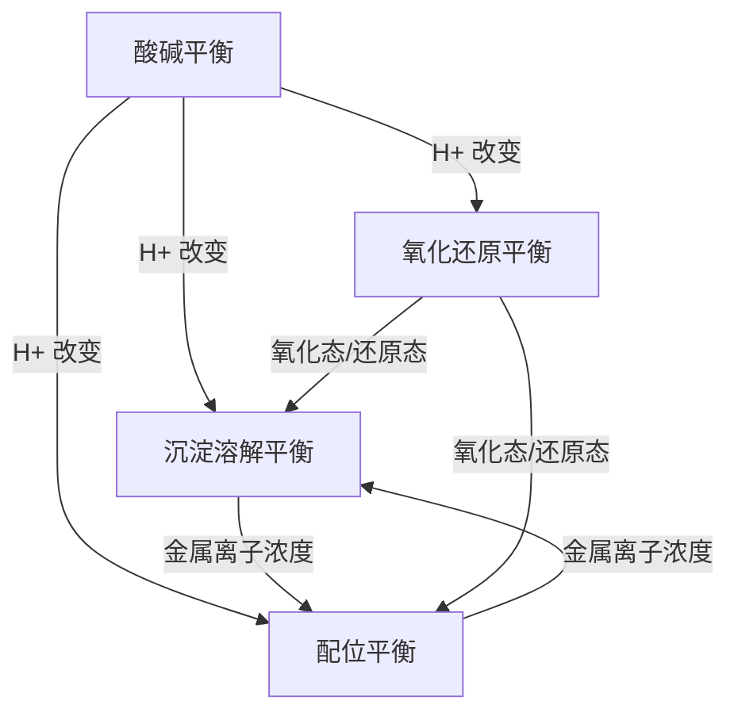

# 第 3 章：无机化学四大平衡：酸碱、沉淀、氧化还原、配位

- **难度**：★★☆ | **预估学时**：4 小时 | **前置**：第 2 章
- **本章作用**：无机化学的计算题和简答题，八成绕不开这四类平衡。食品检验里的 pH、缓冲、沉淀、EDTA 滴定、电极电势，也都在这里。

## 学习目标
学完本章，你能：
1. 用 Ka、Kb、pH 判断酸碱强弱和溶液酸碱性；
2. 说明缓冲溶液的组成、作用和缓冲容量；
3. 用 Ksp 判断沉淀生成、溶解和同离子效应；
4. 用电极电势判断氧化还原方向，写出 Nernst 方程；
5. 用稳定常数解释配位平衡和 EDTA 滴定的条件。

## 一句话核心
平衡不是“反应停了”，而是正逆反应速率相等、各组分浓度不再明显改变。改变条件，平衡会朝减弱这种改变的方向移动。

## 3.1 酸碱平衡

### 3.1.1 酸碱的定义

质子理论：能给出 H⁺ 的是酸，能接受 H⁺ 的是碱。比如：

- HCl 是酸，Cl⁻ 是它的共轭碱；
- NH₃ 是碱，NH₄⁺ 是它的共轭酸；
- HCO₃⁻ 既能给 H⁺，也能接受 H⁺，是两性物质。

水的离子积：

$$K_w=[H^+][OH^-]=1.0\times10^{-14}\quad(25^\circ C)$$

pH 是氢离子浓度的负对数：

$$pH=-\lg[H^+]$$

中性水 pH=7；酸性 pH<7；碱性 pH>7。注意 pH 只适合稀溶液，浓酸浓碱不能用 pH 直接算。

### 3.1.2 弱酸弱碱

弱酸 HA 在水中部分电离：

$$HA\rightleftharpoons H^+ + A^-$$

酸解离常数：

$$K_a=\frac{[H^+][A^-]}{[HA]}$$

弱酸 pH 的近似式（一元弱酸，c 不太稀）：

$$[H^+]\approx\sqrt{K_a c}$$

例：0.10 mol/L 醋酸，Ka=1.8×10⁻⁵，求 pH。

$$[H^+]=\sqrt{1.8\times10^{-5}\times0.10}=1.34\times10^{-3}\ \text{mol/L}$$

$$pH=-\lg(1.34\times10^{-3})=2.87$$

弱碱 B 的 Kb 与共轭酸 Ka 的关系：

$$K_aK_b=K_w$$

### 3.1.3 缓冲溶液

缓冲溶液由弱酸及其共轭碱（或弱碱及其共轭酸）组成，能抵抗少量酸、碱或稀释引起的 pH 变化。

常用体系：

- 醋酸/醋酸钠：pH 约 3.7—5.7；
- 磷酸二氢钠/磷酸氢二钠：pH 约 5.8—8.0；
- 碳酸/碳酸氢钠：pH 约 6.4—8.4；
- Tris/HCl：生化常用。

Henderson-Hasselbalch 方程：

$$pH=pK_a+\lg\frac{[A^-]}{[HA]}$$

例：0.10 mol/L 醋酸和 0.10 mol/L 醋酸钠等体积混合，pKa=4.74，pH=4.74+lg(0.10/0.10)=4.74。

缓冲容量在 pH≈pKa 时最大，即 [A⁻]/[HA]≈1。缓冲溶液不是“永远不变”，加太多酸或碱仍会失效。

### 3.1.4 食品中的酸碱

- 食醋总酸以醋酸计，滴定用 NaOH；
- 牛奶 pH 约 6.6—6.8，酸败会下降；
- 果汁 pH 常低于 4，影响微生物生长；
- 蛋白质饮料常加缓冲盐稳定 pH；
- 水硬度滴定用 EDTA，pH 要控制在 10 左右。

## 3.2 沉淀溶解平衡

难溶电解质在水中存在：

$$AgCl(s)\rightleftharpoons Ag^+ + Cl^-$$

溶度积：

$$K_{sp}=[Ag^+][Cl^-]$$

对于通式 $A_mB_n(s)\rightleftharpoons mA^{n+}+nB^{m-}$：

$$K_{sp}=[A^{n+}]^m[B^{m-}]^n$$

判断沉淀：

- 离子积 Q>Ksp：过饱和，生成沉淀；
- Q=Ksp：饱和，平衡；
- Q<Ksp：不饱和，沉淀溶解。

例：AgCl 的 Ksp=1.8×10⁻¹⁰。若 [Ag⁺]=1.0×10⁻⁵ mol/L，[Cl⁻]=1.0×10⁻⁵ mol/L，Q=1.0×10⁻¹⁰<Ksp，不沉淀。

### 3.2.1 同离子效应

加入含有相同离子的强电解质，会降低难溶物的溶解度。例如在 AgCl 饱和溶液中加 NaCl，Cl⁻ 增大，Ag⁺ 必须减小，AgCl 溶解度下降。

### 3.2.2 分步沉淀

溶液中同时有几种离子能与同一沉淀剂反应时，Ksp 小的先沉淀。比如 Cl⁻ 和 I⁻ 同时存在，滴加 AgNO₃，AgI（Ksp 更小）先沉淀。

### 3.2.3 沉淀的溶解

- 加酸：碳酸盐、氢氧化物等与 H⁺ 反应，降低阴离子浓度；
- 加配位剂：AgCl 可溶于氨水，生成 [Ag(NH₃)₂]⁺；
- 加氧化还原剂：改变离子价态。

食品检验里的灰化、蛋白沉淀、重金属分离，都用到这些原理。

## 3.3 氧化还原平衡

### 3.3.1 氧化数变化

氧化还原的本质是电子转移。氧化数升高是氧化，降低是还原；氧化剂被还原，还原剂被氧化。

例：

$$Zn+Cu^{2+}=Zn^{2+}+Cu$$

Zn 从 0 到 +2，被氧化；Cu²⁺ 从 +2 到 0，被还原。

### 3.3.2 电极电势

标准电极电势 E° 衡量得失电子倾向。E° 越大，氧化型越容易得电子，氧化能力越强。

电池电动势：

$$E^\circ_{\text{池}}=E^\circ_{\text{正}}-E^\circ_{\text{负}}$$

E°池>0，反应自发。

### 3.3.3 Nernst 方程

$$E=E^\circ+\frac{0.0592}{n}\lg\frac{[\text{氧化型}]}{[\text{还原型}]}\quad(25^\circ C)$$

例：$Zn^{2+}/Zn$ 电对，E°=−0.76 V，若 [Zn²⁺]=0.010 mol/L，n=2：

$$E=-0.76+\frac{0.0592}{2}\lg(0.010)=-0.76-0.0592=-0.82\ \text{V}$$

浓度降低，Zn²⁺ 得电子倾向减弱，电极电势更负，符合 Nernst 方程。

### 3.3.4 食品中的应用

- 维生素 C 有还原性，可被碘、2,6-二氯靛酚氧化；
- 油脂氧化生成过氧化物，过氧化值反映氧化程度；
- 高锰酸钾滴定测还原性物质；
- 电极法测 pH、氟离子、氧化还原电位。

## 3.4 配位平衡

配位化合物由中心离子和配体组成。例如：

$$Cu^{2+}+4NH_3\rightleftharpoons [Cu(NH_3)_4]^{2+}$$

稳定常数：

$$K_f=\frac{[[Cu(NH_3)_4]^{2+}]}{[Cu^{2+}][NH_3]^4}$$

Kf 越大，配合物越稳定。配位平衡会影响金属离子的有效浓度，从而影响沉淀、氧化还原和颜色。

### 3.4.1 EDTA 滴定

EDTA（乙二胺四乙酸）是六齿配体，能与大多数金属离子形成 1:1 配合物。滴定 Ca²⁺、Mg²⁺ 时：

$$Ca^{2+}+EDTA\rightleftharpoons [Ca-EDTA]$$

条件稳定常数 K' 受 pH 影响。pH 太低，EDTA 质子化，配位能力下降；pH 太高，金属离子可能水解沉淀。钙镁滴定常用 pH=10 的氨缓冲溶液，指示剂用铬黑 T。

### 3.4.2 掩蔽与解蔽

- 掩蔽：加配位剂把干扰离子“藏”起来，例如用三乙醇胺掩蔽 Fe³⁺、Al³⁺；
- 解蔽：把被掩蔽的离子释放出来，例如用甲醛释放 Zn²⁺。

食品中钙、镁、铁、锌的测定，常涉及配位滴定和掩蔽。

## 3.5 四类平衡的联系

看图说明：四类平衡不是四个孤立的公式。加酸会改变配位剂的存在形式，也会改变沉淀的溶解度；氧化还原会改变离子价态，从而改变沉淀和配位行为。

## 例题

**例 1**：0.10 mol/L 氨水，Kb=1.8×10⁻⁵，求 [OH⁻] 和 pH。

解：[OH⁻]≈√(Kb c)=√(1.8×10⁻⁵×0.10)=1.34×10⁻³ mol/L；pOH=2.87；pH=11.13。

**例 2**：AgCl 的 Ksp=1.8×10⁻¹⁰，求纯水中 AgCl 的溶解度（mol/L）。

解：设溶解度 s，[Ag⁺]=[Cl⁻]=s，s²=1.8×10⁻¹⁰，s=1.34×10⁻⁵ mol/L。

**例 3**：用 0.01000 mol/L EDTA 滴定 25.00 mL 水样，消耗 10.00 mL，求 Ca²⁺ 浓度（mol/L）。

解：EDTA 与 Ca²⁺ 1:1，c(Ca²⁺)=0.01000×10.00/25.00=0.004000 mol/L。

## 常见误解

- 别以为“pH=7 就是中性”——只有在 25 ℃ 稀水溶液中才成立，温度改变 Kw 改变。
- 别以为“缓冲溶液不会变 pH”——它只能抵抗少量酸碱，加多了照样失效。
- 别以为“Ksp 小就一定先沉淀”——还要看离子浓度，Q 才决定是否沉淀。
- 别以为“EDTA 滴定任何 pH 都一样”——pH 影响条件稳定常数，钙镁滴定要控制 pH=10。
- 别以为“电极电势越大，还原剂越强”——E° 越大，氧化型氧化能力越强，还原型还原能力越弱。

## 自测题（答案）

1. 0.10 mol/L 醋酸（Ka=1.8×10⁻⁵）的 pH 约为（ ）
   A. 1.00
   B. 2.87
   C. 4.74
   D. 7.00
   **答案：B**。解析：[H⁺]=√(Ka c)=1.34×10⁻³，pH=2.87。

2. 缓冲溶液 pH 由什么决定（ ）
   A. 只看弱酸浓度
   B. 只看共轭碱浓度
   C. pKa 与共轭酸碱浓度比
   D. 溶液体积
   **答案：C**。解析：Henderson-Hasselbalch 方程 pH=pKa+lg([A⁻]/[HA])。

3. AgCl 在纯水中的溶解度 s 与 Ksp 的关系是（ ）
   A. s=Ksp
   B. s=Ksp²
   C. s=√Ksp
   D. s=Ksp/2
   **答案：C**。解析：AgCl 1:1 型，Ksp=s²，s=√Ksp。

4. 下列哪种情况一定生成沉淀（ ）
   A. Q<Ksp
   B. Q=Ksp
   C. Q>Ksp
   D. Q=0
   **答案：C**。解析：离子积大于溶度积，过饱和，生成沉淀。

5. EDTA 滴定钙镁时，常控制 pH 在（ ）
   A. 2 左右
   B. 5 左右
   C. 7 左右
   D. 10 左右
   **答案：D**。解析：pH=10 时 EDTA 配位能力足够，且 Ca²⁺、Mg²⁺ 不易水解，铬黑 T 变色清楚。

## 复习锚点

- 酸碱：Ka、pH、缓冲方程；pH 只在稀溶液、25 ℃ 下中性为 7。
- 沉淀：Q 与 Ksp 比较；同离子效应降低溶解度；分步沉淀看 Ksp 和浓度。
- 氧化还原：E° 判方向，Nernst 修浓度；E°池>0 自发。
- 配位：Kf 越大越稳定；EDTA 1:1 滴定，pH 决定条件稳定常数。
