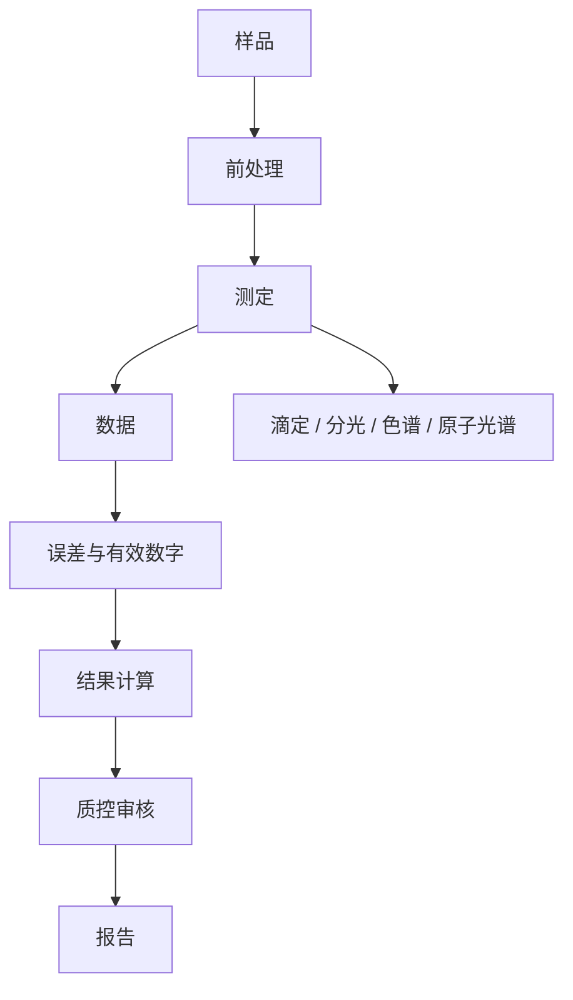

# 第 4 章：分析化学与仪器：误差、滴定、分光、色谱

- **难度**：★★☆ | **预估学时**：4 小时 | **前置**：第 2、3 章
- **本章作用**：食品检验的大部分结果，最终都要落到“分析化学”的语言：误差、准确度、精密度、标准曲线、检出限、回收率。这一章把“做实验”翻译成“出数据”。

## 学习目标
学完本章，你能：
1. 区分系统误差与随机误差、准确度与精密度；
2. 正确记录有效数字，计算绝对误差、相对误差和 RSD；
3. 说明滴定分析的四个基本条件，完成直接滴定和返滴定计算；
4. 用 Beer-Lambert 定律做分光光度法的标准曲线定量；
5. 说清 GC、HPLC、AAS、ICP-MS 各自适合测什么；
6. 看懂方法验证里的 LOD、LOQ、回收率、线性范围。

## 一句话核心
分析结果不是一个数，而是“数 + 单位 + 方法 + 不确定度”。没有方法依据的数字，在检验报告里没有意义。

## 4.1 误差与数据

### 4.1.1 误差的分类

- **系统误差**：方向固定、可重复。比如天平砝码不准、滴定管未校准、试剂空白偏高。可以通过校准、空白、标准物质校正。
- **随机误差**：方向不固定、大小随机。比如读数波动、环境温度微小变化。只能通过多次测定取平均来减小。
- **过失误差**：操作错误、记录错误、仪器故障。必须剔除并重做。

### 4.1.2 准确度与精密度

- **准确度**：测定值与真值的接近程度，用误差或回收率表示。
- **精密度**：多次测定值之间的接近程度，用标准差、RSD 表示。

准确度高一定要求精密度高；精密度高不一定准确度高。打靶比喻：弹着点集中但偏离靶心，是精密度高、准确度低。

### 4.1.3 误差计算

绝对误差：

$$\Delta x=x-\mu$$

相对误差：

$$E_r=\frac{\Delta x}{\mu}\times100\%$$

标准偏差：

$$s=\sqrt{\frac{\sum(x_i-\bar{x})^2}{n-1}}$$

相对标准偏差：

$$RSD=\frac{s}{\bar{x}}\times100\%$$

例：测定值为 10.2、10.1、10.3 mg/kg，平均值 10.2，s≈0.10，RSD≈1.0%。

### 4.1.4 有效数字

- 天平读数 0.1234 g 有 4 位有效数字；
- 滴定管读数 24.50 mL 有 4 位；
- pH=2.87 的有效数字看小数部分，是 2 位；
- 结果修约按 GB/T 8170，四舍六入五成双。

报告结果时，单位和有效数字要与方法匹配。比如分光光度法测微量组分，结果写 0.12 mg/kg，不要写 0.123456 mg/kg。

## 4.2 滴定分析

### 4.2.1 四个基本条件

1. 反应按确定方程式进行，无副反应；
2. 反应完全，程度高；
3. 反应速率快，或可通过加热、催化剂加速；
4. 有合适的指示剂或仪器方法确定终点。

### 4.2.2 滴定方式

- **直接滴定**：标准溶液直接滴定待测物。如 NaOH 滴定食醋总酸。
- **返滴定**：先加过量标准溶液，再用另一种标准溶液滴定剩余。如 EDTA 滴定铝，先加过量 EDTA，再用锌标准溶液返滴。
- **置换滴定**：先让待测物与试剂反应生成可滴定的物质。如碘量法测维生素 C。
- **间接滴定**：待测物不能直接滴定，通过其他反应间接测定。

### 4.2.3 滴定计算

以 NaOH 滴定醋酸为例：

$$CH_3COOH+NaOH=CH_3COONa+H_2O$$

$$n(CH_3COOH)=c(NaOH)\times V(NaOH)$$

质量分数：

$$w=\frac{cV M}{m_{\text{样品}}}\times100\%$$

例：25.00 g 食醋，消耗 0.1000 mol/L NaOH 20.00 mL，M(醋酸)=60.0 g/mol。

$$w=\frac{0.1000\times0.02000\times60.0}{25.00}\times100\%=0.480\%$$

### 4.2.4 终点与指示剂

- 强酸强碱滴定：突跃范围大，甲基橙、酚酞都可；
- 弱酸强碱滴定：终点偏碱性，用酚酞；
- 强酸弱碱滴定：终点偏酸性，用甲基橙；
- 配位滴定：铬黑 T、钙指示剂；
- 氧化还原滴定：淀粉、二苯胺磺酸钠等。

指示剂选择原则：变色范围落在滴定突跃范围内，且变色明显。

## 4.3 分光光度法

### 4.3.1 Beer-Lambert 定律

$$A=\varepsilon bc$$

A 是吸光度，ε 是摩尔吸光系数，b 是光程（cm），c 是浓度（mol/L）。A 与 c 在一定范围内成正比。

透光率 T 与吸光度：

$$A=-\lg T$$

### 4.3.2 标准曲线

步骤：

1. 配制一系列已知浓度的标准溶液；
2. 显色，测吸光度；
3. 以浓度为横坐标、吸光度为纵坐标作图；
4. 线性回归，得到 A=kc+b；
5. 测样品吸光度，代入回归方程求浓度。

例：标准曲线 A=0.500c+0.010，样品 A=0.210，则 c=(0.210−0.010)/0.500=0.400 mg/mL。

注意：标准曲线要覆盖样品浓度范围，相关系数一般要求 r≥0.995 或更高；超出线性范围要稀释。

### 4.3.3 显色条件

- 显色剂用量；
- 溶液 pH；
- 反应时间；
- 温度；
- 干扰离子掩蔽。

食品检验中，总糖、还原糖、蛋白质、亚硝酸盐、维生素 C 等都常用分光光度法。

## 4.4 色谱法

### 4.4.1 基本原理

色谱把混合物在流动相和固定相之间反复分配，不同组分分配系数不同，保留时间不同，从而分离。

- **GC**：气相色谱，适合挥发性、半挥发性物质。如脂肪酸、农药残留、香精成分。
- **HPLC**：高效液相色谱，适合不易挥发、热不稳定、极性较大的物质。如糖、维生素、添加剂、兽药残留。
- **LC-MS/MS**：液相色谱-串联质谱，适合痕量确证，如农残、兽残、真菌毒素。

### 4.4.2 定量方法

- **外标法**：用已知浓度标准品做曲线，适合基质简单的样品；
- **内标法**：加已知量内标，适合基质复杂、进样量不稳定的样品；
- **标准加入法**：在样品中加入不同量标准，适合基质干扰大的样品。

### 4.4.3 关键参数

- 保留时间：定性依据之一；
- 峰面积/峰高：定量依据；
- 分离度 R：相邻峰分开的程度，一般要求 R≥1.5；
- 理论塔板数 N：柱效指标。

## 4.5 原子光谱与元素分析

- **AAS**：原子吸收光谱，测单一元素，如铅、镉、铜、锌。灵敏度高，操作相对简单。
- **ICP-OES**：电感耦合等离子体发射光谱，多元素同时测，适合常量和微量。
- **ICP-MS**：电感耦合等离子体质谱，灵敏度更高，适合痕量、超痕量元素和同位素比。
- **AFS**：原子荧光光谱，常测砷、汞、硒。

食品重金属检测常用微波消解 + ICP-MS 或 AAS。样品前处理的关键是消解完全、空白低、避免损失和污染。

## 4.6 方法验证与质量控制

### 4.6.1 方法验证指标

- **准确度**：加标回收率，一般要求 80%—120%，痕量分析可放宽；
- **精密度**：重复性、中间精密度，用 RSD 表示；
- **特异性**：能否排除基质干扰；
- **线性范围**：标准曲线适用的浓度范围；
- **LOD/LOQ**：检出限、定量限；
- **稳健性**：小条件变化时结果是否稳定。

### 4.6.2 日常质控

- 空白试验：试剂、器皿、环境的本底；
- 平行试验：至少两份，算相对偏差；
- 加标回收：检查准确度；
- 标准物质：检查准确度和溯源性；
- 控制图：监控长期稳定性。

## 图示

看图说明：仪器只是中间一环。前处理、数据、质控任何一环出问题，最终结果都不可靠。

## 例题

**例 1**：某测定值 12.5 mg/kg，真值 12.0 mg/kg，求绝对误差和相对误差。

解：绝对误差 0.5 mg/kg；相对误差 0.5/12.0×100%=4.2%。

**例 2**：标准曲线 A=0.250c+0.020，样品 A=0.145，求 c。

解：c=(0.145−0.020)/0.250=0.500 mg/mL。

**例 3**：用 0.05000 mol/L NaOH 滴定 20.00 mL 醋酸，消耗 15.00 mL，求醋酸浓度。

解：1:1 反应，c=0.05000×15.00/20.00=0.03750 mol/L。

## 常见误解

- 别以为“精密度高就一定准确”——系统误差会让结果又稳又错。
- 别以为“仪器读数位数越多越准”——有效数字由仪器精度和方法决定。
- 别以为“标准曲线相关系数高就一定能用”——还要看线性范围、空白、基质效应。
- 别以为“色谱保留时间相同就是同一物质”——保留时间只是定性依据之一，确证需要标准品或质谱。
- 别以为“加标回收率低一定是操作问题”——可能是提取不完全、基质抑制、标准品降解。

## 自测题（答案）

1. 下列属于系统误差的是（ ）
   A. 读数随机波动
   B. 天平砝码未校准
   C. 记录笔误
   D. 环境温度瞬时变化
   **答案：B**。解析：砝码未校准方向固定、可重复，是系统误差。

2. 某测定值 10.0，真值 9.8，相对误差是（ ）
   A. 0.2%
   B. 2.0%
   C. 20%
   D. 0.02%
   **答案：B**。解析：0.2/9.8×100%≈2.0%。

3. Beer-Lambert 定律中，吸光度与浓度的关系是（ ）
   A. 反比
   B. 平方正比
   C. 正比
   D. 对数关系
   **答案：C**。解析：在一定范围内 A=εbc，A 与 c 成正比。

4. 下列最适合测痕量农药残留确证的是（ ）
   A. 滴定法
   B. 分光光度法
   C. LC-MS/MS
   D. 密度法
   **答案：C**。解析：LC-MS/MS 灵敏度高、能提供结构信息，适合痕量确证。

5. 加标回收率主要反映（ ）
   A. 精密度
   B. 准确度
   C. 检出限
   D. 线性范围
   **答案：B**。解析：加标回收率衡量测定值与真值的接近程度。

## 复习锚点

- 误差：系统误差可校正，随机误差靠重复；准确度看真值，精密度看重复。
- 滴定：四个条件、四种方式、按系数比计算。
- 分光：A=εbc，标准曲线定量，注意线性范围。
- 色谱：GC 测挥发，HPLC 测不挥发/热不稳定，MS 用于确证。
- 方法验证：准确度、精密度、LOD/LOQ、线性、特异性。
