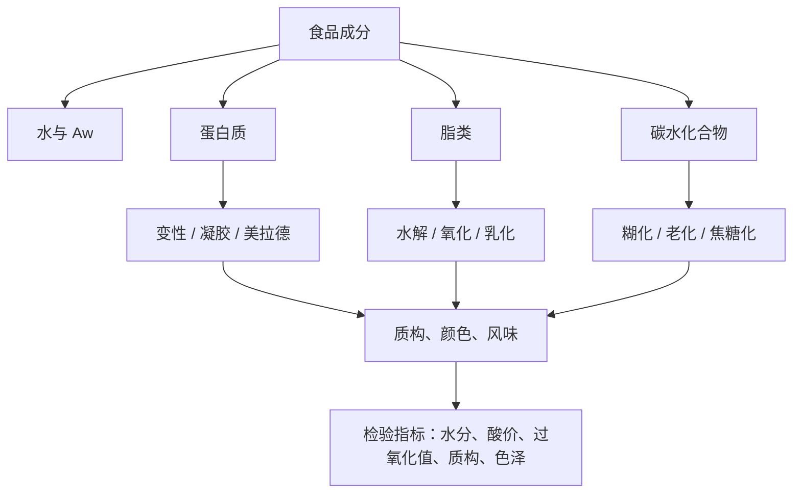

# 第 5 章：食品化学：水、蛋白质、脂类、糖、酶与色香味

- **难度**：★★☆ | **预估学时**：4 小时 | **前置**：第 3 章
- **本章作用**：食品化学解释“为什么面包会变硬、油会哈败、苹果会褐变、牛奶会凝固”。理化检验的很多指标，背后都是这些反应。

## 学习目标
学完本章，你能：
1. 区分自由水、结合水、水分活度，说明 Aw 与微生物生长的关系；
2. 说明蛋白质变性、凝胶、等电点、美拉德反应的条件和结果；
3. 说明脂类水解、氧化、酸败的机制和指标；
4. 说明淀粉糊化、老化、焦糖化、膳食纤维的作用；
5. 解释酶促褐变、脂肪酶、蛋白酶对食品品质的影响；
6. 把色素、风味、质构的变化和检验指标连起来。

## 一句话核心
食品化学研究的不是“成分表”，而是成分在加工、储藏中怎么变。变化决定品质，也决定该测什么指标。

## 5.1 水与水分活度

### 5.1.1 水的存在状态

- **自由水**：能溶剂化、能参与反应、能被微生物利用；
- **结合水**：与蛋白质、多糖等通过氢键结合，流动性低；
- **束缚水**：被细胞结构或凝胶网络限制。

食品的水分含量不等于水分活度。水分含量是“有多少水”，水分活度是“水有多自由”。

### 5.1.2 水分活度

$$a_w=\frac{p}{p_0}$$

p 是食品中水的蒸气压，p₀ 是同温度纯水的蒸气压。Aw 范围 0—1。

Aw 与微生物：

| Aw | 能生长的微生物 |
|---|---|
| >0.95 | 大多数细菌 |
| 0.91—0.95 | 部分细菌 |
| 0.87—0.91 | 酵母、部分霉菌 |
| 0.70—0.87 | 耐旱霉菌 |
| <0.60 | 几乎所有微生物停止生长 |

食品检验里，水分活度影响保质期、微生物风险、质构和化学反应速率。GB 5009.3 测水分，Aw 有专用仪器。

### 5.1.3 水分与检验

- 水分高，易腐败，干物质计价低；
- 水分活度低，微生物难生长，但美拉德反应、脂肪氧化仍可能发生；
- 干燥、盐渍、糖渍、冷冻都是通过降低 Aw 保藏。

## 5.2 蛋白质

### 5.2.1 结构与变性

蛋白质由氨基酸通过肽键连接，具有一级、二级、三级、四级结构。维持结构的力包括氢键、疏水作用、离子键、二硫键。

**变性**：蛋白质的空间结构被破坏，溶解度下降、黏度变化、生物活性丧失，但一级结构不变。常见条件：

- 加热：鸡蛋清凝固；
- 酸：牛奶遇酸沉淀；
- 碱；
- 重金属离子；
- 有机溶剂；
- 高压、超声、辐照。

变性不一定是坏事。酸奶的凝固、豆腐的点卤、面包的面筋网络，都利用了蛋白质的变化。

### 5.2.2 等电点

蛋白质在等电点时净电荷为零，溶解度最低，容易沉淀。牛奶酪蛋白等电点约 pH 4.6，加酸到 pH 4.6 会沉淀。豆腐点卤、酸奶发酵都涉及等电点。

### 5.2.3 凝胶与质构

蛋白质凝胶由蛋白质分子交联形成三维网络，能保留水和风味。影响因素：

- 蛋白质浓度；
- pH；
- 离子强度；
- 加热温度和时间；
- 冷却速度。

肉制品、鱼糜制品、豆腐、酸奶的质构都和凝胶有关。

### 5.2.4 美拉德反应

还原糖的羰基与氨基酸、肽的氨基在加热时反应，生成褐色物质和风味化合物。条件：

- 还原糖；
- 氨基化合物；
- 水分适中；
- 加热；
- 碱性条件促进。

美拉德反应带来面包皮、咖啡、酱油的颜色和香气；过度会损失赖氨酸，产生丙烯酰胺等有害物。

## 5.3 脂类

### 5.3.1 分类

- **甘油三酯**：脂肪酸与甘油酯化，是主要食用油脂；
- **磷脂**：有亲水和亲油基团，是乳化剂；
- **固醇**：动物性食品中的胆固醇；
- **游离脂肪酸**：油脂水解产物。

脂肪酸按饱和度分：

- 饱和脂肪酸：无双键，如硬脂酸；
- 单不饱和脂肪酸：一个双键，如油酸；
- 多不饱和脂肪酸：两个以上双键，如亚油酸、亚麻酸、EPA、DHA。

### 5.3.2 水解与酸败

油脂水解生成甘油和游离脂肪酸。游离脂肪酸含量用**酸价**表示：中和 1 g 油脂中游离脂肪酸所需 KOH 的毫克数。酸价越高，水解越严重。

### 5.3.3 氧化与过氧化值

油脂氧化生成过氧化物，进一步分解为醛、酮、酸，产生哈喇味。**过氧化值**表示每千克油脂中过氧化物的毫摩尔数（或碘的克数，按标准方法）。

影响因素：

- 不饱和度越高，越易氧化；
- 光照、高温、金属离子促进；
- 抗氧化剂（维生素 E、BHA、BHT、TBHQ）抑制；
- 真空、充氮、避光延缓。

### 5.3.4 反式脂肪酸

植物油部分氢化会产生反式脂肪酸。反式脂肪酸升高 LDL、降低 HDL，增加心血管风险。GB 28050 要求标签标示反式脂肪酸含量。

### 5.3.5 乳化

油和水不相溶，需要乳化剂。乳化剂有亲水头和亲油尾，降低界面张力，形成稳定乳状液。牛奶是水包油乳状液，黄油是油包水乳状液。均质、乳化剂、增稠剂都能提高稳定性。

## 5.4 碳水化合物

### 5.4.1 分类

- **单糖**：葡萄糖、果糖、半乳糖；
- **双糖**：蔗糖、乳糖、麦芽糖；
- **寡糖**：低聚果糖、低聚半乳糖；
- **多糖**：淀粉、糖原、纤维素、果胶、卡拉胶。

### 5.4.2 淀粉糊化与老化

淀粉在水中加热，颗粒吸水膨胀、结晶结构破坏，黏度上升，这叫**糊化**。冷却后，淀粉分子重新排列，形成结晶，叫**老化**（回生）。面包变硬、米饭变干就是老化。

影响因素：

- 直链淀粉含量高，易老化；
- 支链淀粉含量高，不易老化；
- 糖、脂、乳化剂可延缓老化；
- 反复冻融会加速老化。

### 5.4.3 焦糖化与美拉德

- **焦糖化**：糖在高温下脱水、聚合，生成褐色物质和焦糖风味，不需要氨基化合物。
- **美拉德**：糖与氨基化合物反应，需要蛋白质或氨基酸。

两者都能产生颜色和风味，但机制不同。考试常问“焦糖化和美拉德有什么区别”，关键看有没有氨基化合物参与。

### 5.4.4 膳食纤维

膳食纤维是不能被人体消化酶分解的碳水化合物，包括纤维素、半纤维素、果胶、抗性淀粉、低聚糖等。

- 可溶性纤维：果胶、β-葡聚糖，能形成凝胶，延缓胃排空，降低胆固醇和血糖；
- 不可溶性纤维：纤维素，增加粪便体积，促进肠道蠕动。

## 5.5 酶与褐变

### 5.5.1 酶促褐变

苹果、土豆、茄子切开后变褐，是**多酚氧化酶（PPO）**催化酚类物质氧化成醌，再聚合形成褐色物质。

抑制方法：

- 热处理灭酶：烫漂；
- 降低 pH；
- 加抗坏血酸还原；
- 隔绝氧气；
- 加螯合剂。

### 5.5.2 其他酶

- 蛋白酶：分解蛋白质，影响嫩度、发泡性；
- 脂肪酶：水解脂肪，产生游离脂肪酸；
- 淀粉酶：分解淀粉，影响甜味、黏度；
- 果胶酶：分解果胶，影响果汁澄清。

酶活力是食品加工和储藏的重要变量。超高温灭菌、低温冷藏、pH 调节都能控制酶。

## 5.6 色素与风味

### 5.6.1 色素

- **叶绿素**：绿色，遇酸变褐，遇热分解；
- **类胡萝卜素**：橙黄红，脂溶性，易氧化；
- **花青素**：红紫蓝，水溶性，pH 敏感；
- **血红素**：肉类的红色，氧化后变褐。

### 5.6.2 风味

风味由挥发性化合物和非挥发性滋味物质共同组成。常见来源：

- 美拉德反应：烤香、坚果香；
- 脂质氧化：醛、酮，过量产生哈喇味；
- 发酵：醇、酯、酸；
- 香料：萜烯、含硫化合物。

食品检验中的感官评价、挥发性成分分析（GC-O、GC-MS）都从这里来。

## 图示

看图说明：成分变化最终会落到可测指标。理解反应，才能理解为什么要测这些指标。

## 例题

**例 1**：为什么面包放几天会变硬？

解：淀粉老化。冷却后直链淀粉重新排列成结晶，水分从淀粉凝胶中析出，质构变硬。加热可部分逆转，但反复老化会更严重。

**例 2**：为什么油炸油用久了酸价和过氧化值都升高？

解：高温和水分促进甘油三酯水解，游离脂肪酸增加，酸价升高；同时不饱和脂肪酸氧化生成过氧化物，过氧化值升高。

**例 3**：苹果切开后变褐，怎么抑制？

解：烫漂灭活多酚氧化酶；加抗坏血酸还原醌；降低 pH；隔绝氧气；加柠檬酸螯合金属离子。

## 常见误解

- 别以为“水分含量高就是水分活度高”——结合水多时，水分含量高但 Aw 不一定高。
- 别以为“蛋白质变性就是变质”——变性不一定有害，豆腐、酸奶、面包都利用变性。
- 别以为“酸价高就是氧化”——酸价反映水解产生的游离脂肪酸，过氧化值才反映氧化初期。
- 别以为“焦糖化和美拉德是一回事”——焦糖化只有糖，美拉德需要氨基化合物。
- 别以为“反式脂肪都是氢化产生的”——反式脂肪也可在高温精炼、油炸中产生，但主要来源是部分氢化油。

## 自测题（答案）

1. 水分活度主要反映（ ）
   A. 水分总含量
   B. 水的自由程度
   C. 水的硬度
   D. 水的 pH
   **答案：B**。解析：Aw 是蒸气压比，反映水被微生物利用的程度。

2. 牛奶加酸凝固，主要利用（ ）
   A. 蛋白质变性
   B. 脂肪氧化
   C. 淀粉糊化
   D. 美拉德反应
   **答案：A**。解析：酸使酪蛋白接近等电点，溶解度下降，凝固。

3. 油脂酸价反映（ ）
   A. 氧化程度
   B. 水解产生的游离脂肪酸
   C. 不饱和度
   D. 反式脂肪酸含量
   **答案：B**。解析：酸价是中和游离脂肪酸所需 KOH 的量。

4. 面包变硬主要与什么有关（ ）
   A. 淀粉老化
   B. 蛋白质变性
   C. 脂肪氧化
   D. 色素降解
   **答案：A**。解析：淀粉回生导致质构变硬。

5. 苹果褐变的主要酶是（ ）
   A. 脂肪酶
   B. 蛋白酶
   C. 多酚氧化酶
   D. 淀粉酶
   **答案：C**。解析：PPO 催化酚类氧化成醌，再聚合变褐。

## 复习锚点

- 水：Aw 比水分含量更能预测微生物风险。
- 蛋白质：变性、等电点、凝胶、美拉德。
- 脂类：水解看酸价，氧化看过氧化值，反式脂肪看标签。
- 碳水：糊化、老化、焦糖化、膳食纤维。
- 酶：PPO 引起褐变，烫漂灭酶。
