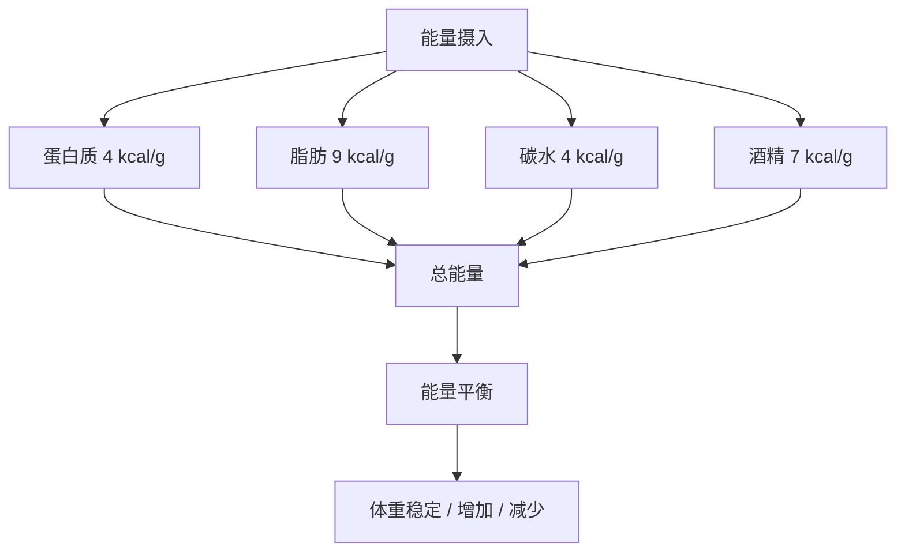

# 第 6 章：能量与宏量营养素：蛋白质、脂类、碳水化合物

- **难度**：★★☆ | **预估学时**：3.5 小时 | **前置**：第 5 章
- **本章作用**：食品营养与健康的第一层是能量和三大宏量营养素。能量折算、蛋白质质量、脂肪酸分类、碳水与膳食纤维，是专升本和营养标签的高频考点。

## 学习目标
学完本章，你能：
1. 用 Atwater 系数把蛋白质、脂肪、碳水、酒精折算成能量；
2. 说明人体能量消耗的组成，估算基础代谢和总能量需求；
3. 区分必需氨基酸、限制氨基酸、蛋白质互补作用；
4. 说明蛋白质质量评价指标 PDCAAS、DIAAS 的含义；
5. 区分饱和、单不饱和、多不饱和、反式脂肪酸，说明必需脂肪酸；
6. 说明碳水化合物的分类、血糖生成指数、膳食纤维的作用。

## 一句话核心
能量看总量，蛋白质看质量，脂肪看类型，碳水看来源。四句话分别对应四个考点。

## 6.1 能量

### 6.1.1 能量系数

食物在体内氧化释放的能量，用 Atwater 系数估算：

| 营养素 | 能量系数 |
|---|---|
| 蛋白质 | 4 kcal/g（约 17 kJ/g） |
| 脂肪 | 9 kcal/g（约 37 kJ/g） |
| 碳水化合物 | 4 kcal/g（约 17 kJ/g） |
| 酒精 | 7 kcal/g（约 29 kJ/g） |
| 膳食纤维 | 约 2 kcal/g（部分国家按 2 或 1.5） |

例：一份食物含蛋白质 10 g、脂肪 5 g、碳水 20 g，能量 = 10×4 + 5×9 + 20×4 = 145 kcal。

### 6.1.2 能量消耗

人体能量消耗包括：

- **基础代谢**：维持生命基本活动，约占 60%—70%；
- **身体活动**：运动、走路、劳动；
- **食物热效应**：消化吸收食物消耗的能量，约占 10%；
- **生长发育**：儿童、孕妇、恢复期病人额外需要。

基础代谢估算可用 Harris-Benedict 公式或 Mifflin-St Jeor 公式。临床和营养计算中，常用间接测热法更准确。

### 6.1.3 能量平衡

- 能量摄入 > 消耗：体重增加；
- 能量摄入 < 消耗：体重下降；
- 长期能量过剩：超重、肥胖、代谢综合征。

减重不是“不吃碳水”，而是控制总能量、保证蛋白质和微量营养素、增加活动。

## 6.2 蛋白质

### 6.2.1 氨基酸

蛋白质由 20 种氨基酸组成。人体不能合成或合成不足的称为**必需氨基酸**：

- 成人 8 种：异亮氨酸、亮氨酸、赖氨酸、蛋氨酸、苯丙氨酸、苏氨酸、色氨酸、缬氨酸；
- 婴儿额外需要组氨酸；
- 近年把含硫氨基酸和芳香族氨基酸分别合并计算，但考试常用 8 种。

**限制氨基酸**：食物中含量低于人体需要、限制蛋白质利用率的氨基酸。谷类第一限制氨基酸通常是赖氨酸；豆类通常是蛋氨酸。

### 6.2.2 蛋白质质量

- **蛋白质含量**：凯氏定氮法测总氮×换算系数。
- **蛋白质消化率**：吸收氮/摄入氮。
- **生物价**：储留氮/吸收氮。
- **蛋白质净利用率**：储留氮/摄入氮。
- **PDCAAS**：蛋白质消化率校正氨基酸评分，0—1，1 为最高。
- **DIAAS**：可消化必需氨基酸评分，更强调回肠消化率，可大于 1。

动物蛋白（蛋、奶、肉、鱼）通常质量高；植物蛋白中大豆质量较高，谷类赖氨酸不足。

### 6.2.3 蛋白质互补

两种或多种食物蛋白质混合食用，必需氨基酸互相补充，提高蛋白质利用率。

例：谷类赖氨酸不足、蛋氨酸充足；豆类赖氨酸充足、蛋氨酸不足。谷物+豆类（如米饭+豆腐）能互补。

### 6.2.4 需要量

中国居民膳食蛋白质推荐摄入量（RNI）按体重和年龄不同。一般成人轻体力活动：

- 男性约 65 g/d；
- 女性约 55 g/d；
- 按体重约 0.8—1.0 g/kg/d。

孕妇、乳母、运动员、恢复期病人需要增加。蛋白质过量会增加肾脏负担，但健康人适量范围较宽。

## 6.3 脂类

### 6.3.1 分类

- **饱和脂肪酸**：无双重键，主要来自动物脂肪、椰子油、棕榈油；
- **单不饱和脂肪酸**：一个双键，如油酸，橄榄油、茶油含量高；
- **多不饱和脂肪酸**：两个以上双键，如亚油酸、亚麻酸、EPA、DHA；
- **反式脂肪酸**：至少一个反式双键，主要来自部分氢化油。

### 6.3.2 必需脂肪酸

人体不能合成、必须从食物获得的脂肪酸：

- **亚油酸**（C18:2，ω-6）；
- **α-亚麻酸**（C18:3，ω-3）。

它们参与细胞膜、前列腺素、类二十烷酸合成。缺乏会影响生长、皮肤、血脂。

### 6.3.3 脂肪的生理功能

- 供能；
- 提供必需脂肪酸；
- 促进脂溶性维生素吸收；
- 构成细胞膜；
- 保护器官；
- 提供饱腹感和风味。

### 6.3.4 脂肪摄入

中国居民膳食指南建议：

- 脂肪供能比 20%—30%；
- 饱和脂肪酸供能比 <10%；
- 反式脂肪酸供能比 <1%；
- 胆固醇摄入适量，高血脂人群控制。

### 6.3.5 反式脂肪酸

反式脂肪酸升高 LDL-C、降低 HDL-C，增加心血管疾病风险。标签标示时，若含量低于 0.3 g/100 g，可标“0”，但不等于是零摄入。

## 6.4 碳水化合物

### 6.4.1 分类

- **糖**：单糖、双糖；
- **寡糖**：3—9 个单糖；
- **多糖**：淀粉、糖原、纤维素、果胶等。

### 6.4.2 血糖生成指数

GI 是含 50 g 可利用碳水化合物的食物引起血糖升高的程度，与葡萄糖比较。

- 低 GI：≤55；
- 中 GI：56—69；
- 高 GI：≥70。

GI 受食物加工、成熟度、膳食纤维、蛋白质、脂肪、酸度影响。低 GI 不等于低热量，高 GI 不等于不能吃，关键看总量和搭配。

### 6.4.3 膳食纤维

膳食纤维不能被人体消化酶分解，但能被肠道菌群部分发酵。

- 可溶性纤维：果胶、β-葡聚糖、低聚糖，延缓胃排空、降低胆固醇、改善血糖；
- 不可溶性纤维：纤维素、半纤维素，增加粪便体积、促进排便。

中国居民膳食指南建议成人每天摄入 25—30 g 膳食纤维。实际摄入常不足。

### 6.4.4 添加糖

添加糖是指在食品加工中添加的糖和糖浆，不包括水果、牛奶中的天然糖。建议：

- 添加糖供能比 <10%；
- 最好 <5%；
- 每天不超过 50 g，最好控制在 25 g 以下。

## 6.5 能量与营养素计算

### 6.5.1 食谱能量

例：早餐：牛奶 250 mL（蛋白质 8 g、脂肪 8 g、碳水 12 g），鸡蛋 50 g（蛋白质 6 g、脂肪 5 g、碳水 1 g），面包 100 g（蛋白质 8 g、脂肪 3 g、碳水 50 g）。

蛋白质 = 8+6+8 = 22 g；脂肪 = 8+5+3 = 16 g；碳水 = 12+1+50 = 63 g。

能量 = 22×4 + 16×9 + 63×4 = 88+144+252 = 484 kcal。

### 6.5.2 供能比

例：一天摄入 2000 kcal，蛋白质 75 g、脂肪 70 g、碳水 260 g。

蛋白质能量 = 75×4 = 300 kcal，占 15%；
脂肪能量 = 70×9 = 630 kcal，占 31.5%；
碳水能量 = 260×4 = 1040 kcal，占 52%。

这个例子脂肪供能比略高，碳水在推荐范围内，蛋白质合理。

## 图示

看图说明：总能量由各营养素折算相加。控制体重先看总能量，再看营养素比例。

## 例题

**例 1**：某食品每 100 g 含蛋白质 12 g、脂肪 20 g、碳水 60 g，能量是多少？

解：12×4 + 20×9 + 60×4 = 48+180+240 = 468 kcal。

**例 2**：某人每天摄入 1800 kcal，脂肪 60 g，脂肪供能比是多少？

解：60×9=540 kcal；540/1800×100%=30%。

**例 3**：谷类+豆类为什么能提高蛋白质利用率？

解：谷类赖氨酸不足、蛋氨酸较多；豆类赖氨酸较多、蛋氨酸不足。混合后必需氨基酸互补，接近人体需要，利用率提高。

## 常见误解

- 别以为“蛋白质越多越好”——过量增加肾脏负担，也挤占其他营养素。
- 别以为“低 GI 就能随便吃”——低 GI 食物仍有热量，总量决定体重。
- 别以为“脂肪都是坏的”——必需脂肪酸、脂溶性维生素吸收都需要脂肪，关键是类型和量。
- 别以为“反式脂肪标 0 就是没有”——低于 0.3 g/100 g 可标 0，仍可能摄入。
- 别以为“膳食纤维越多越好”——过量影响矿物质吸收，胃肠不适。

## 自测题（答案）

1. 脂肪的能量系数是（ ）
   A. 4 kcal/g
   B. 7 kcal/g
   C. 9 kcal/g
   D. 17 kcal/g
   **答案：C**。解析：脂肪约 9 kcal/g。

2. 谷类第一限制氨基酸通常是（ ）
   A. 赖氨酸
   B. 蛋氨酸
   C. 色氨酸
   D. 亮氨酸
   **答案：A**。解析：谷类赖氨酸含量低，限制蛋白质利用率。

3. 下列属于必需脂肪酸的是（ ）
   A. 油酸
   B. 亚油酸
   C. 棕榈酸
   D. 硬脂酸
   **答案：B**。解析：亚油酸和α-亚麻酸是必需脂肪酸。

4. 中国居民膳食指南建议脂肪供能比为（ ）
   A. 10%—15%
   B. 20%—30%
   C. 40%—50%
   D. 60%—70%
   **答案：B**。解析：脂肪供能比建议 20%—30%。

5. 膳食纤维的主要作用不包括（ ）
   A. 促进排便
   B. 降低胆固醇
   C. 提供大量能量
   D. 改善血糖
   **答案：C**。解析：膳食纤维能量低，主要作用是肠道和代谢调节。

## 复习锚点

- 能量系数：蛋白质 4、脂肪 9、碳水 4、酒精 7 kcal/g。
- 蛋白质：必需氨基酸、限制氨基酸、互补作用、PDCAAS/DIAAS。
- 脂肪：必需脂肪酸、饱和/不饱和/反式、供能比 20%—30%。
- 碳水：GI、膳食纤维 25—30 g/d、添加糖 <10% 供能。
