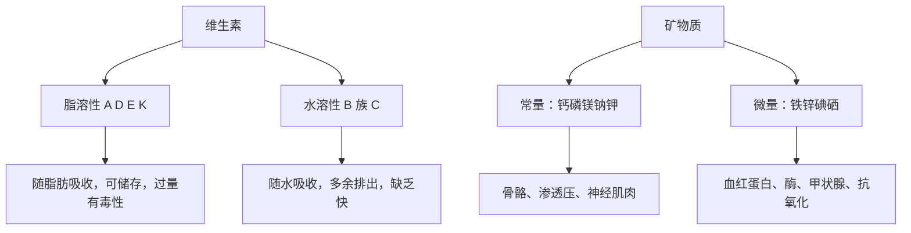

# 第 7 章：维生素、矿物质与水

- **难度**：★★☆ | **预估学时**：3.5 小时 | **前置**：第 6 章
- **本章作用**：微量营养素在食品营养考题里很碎，但高频。关键是按“溶解性—功能—缺乏—过量—食物来源”五列记，不要零散背。

## 学习目标
学完本章，你能：
1. 区分脂溶性维生素和水溶性维生素，说明各自的吸收、储存和缺乏特点；
2. 说出维生素 A、D、E、K、B 族、C 的主要功能和典型缺乏症；
3. 说明钙、铁、锌、碘、硒、钠、钾的生理功能和食物来源；
4. 说明影响钙、铁、锌吸收的因素；
5. 说明水的生理功能、需要量和电解质平衡；
6. 区分 RNI、AI、UL，正确理解“推荐摄入量”和“可耐受最高摄入量”。

## 一句话核心
脂溶性维生素看“储存和过量”，水溶性维生素看“吸收和流失”；矿物质看“吸收干扰和缺乏人群”。

## 7.1 维生素总览

### 7.1.1 分类

| 类型 | 维生素 | 特点 |
|---|---|---|
| 脂溶性 | A、D、E、K | 随脂肪吸收，能在肝脏/脂肪组织储存，过量有毒性 |
| 水溶性 | B 族、C | 随水吸收，多余部分随尿排出，缺乏快，过量毒性相对低 |

### 7.1.2 DRIs 的四个概念

- **EAR**：平均需要量，满足 50% 人群需要；
- **RNI**：推荐摄入量，满足 97%—98% 人群需要，可作为个体摄入目标；
- **AI**：适宜摄入量，数据不足时使用的近似值；
- **UL**：可耐受最高摄入量，长期超过可能增加健康风险。

RNI 不是“最低需要量”，也不是“越多越好”。UL 是安全上限，不是推荐量。

## 7.2 脂溶性维生素

### 7.2.1 维生素 A

- 形式：视黄醇、视网膜醛、视黄酸；植物中的β-胡萝卜素可转化为维生素 A。
- 功能：维持视觉、上皮组织、免疫功能、生长发育。
- 缺乏：夜盲症、干眼症、角膜软化、皮肤干燥。
- 过量：头痛、肝损伤、骨痛、致畸风险。
- 来源：动物肝脏、蛋黄、奶、深色蔬菜、胡萝卜。

### 7.2.2 维生素 D

- 形式：D₂（麦角钙化醇）、D₃（胆钙化醇）。
- 功能：促进钙磷吸收，维持骨骼矿化。
- 缺乏：儿童佝偻病、成人骨软化症、骨质疏松风险增加。
- 过量：高钙血症、肾结石、软组织钙化。
- 来源：日光照射皮肤合成、鱼肝油、蛋黄、深海鱼、强化食品。

### 7.2.3 维生素 E

- 形式：生育酚、生育三烯酚。
- 功能：抗氧化，保护细胞膜不饱和脂肪酸。
- 缺乏：罕见，可能溶血、神经病变。
- 过量：增加出血风险，尤其与抗凝药同用。
- 来源：植物油、坚果、种子、绿叶蔬菜。

### 7.2.4 维生素 K

- 形式：K₁（叶绿醌）、K₂（甲萘醌）。
- 功能：凝血因子合成、骨代谢。
- 缺乏：凝血时间延长、出血。
- 过量：一般不常见，但会影响抗凝药。
- 来源：绿叶蔬菜、发酵食品、肠道菌群合成。

## 7.3 水溶性维生素

### 7.3.1 维生素 B 族

| 维生素 | 主要功能 | 缺乏症 | 来源 |
|---|---|---|---|
| B₁（硫胺素） | 糖代谢、神经功能 | 脚气病 | 全谷物、豆、瘦肉 |
| B₂（核黄素） | 氧化还原酶辅基 | 口角炎、舌炎 | 奶、蛋、肝、绿叶菜 |
| B₃（烟酸） | 氧化还原反应 | 癞皮病（三 D：皮炎、腹泻、痴呆） | 肉、鱼、花生 |
| B₆（吡哆醇） | 氨基酸代谢 | 皮炎、贫血、神经症状 | 肉、鱼、蛋、豆 |
| B₉（叶酸） | 一碳单位、DNA 合成 | 巨幼红细胞贫血、胎儿神经管缺陷 | 绿叶菜、豆、肝 |
| B₁₂（钴胺素） | 红细胞生成、神经功能 | 巨幼红细胞贫血、神经病变 | 动物性食品、发酵食品 |

### 7.3.2 维生素 C

- 功能：抗氧化、胶原合成、铁吸收促进、免疫。
- 缺乏：坏血病（牙龈出血、皮下出血、伤口愈合差）。
- 过量：胃肠不适、腹泻、肾结石风险。
- 来源：新鲜蔬菜、水果，尤其猕猴桃、柑橘、青椒。
- 特点：水溶性、热不稳定、易氧化，烹调损失大。

## 7.4 矿物质

### 7.4.1 常量元素与微量元素

- 常量元素：钙、磷、镁、钠、钾、氯、硫；
- 微量元素：铁、锌、碘、硒、铜、锰、铬、钼、钴。

### 7.4.2 钙

- 功能：骨骼牙齿、神经肌肉、凝血、酶活性。
- 缺乏：儿童佝偻病、成人骨软化、骨质疏松。
- 来源：奶及奶制品、豆制品、绿叶菜、小鱼虾。
- 吸收：维生素 D 促进；植酸、草酸、过量膳食纤维抑制；乳糖、蛋白质、酸性环境促进。

### 7.4.3 铁

- 功能：血红蛋白、肌红蛋白、细胞色素。
- 缺乏：缺铁性贫血，表现为乏力、头晕、面色苍白。
- 来源：动物肝脏、红肉、动物血（血红素铁，吸收率高）；豆、绿叶菜（非血红素铁，吸收率低）。
- 吸收：维生素 C、肉类因子促进；植酸、草酸、茶多酚、钙抑制。

### 7.4.4 锌

- 功能：酶活性、免疫功能、生长发育、伤口愈合。
- 缺乏：生长迟缓、味觉减退、免疫功能下降。
- 来源：牡蛎、红肉、动物肝、坚果。
- 吸收：植酸抑制；动物蛋白促进。

### 7.4.5 碘

- 功能：甲状腺激素合成。
- 缺乏：甲状腺肿、克汀病、智力发育受损。
- 过量：甲状腺功能异常。
- 来源：碘盐、海产品。

### 7.4.6 硒

- 功能：抗氧化、甲状腺激素代谢、免疫。
- 缺乏：克山病、大骨节病（与地区土壤硒低有关）。
- 过量：硒中毒，脱发、指甲变形、胃肠不适。
- 来源：海产品、动物内脏、坚果。

### 7.4.7 钠与钾

- 钠：维持细胞外液渗透压、酸碱平衡、神经肌肉兴奋。
- 钾：维持细胞内液渗透压、心脏节律、肌肉功能。
- 中国居民膳食指南建议食盐 <5 g/d，增加富钾食物（蔬菜、水果、豆类、薯类）。
- 高钠低钾饮食与高血压风险相关。

## 7.5 水

### 7.5.1 水的生理功能

- 构成细胞和组织；
- 运输营养物质和代谢废物；
- 调节体温；
- 润滑关节、器官；
- 参与代谢反应。

### 7.5.2 水需要量

一般成人每天饮水约 1500—1700 mL，总水摄入（包括食物水）约 2500—3000 mL。运动、高温、发热、哺乳需要增加。

### 7.5.3 电解质平衡

- 钠、钾、氯维持渗透压和酸碱平衡；
- 大量出汗会丢失钠、钾，长时间运动需补充电解质；
- 腹泻、呕吐会导致脱水和电解质紊乱，严重时需口服补液盐。

## 7.6 微量营养素与食品加工

- 维生素 C 热不稳定，长时间加热、切碎后暴露空气会损失；
- 维生素 B 族水溶性，淘米、长时间浸泡会流失；
- 维生素 A、E 脂溶性，氧化和光照会破坏；
- 矿物质一般不会因加热损失，但可能随汤汁流失；
- 强化食品、营养补充剂可弥补不足，但不能替代多样膳食。

## 图示

看图说明：脂溶性和水溶性的区别决定吸收、储存、缺乏速度和中毒风险。矿物质按常量/微量分类，功能各有侧重。

## 例题

**例 1**：为什么缺铁性贫血在素食者中更常见？

解：植物性食物中的铁多为非血红素铁，吸收率低；植酸、草酸、茶多酚会抑制吸收。素食者需要搭配维生素 C 丰富的食物，必要时补充。

**例 2**：为什么维生素 C 要快炒、少水？

解：维生素 C 水溶性、热不稳定、易氧化。长时间加热、大量水煮、切后久放都会增加损失。

**例 3**：维生素 D 缺乏为什么影响钙吸收？

解：维生素 D 促进小肠对钙的吸收，维持血钙和骨矿化。缺乏时钙吸收下降，儿童佝偻病、成人骨软化风险增加。

## 常见误解

- 别以为“维生素越多越好”——脂溶性维生素过量会中毒，水溶性维生素过量也有风险。
- 别以为“RNI 是最低量”——RNI 是推荐摄入量，满足绝大多数人需要。
- 别以为“钙片补钙最好”——奶制品、豆制品、绿叶菜是更自然的来源，补剂不能替代膳食。
- 别以为“铁锅炒菜能补铁”——铁锅溶出的铁吸收率低，不能作为主要补铁方式。
- 别以为“出汗只补钠”——大量出汗也丢钾，需要电解质饮料或食物补充。

## 自测题（答案）

1. 下列属于脂溶性维生素的是（ ）
   A. 维生素 C
   B. 维生素 B₁
   C. 维生素 D
   D. 叶酸
   **答案：C**。解析：维生素 A、D、E、K 是脂溶性。

2. 缺乏维生素 C 会导致（ ）
   A. 夜盲症
   B. 坏血病
   C. 佝偻病
   D. 癞皮病
   **答案：B**。解析：维生素 C 缺乏导致坏血病。

3. 促进非血红素铁吸收的因素是（ ）
   A. 植酸
   B. 草酸
   C. 维生素 C
   D. 茶多酚
   **答案：C**。解析：维生素 C 可将 Fe³⁺ 还原为 Fe²⁺，促进吸收。

4. 碘缺乏可导致（ ）
   A. 贫血
   B. 甲状腺肿
   C. 佝偻病
   D. 坏血病
   **答案：B**。解析：碘是甲状腺激素合成原料，缺乏导致甲状腺肿。

5. 中国居民膳食指南建议每日食盐摄入量不超过（ ）
   A. 2 g
   B. 5 g
   C. 10 g
   D. 15 g
   **答案：B**。解析：建议成人每天食盐不超过 5 g。

## 复习锚点

- 脂溶性 A、D、E、K：可储存，过量有毒性；水溶性 B、C：多余排出，缺乏快。
- 维生素 A 夜盲，D 佝偻病，C 坏血病，B₁ 脚气病，B₃ 癞皮病，B₉/B₁₂ 巨幼贫血。
- 钙看奶豆绿叶，铁看红肉动物血，锌看牡蛎红肉，碘看碘盐海产品，硒看海产品和坚果。
- 水：成人每天饮水约 1500—1700 mL，出汗腹泻要补电解质。
