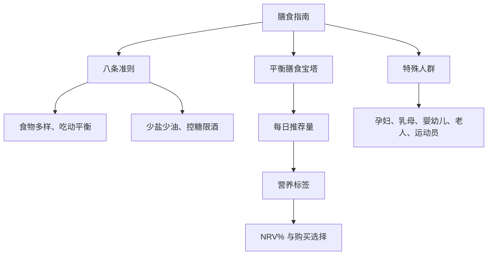

# 第 8 章：膳食指南、营养标签与特殊人群

- **难度**：★★☆ | **预估学时**：3 小时 | **前置**：第 6、7 章
- **本章作用**：这一章把营养素知识变成“怎么吃”和“怎么看标签”。专升本常考膳食指南条目、营养标签计算、特殊人群需求。

## 学习目标
学完本章，你能：
1. 说出中国居民膳食指南（2022）的八条准则；
2. 看懂平衡膳食宝塔的食物类别和推荐量；
3. 读懂营养成分表：能量、蛋白质、脂肪、碳水、钠、NRV%；
4. 完成营养标签的简单计算和比较；
5. 说明孕妇、乳母、婴幼儿、儿童、老年人、运动员的营养重点；
6. 识别常见营养声称和健康声称的边界。

## 一句话核心
膳食指南解决“大多数人怎么吃”，营养标签解决“这一包食品吃进去多少”，特殊人群解决“哪些人不能照普通人的标准吃”。

## 8.1 中国居民膳食指南（2022）

### 8.1.1 八条准则

1. **食物多样，合理搭配**；
2. **吃动平衡，健康体重**；
3. **多吃蔬果、奶类、全谷、大豆**；
4. **适量吃鱼、禽、蛋、瘦肉**；
5. **少盐少油，控糖限酒**；
6. **规律进餐，足量饮水**；
7. **会烹会选，会看标签**；
8. **公筷分餐，杜绝浪费**。

这八条不是口号，每一条都能出题。比如“少盐”对应食盐 <5 g/d；“控糖”对应添加糖 <10% 供能，最好 <5%；“足量饮水”对应成人每天饮水 1500—1700 mL。

### 8.1.2 平衡膳食宝塔

成人每日推荐量（轻体力活动，具体按能量调整）：

| 食物类别 | 推荐量 |
|---|---|
| 谷类 | 200—300 g，其中全谷物和杂豆 50—150 g |
| 薯类 | 50—100 g |
| 蔬菜 | 300—500 g，深色蔬菜占一半 |
| 水果 | 200—350 g |
| 畜禽肉 | 40—75 g |
| 水产品 | 40—75 g |
| 蛋类 | 40—50 g（约 1 个） |
| 奶及奶制品 | 300—500 g |
| 大豆及坚果 | 25—35 g，其中坚果约 10 g |
| 烹调油 | 25—30 g |
| 食盐 | <5 g |
| 水 | 1500—1700 mL |

宝塔是“推荐范围”，不是“必须每天精确到克”。一天吃不全，可以一周平均。

### 8.1.3 食物多样

建议每天摄入 12 种以上食物，每周 25 种以上。谷类、薯类、蔬菜、水果、畜禽鱼蛋奶、豆类、坚果都要有。

“食物多样”不是把同一类食物换着吃，而是跨类别搭配。比如米饭+面条不算多样，米饭+豆腐+青菜+苹果才算。

## 8.2 营养标签

### 8.2.1 营养成分表

预包装食品标签上通常有“1+4”：

- 能量；
- 蛋白质；
- 脂肪；
- 碳水化合物；
- 钠。

部分产品还会标糖、饱和脂肪、反式脂肪、膳食纤维、维生素、矿物质。

格式：

| 项目 | 每 100 g | NRV% |
|---|---|---|
| 能量 | 2000 kJ | 24% |
| 蛋白质 | 8.0 g | 13% |
| 脂肪 | 20.0 g | 33% |
| 碳水化合物 | 60.0 g | 20% |
| 钠 | 400 mg | 20% |

### 8.2.2 NRV%

NRV 是营养素参考值，用于比较食品中某营养素占每日推荐量的比例。

$$NRV\%=\frac{\text{每 100 g 含量}}{\text{NRV}}\times100\%$$

常用 NRV：

- 能量 8400 kJ；
- 蛋白质 60 g；
- 脂肪 60 g；
- 碳水化合物 300 g；
- 钠 2000 mg；
- 钙 800 mg；
- 铁 15 mg；
- 锌 15 mg；
- 维生素 C 100 mg。

例：某饼干每 100 g 含钠 400 mg，NRV%=400/2000×100%=20%。吃 100 g 就占了一天钠参考值的 20%。

### 8.2.3 营养标签计算

例：某饮料每 100 mL 含能量 180 kJ、蛋白质 0 g、脂肪 0 g、碳水 10.6 g、钠 20 mg。一瓶 500 mL：

- 能量 900 kJ；
- 碳水 53 g；
- 钠 100 mg。

如果一天喝两瓶，能量 1800 kJ，约占 8400 kJ 的 21.4%。这就是“饮料不算饭，但能量会算进总账”。

### 8.2.4 营养声称

常见声称有门槛，不是想标就标：

- “无糖”：每 100 g 或 100 mL 含糖 ≤0.5 g；
- “低糖”：≤5 g/100 g 或 100 mL；
- “高蛋白”：蛋白质 ≥12 g/100 g 或 ≥6 g/100 mL；
- “低脂”：脂肪 ≤3 g/100 g 固体或 ≤1.5 g/100 mL 液体；
- “高钙”：钙 ≥240 mg/100 g 或 ≥120 mg/100 mL。

具体以 GB 28050 和后续标准为准。考试遇到“无糖等于没有糖”“高蛋白等于优质蛋白”这类说法，要判断偷换概念。

## 8.3 特殊人群营养

### 8.3.1 孕妇

- 孕早期：叶酸 400 μg/d，预防神经管缺陷；
- 孕中期：能量和蛋白质增加，钙、铁、碘需求增加；
- 孕晚期：能量进一步增加，注意铁、钙、DHA；
- 全程：控盐、控糖、避免酒精和生食。

### 8.3.2 乳母

- 能量和蛋白质增加；
- 钙、铁、碘、维生素 A 需求增加；
- 保证水分摄入；
- 避免酒精、烟草和某些药物。

### 8.3.3 婴幼儿

- 0—6 月龄：纯母乳喂养，按需哺乳；
- 6 月龄起：添加辅食，从富铁食物开始；
- 1 岁前：不加盐、糖，不喝含糖饮料；
- 注意铁、锌、维生素 D 补充。

### 8.3.4 儿童青少年

- 保证能量、蛋白质、钙、铁、锌；
- 早餐要吃，控制含糖饮料和零食；
- 每天至少 60 分钟中高强度运动；
- 青春期女生注意铁，男生注意锌和蛋白质。

### 8.3.5 老年人

- 能量需求下降，但蛋白质、钙、维生素 D 需求不降；
- 预防肌少症：优质蛋白 + 抗阻运动；
- 预防骨质疏松：钙 + 维生素 D + 负重运动；
- 食物软烂、少量多餐，注意吞咽和消化。

### 8.3.6 运动员

- 能量按训练量增加；
- 蛋白质 1.2—2.0 g/kg/d，力量训练可更高；
- 碳水是主要能源，赛前赛后补糖；
- 补水、电解质；
- 注意铁、钙、维生素 D。

### 8.3.7 素食者

- 蛋白质：豆类、豆制品、谷物、坚果搭配；
- 铁：植物铁吸收率低，搭配维生素 C；
- 维生素 B₁₂：主要来自动物性食品，严格素食者需强化食品或补充剂；
- 钙、锌、DHA：注意强化食品和藻油。

## 8.4 营养评价与膳食调查

常见方法：

- **24 小时膳食回顾**：回忆过去 24 小时吃的所有食物；
- **食物频率问卷**：了解长期摄入频率；
- **称重法**：称量食物实际摄入量；
- **膳食史法**：了解长期饮食习惯。

评价指标：

- 能量和营养素摄入量；
- 供能比；
- 蛋白质质量；
- 膳食多样性；
- BMI、腰围、体脂。

## 图示

看图说明：指南给方向，宝塔给数量，标签给单包食品的信息，特殊人群给个体化调整。

## 例题

**例 1**：某食品每 100 g 含蛋白质 12 g，NRV% 是多少？

解：蛋白质 NRV 为 60 g，12/60×100%=20%。

**例 2**：某饮料每 100 mL 含糖 0.4 g，能否标“无糖”？

解：可以。无糖要求每 100 g 或 100 mL 含糖 ≤0.5 g。0.4 g 符合。

**例 3**：孕妇为什么要补叶酸？

解：叶酸参与一碳单位和 DNA 合成，孕早期缺乏增加胎儿神经管缺陷风险。建议从孕前 3 个月开始补充 400 μg/d。

## 常见误解

- 别以为“无糖就是没有热量”——无糖只是糖 ≤0.5 g/100 g，脂肪、蛋白质仍可能提供能量。
- 别以为“营养标签上的 NRV% 就是这包食品的占比”——NRV% 是按每 100 g 或每份计算的，要看实际吃多少。
- 别以为“孕妇吃得越多越好”——能量增加有限，关键是优质蛋白、叶酸、铁、钙、碘。
- 别以为“老年人少吃肉更健康”——老年人需要优质蛋白预防肌少症，关键在于软烂、适量、均衡。
- 别以为“素食一定缺营养”——合理搭配豆类、坚果、强化食品，可以满足大部分需求，但 B₁₂ 需要特别注意。

## 自测题（答案）

1. 中国居民膳食指南建议成人每天食盐不超过（ ）
   A. 3 g
   B. 5 g
   C. 8 g
   D. 10 g
   **答案：B**。解析：指南建议 <5 g/d。

2. 营养标签“1+4”中的“4”不包括（ ）
   A. 蛋白质
   B. 脂肪
   C. 碳水化合物
   D. 钙
   **答案：D**。解析：“1+4”是能量+蛋白质、脂肪、碳水、钠。

3. 某食品每 100 g 含钠 600 mg，NRV% 是（ ）
   A. 15%
   B. 20%
   C. 30%
   D. 60%
   **答案：C**。解析：600/2000×100%=30%。

4. 孕早期重点补充（ ）
   A. 叶酸
   B. 维生素 E
   C. 钠
   D. 反式脂肪
   **答案：A**。解析：叶酸预防神经管缺陷。

5. 老年人预防肌少症的关键是（ ）
   A. 只吃蔬菜
   B. 优质蛋白 + 抗阻运动
   C. 大量补钙
   D. 减少饮水
   **答案：B**。解析：优质蛋白和抗阻运动是预防肌少症的核心。

## 复习锚点

- 八条准则：食物多样、吃动平衡、多吃蔬果奶豆、适量鱼禽蛋瘦肉、少盐少油控糖限酒、规律进餐足量饮水、会烹会选会看标签、公筷分餐。
- 宝塔：盐 <5 g、油 25—30 g、奶 300—500 g、蔬菜 300—500 g、水果 200—350 g。
- 标签：1+4，NRV%，按实际摄入量计算。
- 特殊人群：孕妇叶酸，婴幼儿铁，老人蛋白+运动，素食者 B₁₂。
