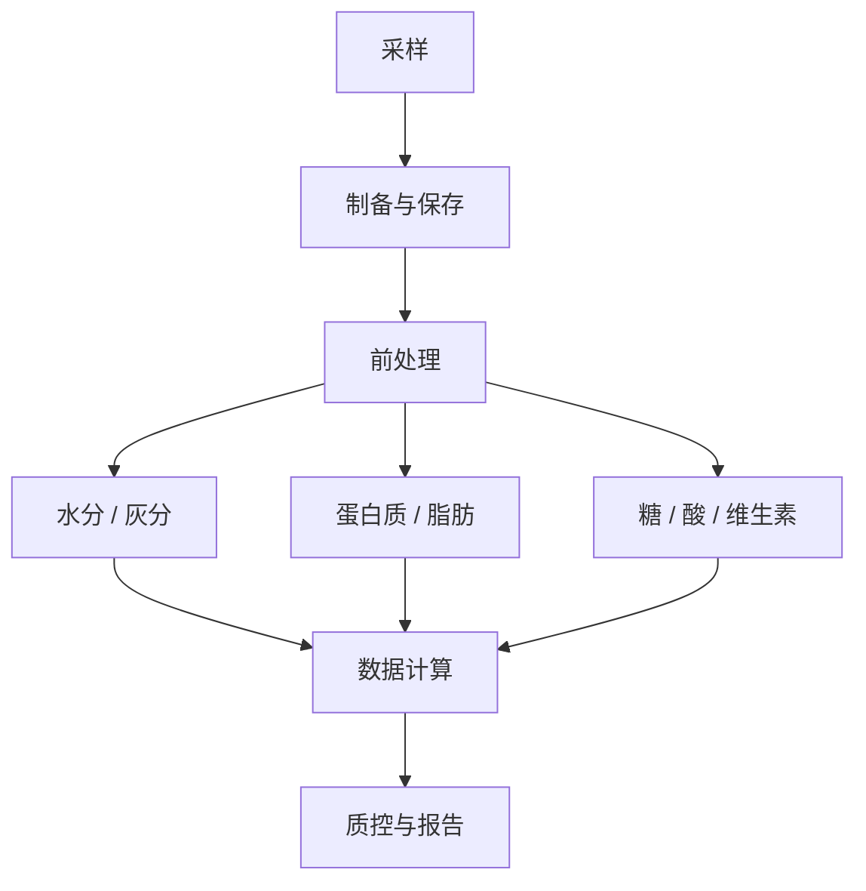

# 第 9 章：食品检验总论与理化检验：从采样到水分、蛋白、脂肪

- **难度**：★★☆ | **预估学时**：4.5 小时 | **前置**：第 2、4 章
- **本章作用**：这是食品检验的“主干”。采样、前处理、常规成分测定，是实训和上岗最常做的事，也是专升本计算题的主要来源。

## 学习目标
学完本章，你能：
1. 说明代表性采样的原则、方法和样品保存要求；
2. 选择合适的前处理方法：干燥、灰化、消解、提取、净化；
3. 用干燥法、减压法、蒸馏法、卡尔·费休法测水分，并计算水分含量；
4. 用凯氏定氮法测蛋白质，正确选择换算系数；
5. 用索氏提取法、酸水解法测脂肪；
6. 用斐林试剂法、HPLC 测还原糖和总糖；
7. 用滴定法测总酸，用 2,6-二氯靛酚法测维生素 C。

## 一句话核心
检验结果的可信度，七成取决于采样和前处理。仪器再准，样品不具代表性、前处理损失或污染，结果就是错的。

## 9.1 采样

### 9.1.1 代表性

采样的核心是“让所采样品能代表整批食品”。不能只挑好看的、方便的、表面的。

- **随机采样**：每件产品都有同等被抽到的机会；
- **分层采样**：按批次、位置、包装分层，再从每层随机抽；
- **四分法**：将样品混匀、铺平、划十字、取对角，反复缩分到所需量。

### 9.1.2 采样量

采样量要满足：

- 检验项目所需；
- 复检、留样所需；
- 仲裁所需。

一般不少于检验需要量的 3 倍，具体按标准或抽样方案。

### 9.1.3 样品保存

- 易腐败样品：冷藏、冷冻，尽快检验；
- 光敏样品：避光；
- 易氧化样品：充氮、密封；
- 微生物样品：无菌容器，冷藏，不能冷冻（除非方法允许）；
- 样品要有唯一标识、采样记录、封条。

## 9.2 前处理

### 9.2.1 目的

- 把待测组分从食品基质中分离出来；
- 浓缩到方法可测的浓度；
- 消除干扰；
- 使样品状态符合仪器要求。

### 9.2.2 常用方法

| 方法 | 用途 | 注意 |
|---|---|---|
| 干燥 | 去水、测水分 | 温度、时间、恒重 |
| 灰化 | 测灰分、无机元素 | 炭化、温度、坩埚 |
| 湿消解 | 重金属、微量元素 | 酸体系、温度、空白 |
| 提取 | 脂肪、糖、维生素、添加剂 | 溶剂选择、提取次数 |
| 净化 | 色谱前处理 | 固相萃取、QuEChERS |
| 衍生化 | 提高挥发性/检测灵敏度 | 试剂、时间、温度 |

### 9.2.3 避免损失和污染

- 器皿洗净、酸泡、纯水冲洗；
- 试剂空白低；
- 避免高温碳化损失易挥发元素（如砷、汞、硒）；
- 避免光照破坏维生素；
- 加标回收验证前处理效率。

## 9.3 水分测定

### 9.3.1 常压恒重法

适用：一般食品，热稳定。

步骤：

1. 称量皿恒重；
2. 称取样品；
3. 105 ℃ 烘干至恒重；
4. 冷却、称量；
5. 计算水分。

$$水分\%=\frac{m_1-m_2}{m_1-m_0}\times100\%$$

m₀ 是空皿质量，m₁ 是烘干前样品+皿，m₂ 是烘干后样品+皿。

### 9.3.2 减压干燥法

适用：高糖、高脂、热不稳定样品。降低压力，降低干燥温度，减少焦化。

### 9.3.3 蒸馏法

适用：含挥发性成分的样品，如油脂、香料。加水与甲苯/二甲苯共沸蒸馏，收集水层，读体积。

### 9.3.4 卡尔·费休法

适用：低水分、微量水分样品。利用碘-二氧化硫-水反应，电化学滴定。精度高，试剂需防潮。

### 9.3.5 水分活度

水分活度用专用仪器测，不是水分含量。Aw 影响微生物生长和保质期。

## 9.4 灰分测定

### 9.4.1 总灰分

样品炭化后，550 ℃ 灼烧至恒重，残留物为总灰分。

$$灰分\%=\frac{m_2-m_0}{m_1-m_0}\times100\%$$

### 9.4.2 酸不溶性灰分

总灰分加盐酸煮沸，过滤、灼烧、称量。反映泥沙等酸不溶性杂质。

### 9.4.3 注意

- 炭化要缓慢，避免明火；
- 温度不能过高，避免无机盐损失；
- 坩埚恒重；
- 高盐样品可能结块，需控制灼烧时间。

## 9.5 蛋白质测定

### 9.5.1 凯氏定氮法

三步：

1. **消化**：样品 + 浓硫酸 + 催化剂（硫酸铜、硫酸钾）加热，把有机氮转化为硫酸铵；
2. **蒸馏**：加碱使氨释放，蒸馏到硼酸吸收液；
3. **滴定**：用标准酸滴定，计算氮含量。

反应：

$$(NH_4)_2SO_4+2NaOH=Na_2SO_4+2NH_3\uparrow+2H_2O$$

$$NH_3+H_3BO_3=NH_4^++H_2BO_3^-$$

$$H_2BO_3^-+H^+=H_3BO_3$$

### 9.5.2 计算

$$蛋白质\%=\frac{(V_1-V_0)\times c\times 0.014}{m}\times F\times100\%$$

V₁ 是样品滴定体积，V₀ 是空白，c 是标准酸浓度，0.014 是氮的毫摩尔质量（g/mmol），F 是换算系数，m 是样品质量。

换算系数：

- 一般食品 6.25；
- 乳制品 6.38；
- 小麦 5.70；
- 玉米 6.25；
- 大豆 5.71；
- 明胶 5.55。

### 9.5.3 非蛋白氮

凯氏定氮测的是总氮，包括非蛋白氮。三聚氰胺、尿素等非蛋白氮会被算成蛋白质，这是历史掺假事件的漏洞。现在有真蛋白沉淀法、氨基酸分析等方法补充。

## 9.6 脂肪测定

### 9.6.1 索氏提取法

适用：游离脂肪，不含结合态脂肪的样品。

步骤：干燥样品 → 滤纸筒 → 乙醚/石油醚回流提取 → 回收溶剂 → 烘干 → 称量。

$$粗脂肪\%=\frac{m_2-m_1}{m}\times100\%$$

### 9.6.2 酸水解法

适用：谷物、面包等含结合态脂肪的样品。加盐酸水解，脂肪释放，再用乙醚提取。

### 9.6.3 注意

- 乙醚易燃，操作要通风、无明火；
- 样品要干燥，水分会影响提取；
- 提取完全，恒重；
- 结果叫“粗脂肪”，因为还含脂溶性色素、蜡等。

## 9.7 糖与酸度

### 9.7.1 还原糖

斐林试剂法：还原糖在碱性条件下将 Cu²⁺ 还原为 Cu₂O 红色沉淀，用标准葡萄糖溶液标定。

$$葡萄糖+Cu^{2+}\rightarrow Cu_2O\downarrow+葡萄糖酸$$

### 9.7.2 总糖

先用酸或酶水解蔗糖、淀粉等多糖，再测还原糖。总糖 = 水解后还原糖（以葡萄糖计）。

### 9.7.3 酸度

- **总酸**：用 NaOH 滴定，以主要酸计（如食醋以醋酸计，果汁以柠檬酸计）。
- **pH**：用 pH 计测，反映游离 H⁺ 浓度。
- **滴定酸度**：以消耗 NaOH 的体积或换算成酸的质量分数表示。

$$总酸\%=\frac{c(NaOH)\times V\times M}{m}\times100\%$$

### 9.7.4 维生素 C

2,6-二氯靛酚法：维生素 C 还原染料，染料褪色，滴定至微红色终点。也可用 HPLC 测。

注意：维生素 C 易氧化，样品要新鲜、避光、快速处理，提取液常加草酸或偏磷酸稳定。

## 9.8 检验报告的基本信息

一份报告至少要有：

- 样品名称、编号、来源、状态；
- 采样日期、检验日期；
- 检验项目、方法依据；
- 结果、单位、检出限/定量限；
- 判定依据和结论；
- 检验人、审核人、批准人；
- 备注（偏离、异常、复检）。

## 图示

看图说明：采样和前处理是共同上游，不同项目在中间分叉，最后都汇到数据和质量控制。

## 例题

**例 1**：某样品 2.000 g，烘干后失重 0.200 g，水分含量是多少？

解：水分 = 0.200/2.000×100% = 10.0%。

**例 2**：凯氏定氮中，样品 0.500 g，滴定消耗 0.1000 mol/L HCl 10.00 mL，空白 0.50 mL，F=6.25，求蛋白质含量。

解：氮质量 = (10.00−0.50)×0.1000×0.014 = 0.0133 g；氮含量 = 0.0133/0.500×100% = 2.66%；蛋白质 = 2.66×6.25 = 16.6%。

**例 3**：某食醋 10.00 g，消耗 0.1000 mol/L NaOH 15.00 mL，以醋酸计（M=60.0 g/mol），求总酸。

解：总酸 = 0.1000×0.01500×60.0/10.00×100% = 0.900%。

## 常见误解

- 别以为“采样就是随便拿一点”——没有代表性的样品，结果没有意义。
- 别以为“水分测定都用 105 ℃”——高糖高脂样品要减压或蒸馏，否则焦化。
- 别以为“凯氏定氮测的是蛋白质”——测的是总氮，乘以系数才是粗蛋白。
- 别以为“粗脂肪就是脂肪”——索氏提取还包括脂溶性色素、蜡、固醇。
- 别以为“总酸和 pH 是一回事”——总酸是滴定得到的酸总量，pH 是游离 H⁺ 浓度。

## 自测题（答案）

1. 下列样品最适合减压干燥法测水分的是（ ）
   A. 面包
   B. 高糖糖果
   C. 大米
   D. 茶叶
   **答案：B**。解析：高糖样品常压高温会焦化，用减压干燥。

2. 凯氏定氮法测的是（ ）
   A. 蛋白质
   B. 总氮
   C. 氨基酸
   D. 肽
   **答案：B**。解析：凯氏定氮测总氮，乘以换算系数得粗蛋白。

3. 索氏提取法测的是（ ）
   A. 结合态脂肪
   B. 游离脂肪
   C. 总糖
   D. 灰分
   **答案：B**。解析：索氏提取测游离脂肪；酸水解法测结合态脂肪。

4. 食醋总酸通常以（ ）计
   A. 醋酸
   B. 柠檬酸
   C. 乳酸
   D. 盐酸
   **答案：A**。解析：食醋总酸以醋酸计。

5. 维生素 C 测定时，提取液常加（ ）稳定
   A. 盐酸
   B. 草酸或偏磷酸
   C. 氢氧化钠
   D. 乙醚
   **答案：B**。解析：酸性稳定剂抑制维生素 C 氧化。

## 复习锚点

- 采样：代表性、随机/分层、四分法、保存、留样。
- 前处理：干燥、灰化、消解、提取、净化、衍生化。
- 水分：常压、减压、蒸馏、卡尔·费休；高糖高脂用减压。
- 蛋白质：凯氏定氮三步，总氮×换算系数。
- 脂肪：索氏测游离，酸水解测结合。
- 总酸：NaOH 滴定，按主要酸计。
