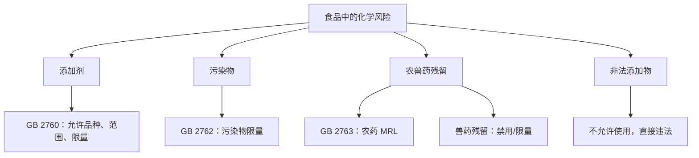

# 第 10 章：食品添加剂、污染物与农兽药残留

- **难度**：★★☆ | **预估学时**：4 小时 | **前置**：第 4、9 章
- **本章作用**：这一章是“安全检测”的核心。考试常考标准编号、限量概念、检测方法和非法添加物。记忆要按“类别—标准—危害—方法”四列走。

## 学习目标
学完本章，你能：
1. 说明食品添加剂的定义、使用原则和 GB 2760 的基本框架；
2. 区分防腐剂、着色剂、甜味剂、抗氧化剂、增稠剂的作用和常见品种；
3. 说明 GB 2762 污染物限量、GB 2763 农药残留限量、GB 29921 致病菌限量的适用范围；
4. 说出铅、镉、汞、砷、黄曲霉毒素、丙烯酰胺的来源和危害；
5. 区分农药残留、兽药残留和非法添加物；
6. 说明农残、兽残的常用检测方法和快检初筛流程。

## 一句话核心
添加剂是“按标准允许使用”，污染物是“不得超过限量”，非法添加物是“根本不允许”。三者法律性质不同，不能混。

## 10.1 食品添加剂

### 10.1.1 定义

食品添加剂是为改善食品品质、色香味、防腐、保鲜和加工工艺需要而加入食品中的人工合成或天然物质。

### 10.1.2 使用原则

- 不应对人体产生健康危害；
- 不应掩盖食品腐败变质；
- 不应掩盖食品本身或加工过程中的质量缺陷；
- 不应以掺杂、掺假、伪造为目的；
- 不应降低食品本身的营养价值；
- 在达到预期效果的前提下尽可能降低使用量。

### 10.1.3 GB 2760

GB 2760 是食品安全国家标准《食品添加剂使用标准》，规定：

- 允许使用的添加剂品种；
- 使用范围；
- 最大使用量；
- 残留量；
- 带入原则。

使用添加剂时，要同时满足“品种允许、范围允许、限量允许”。三者缺一不可。

### 10.1.4 常见类别

| 类别 | 作用 | 常见品种 |
|---|---|---|
| 防腐剂 | 抑制微生物 | 苯甲酸及其钠盐、山梨酸及其钾盐、丙酸钙、乳酸链球菌素 |
| 着色剂 | 改善颜色 | 胭脂红、柠檬黄、日落黄、亮蓝、β-胡萝卜素 |
| 甜味剂 | 提供甜味 | 蔗糖、果葡糖浆、阿斯巴甜、安赛蜜、三氯蔗糖、甜菊糖苷 |
| 抗氧化剂 | 延缓氧化 | 维生素 C、维生素 E、BHA、BHT、TBHQ、迷迭香提取物 |
| 增稠剂 | 改善质构 | 卡拉胶、黄原胶、瓜尔胶、果胶、明胶 |
| 膨松剂 | 使制品膨松 | 碳酸氢钠、碳酸氢铵、复合膨松剂 |
| 护色剂 | 保持肉色 | 亚硝酸钠、硝酸钠 |
| 乳化剂 | 稳定乳状液 | 单甘酯、蔗糖酯、卵磷脂 |

### 10.1.5 带入原则

食品添加剂可以通过原料带入终产品，但带入量不应超过由原料带入的合理水平，且终产品中不得超过限量。不能以“原料带入”为借口超量使用。

## 10.2 污染物

### 10.2.1 GB 2762

GB 2762 是《食品中污染物限量》，规定铅、镉、汞、砷、锡、镍、铬、苯并[a]芘、N-亚硝基化合物、多氯联苯等污染物在不同食品中的限量。

常见：

- 铅：蓄积性神经毒性，儿童更敏感；
- 镉：肾毒性、骨毒性，大米、贝类风险；
- 汞：甲基汞对神经系统，尤其是胎儿；
- 砷：无机砷致癌，海产品注意；
- 锡：罐头食品溶出。

### 10.2.2 真菌毒素

- **黄曲霉毒素**：花生、玉米、坚果，强致癌，尤其黄曲霉毒素 B₁；
- **赭曲霉毒素 A**：谷物、咖啡、葡萄制品，肾毒性；
- **脱氧雪腐镰刀菌烯醇（DON）**：小麦、玉米，呕吐毒素；
- **玉米赤霉烯酮**：玉米、小麦，类雌激素作用；
- **展青霉素**：苹果制品，神经毒性。

检测方法：HPLC、LC-MS/MS、ELISA 快检。

### 10.2.3 加工污染物

- **丙烯酰胺**：高温油炸、烘焙富含碳水+氨基酸的食物，2A 类致癌物；
- **3-MCPD**：油脂精炼，尤其棕榈油；
- **苯并[a]芘**：烟熏、烧烤、油炸，多环芳烃；
- **杂环胺**：高温烹调肉类；
- **亚硝胺**：腌制、烟熏，亚硝酸盐与胺反应。

### 10.2.4 其他

- 持久性有机污染物（POPs）；
- 微塑料；
- 全氟和多氟烷基物质（PFAS）；
- 放射性核素。

这些属于进阶内容，专升本一般考基本概念。

## 10.3 农药残留

### 10.3.1 GB 2763

GB 2763 是《食品中农药最大残留限量》，规定农药名称、食品类别、最大残留限量（MRL）。

农药分类：

- 有机磷：敌敌畏、乐果、毒死蜱，抑制胆碱酯酶；
- 氨基甲酸酯：克百威、涕灭威；
- 拟除虫菊酯：氯氰菊酯、溴氰菊酯；
- 有机氯：六六六、滴滴涕，已禁用但环境残留；
- 杀菌剂：多菌灵、百菌清；
- 除草剂：草甘膦、百草枯。

### 10.3.2 检测方法

- GC：有机磷、有机氯、拟除虫菊酯；
- LC-MS/MS：氨基甲酸酯、除草剂、极性农药；
- 快检：酶抑制法（有机磷/氨基甲酸酯）、免疫层析、拉曼光谱。

### 10.3.3 快检局限

酶抑制法只对有机磷和氨基甲酸酯类敏感，对拟除虫菊酯、有机氯无效。快检阳性要复检，阴性不能排除其他农药。

## 10.4 兽药残留

### 10.4.1 常见类别

- 抗生素：青霉素、四环素、氟喹诺酮；
- 磺胺类；
- 硝基呋喃类：已禁用；
- 氯霉素：已禁用；
- β-受体激动剂：克伦特罗（瘦肉精），禁用；
- 激素类；
- 抗寄生虫药。

### 10.4.2 检测方法

- LC-MS/MS：多残留确证；
- ELISA：初筛；
- 免疫层析：现场快检；
- 微生物抑制法：筛选。

### 10.4.3 风险

兽药残留可能引起过敏、耐药性、内分泌干扰。动物性食品、蜂蜜、牛奶是重点。

## 10.5 非法添加物

非法添加物不是食品添加剂，不允许用于食品。常见：

- 三聚氰胺：冒充蛋白质，肾结石；
- 苏丹红：工业染料，致癌；
- 吊白块：甲醛次硫酸氢钠，漂白、防腐；
- 硼砂：增加弹性，毒性；
- 甲醛：防腐，致癌；
- 工业明胶；
- 塑化剂。

检测时要注意“本底”和“非法添加”的区别。比如甲醛在部分食品中天然存在，不能一检出就判非法添加，要看含量和来源。

## 10.6 限量判定

### 10.6.1 判定步骤

1. 确认样品类别；
2. 确认项目对应的标准；
3. 确认限量值；
4. 确认检测方法；
5. 比较结果与限量；
6. 给出判定。

### 10.6.2 检出限与限量

- 检出限低，不等于限量低；
- 未检出，不等于零；
- 结果低于 LOQ 时，报告要写明“低于定量限”；
- 判定要按标准规定的有效位数和修约规则。

## 图示

看图说明：添加剂看“允许不允许、超没超量”；污染物看“限量”；农残看 MRL；非法添加物不看限量，直接不允许。

## 例题

**例 1**：某食品检出苯甲酸 0.5 g/kg，GB 2760 规定该类别最大使用量 0.2 g/kg，如何判定？

解：品种允许、范围允许，但 0.5>0.2，超限量使用，不合格。

**例 2**：某蔬菜酶抑制法快检阳性，能否直接判农药残留超标？

解：不能。酶抑制法只筛有机磷和氨基甲酸酯，阳性需用 GC 或 LC-MS/MS 复检，按 GB 2763 限量判定。

**例 3**：某花生制品检出黄曲霉毒素 B₁ 5 μg/kg，限量 20 μg/kg，是否合格？

解：5<20，符合限量。但还要看 Total aflatoxin 等其他指标和产品标准。

## 常见误解

- 别以为“食品添加剂都有害”——按标准使用是安全的，超范围超限量才是问题。
- 别以为“天然添加剂一定安全”——天然不等于无毒，也要按标准。
- 别以为“检出污染物就是不合格”——要看限量、本底、方法。
- 别以为“快检阴性就安全”——快检只覆盖部分项目，不能替代全项检测。
- 别以为“非法添加物有限量”——非法添加物不允许用于食品，没有“合法限量”。

## 自测题（答案）

1. 食品添加剂使用标准是（ ）
   A. GB 2760
   B. GB 2762
   C. GB 2763
   D. GB 29921
   **答案：A**。解析：GB 2760 是食品添加剂使用标准。

2. 下列属于非法添加物的是（ ）
   A. 山梨酸钾
   B. 三聚氰胺
   C. 维生素 C
   D. 果胶
   **答案：B**。解析：三聚氰胺不允许用于食品。

3. 有机磷农药快检常用（ ）
   A. 酶抑制法
   B. 凯氏定氮法
   C. 索氏提取法
   D. 干燥法
   **答案：A**。解析：有机磷和氨基甲酸酯抑制胆碱酯酶，酶抑制法用于初筛。

4. 黄曲霉毒素主要危害是（ ）
   A. 肾毒性
   B. 强致癌，尤其肝癌
   C. 神经毒性
   D. 甲状腺肿
   **答案：B**。解析：黄曲霉毒素 B₁ 是强致癌物，与肝癌相关。

5. 农药最大残留限量标准是（ ）
   A. GB 2760
   B. GB 2762
   C. GB 2763
   D. GB 28050
   **答案：C**。解析：GB 2763 是农药最大残留限量。

## 复习锚点

- 添加剂：GB 2760，品种、范围、限量三关。
- 污染物：GB 2762，铅镉汞砷、真菌毒素、加工污染物。
- 农残：GB 2763，MRL；快检初筛，标准法确证。
- 兽残：抗生素、磺胺、瘦肉精，LC-MS/MS 确证。
- 非法添加物：三聚氰胺、苏丹红、吊白块、硼砂、甲醛，不允许使用。
