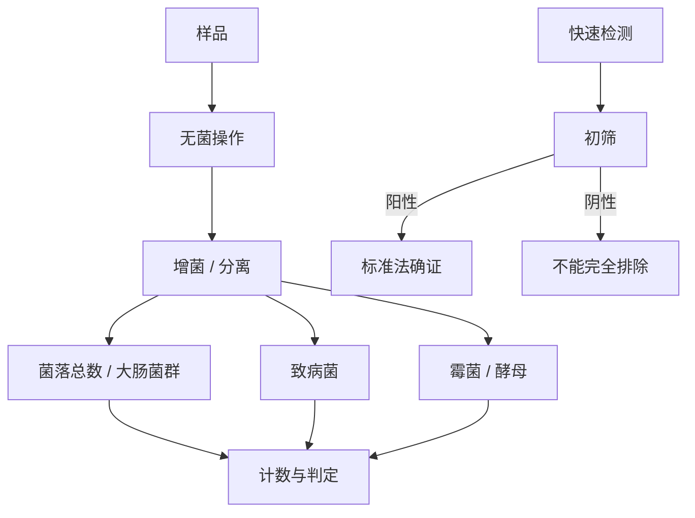

# 第 11 章：食品微生物检验与快速检测

- **难度**：★★☆ | **预估学时**：4 小时 | **前置**：第 9 章
- **本章作用**：微生物检验和快速检测是食品检验岗位的两大实操模块。这一章把“无菌操作、菌落计数、致病菌、快检原理”串起来。

## 学习目标
学完本章，你能：
1. 说明无菌操作、培养基、灭菌和生物安全的基本要求；
2. 区分菌落总数、大肠菌群、致病菌的卫生学意义；
3. 用倾注平板法、涂布平板法、MPN 法进行计数；
4. 说出沙门氏菌、金黄色葡萄球菌、单核细胞增生李斯特菌、副溶血性弧菌的检验要点；
5. 说明商业无菌、益生菌、霉菌和酵母检验的适用场景；
6. 区分 ELISA、PCR、LAMP、免疫层析、ATP 快检的用途和局限。

## 一句话核心
微生物检验的第一原则是“不让外界微生物进来，也不让样品微生物跑出去”。所有操作都围绕无菌和防污染。

## 11.1 实验室基础

### 11.1.1 无菌操作

- 操作前洗手、消毒，穿工作服，戴帽子、口罩；
- 在生物安全柜或超净工作台内操作；
- 器皿、培养基、移液器灭菌；
- 操作时动作轻，避免扬尘；
- 接种环使用前后灼烧灭菌；
- 样品、废弃物按生物安全要求处理。

### 11.1.2 培养基

培养基提供微生物生长所需的碳源、氮源、无机盐、生长因子和水。

按用途分：

- 基础培养基：通用营养；
- 选择性培养基：抑制非目标菌，促进目标菌；
- 鉴别培养基：通过颜色、沉淀、气泡区分菌落；
- 增菌培养基：让目标菌数量增加，便于检出。

### 11.1.3 灭菌方法

- 高压蒸汽灭菌：121 ℃、15—20 min，适用于培养基、器皿；
- 干热灭菌：160—170 ℃、2 h，适用于玻璃器皿；
- 过滤除菌：适用于热不稳定试剂；
- 紫外灭菌：表面和空气，穿透力弱；
- 化学消毒：乙醇、次氯酸钠等。

### 11.1.4 生物安全

- 食品微生物实验室通常按 Biosafety Level 1—2 管理；
- 致病菌操作在相应生物安全柜内进行；
- 废弃物高压灭菌后再处理；
- 防止气溶胶、溅洒；
- 有应急处理预案。

## 11.2 卫生指示菌

### 11.2.1 菌落总数

菌落总数是食品中在特定条件下培养形成的需氧或兼性厌氧菌落总数，反映食品卫生状况和加工过程的清洁程度。

不是“所有细菌总数”，也不是“致病菌数量”。它是指示菌，不是致病菌指标。

### 11.2.2 大肠菌群

大肠菌群是一群在 37 ℃、24—48 h 内发酵乳糖、产酸产气、革兰氏阴性、无芽孢的杆菌。主要来自人和温血动物粪便，反映粪便污染。

大肠菌群超标说明：

- 原料污染；
- 加工过程卫生差；
- 人员卫生不合格；
- 清洗消毒不到位。

### 11.2.3 致病菌

常见食源性致病菌：

| 致病菌 | 主要来源 | 特点 |
|---|---|---|
| 沙门氏菌 | 禽肉、蛋、奶、肉 | 革兰氏阴性杆菌，食物中毒常见 |
| 金黄色葡萄球菌 | 人员皮肤、鼻腔、乳制品 | 产肠毒素，耐热 |
| 单核细胞增生李斯特菌 | 冷藏食品、乳制品、肉制品 | 嗜冷，孕妇易感 |
| 副溶血性弧菌 | 海产品 | 嗜盐，沿海地区常见 |
| 大肠杆菌 O157:H7 | 牛肉、生菜 | 产志贺毒素，溶血性尿毒综合征 |
| 蜡样芽孢杆菌 | 米饭、淀粉类 | 产芽孢，耐热 |
| 肉毒梭菌 | 罐头、发酵食品 | 厌氧，肉毒毒素极毒 |

## 11.3 计数方法

### 11.3.1 倾注平板法

样品稀释液与融化并冷却到 45—50 ℃ 的琼脂培养基混合，倒入平皿，凝固后培养，计数菌落。

优点：菌落分布均匀；缺点：热敏感菌可能被烫死，菌落可能在培养基内部。

### 11.3.2 涂布平板法

先倒平板，凝固后涂布样品稀释液，培养后计数。

优点：不经过热琼脂，适合热敏感菌；缺点：涂布不均匀会影响计数。

### 11.3.3 MPN 法

最可能数法，适用于低浓度微生物计数，如大肠菌群。

原理：系列稀释，每稀释度接种多管，根据产气/产酸管数查 MPN 表，估计菌数。

优点：适合低浓度；缺点：统计估计，不是直接计数。

### 11.3.4 计算

平板计数：

$$CFU/g=\frac{\text{平均菌落数}\times\text{稀释倍数}}{\text{样品质量}}$$

例：10⁻⁴ 稀释液 1 mL 平均菌落 25 个，样品 25 g 均质，则：

$$CFU/g=\frac{25\times10^4}{25}=1.0\times10^4\ \text{CFU/g}$$

## 11.4 商业无菌

商业无菌是指罐头食品经适度杀菌后，不含致病菌，也不含在正常储藏条件下能繁殖的非致病菌。

检验步骤：

- 保温试验：36 ℃ 保温 10 天，或 55 ℃ 保温 5—7 天；
- 观察胀罐；
- 开罐、涂片、染色、镜检；
- 培养，检查有无微生物生长。

商业无菌不是“绝对无菌”，而是“在正常储藏条件下不会腐败”。

## 11.5 益生菌与霉菌

### 11.5.1 益生菌

益生菌是摄入足够数量后对宿主有益的活微生物。常见：

- 乳杆菌属；
- 双歧杆菌属；
- 嗜热链球菌；
- 酵母菌（部分）。

检验要点：活菌计数、菌种鉴定、耐药性、致病性。

### 11.5.2 霉菌和酵母

霉菌和酵母计数反映食品霉变和发酵状况。常见培养基：马铃薯葡萄糖琼脂（PDA）、孟加拉红琼脂。

霉菌可能产真菌毒素，酵母过多会导致食品发酵、胀袋。

## 11.6 快速检测

### 11.6.1 免疫学方法

- **ELISA**：酶联免疫吸附，适合批量初筛，灵敏度高；
- **免疫层析**：试纸条，现场快速，半定量/定性；
- **免疫荧光**：标记抗体，显微镜或仪器检测。

局限：交叉反应、基质干扰、只能测已知目标。

### 11.6.2 分子生物学方法

- **PCR**：扩增特定 DNA 片段，检测致病菌、转基因、过敏原；
- **qPCR**：实时定量；
- **LAMP**：环介导等温扩增，恒温、快速，适合现场；
- **基因芯片**：多目标同时检测。

注意：PCR 检测的是 DNA，死菌 DNA 也可能阳性，不能直接说明有活菌。

### 11.6.3 生物传感器与 ATP

- 生物传感器：抗体、酶、核酸探针与信号转换器结合；
- ATP 荧光法：检测表面 ATP，反映清洁度，不是直接测微生物；
- 显色培养基：目标菌形成特定颜色菌落，便于计数。

### 11.6.4 快检定位

快检适合：

- 原料验收；
- 生产过程监控；
- 现场筛查；
- 应急事件初筛。

快检不适合：

- 最终仲裁；
- 低浓度确证；
- 多残留全项覆盖。

快检阳性 → 标准法复检；快检阴性 → 不能排除所有风险。

## 图示

看图说明：培养法是“金标准”路径，快检是“初筛”路径。两条路径不能互相替代。

## 例题

**例 1**：某样品 10⁻³ 稀释液 1 mL 平均菌落 40 个，样品 25 g 均质，求 CFU/g。

解：CFU/g = 40×10³/25 = 1.6×10³ CFU/g。

**例 2**：罐头保温 10 天出现胀罐，说明什么？

解：可能灭菌不彻底，残留微生物繁殖产气。需要开罐镜检、培养，判断是否商业无菌不合格。

**例 3**：PCR 检出沙门氏菌 DNA，能否直接判样品有活沙门氏菌？

解：不能。PCR 检测 DNA，死菌 DNA 也可能阳性。需要结合培养法确证活菌。

## 常见误解

- 别以为“菌落总数高就一定有致病菌”——菌落总数是指示菌，致病菌要单独检。
- 别以为“大肠菌群就是大肠杆菌”——大肠菌群是一类菌，大肠杆菌是其中一种。
- 别以为“商业无菌就是绝对无菌”——商业无菌是正常储藏条件下不腐败、不含致病菌。
- 别以为“PCR 阳性就是活菌”——DNA 可能来自死菌。
- 别以为“ATP 高就是细菌多”——ATP 反映有机物残留和清洁度，不是直接菌数。

## 自测题（答案）

1. 菌落总数主要反映（ ）
   A. 致病菌数量
   B. 食品卫生状况
   C. 霉菌数量
   D. 病毒数量
   **答案：B**。解析：菌落总数是卫生指示菌。

2. 大肠菌群主要反映（ ）
   A. 粪便污染
   B. 农药残留
   C. 重金属污染
   D. 油脂氧化
   **答案：A**。解析：大肠菌群来自人和温血动物粪便。

3. 下列适合低浓度微生物计数的是（ ）
   A. 涂布平板法
   B. 倾注平板法
   C. MPN 法
   D. 直接显微镜计数
   **答案：C**。解析：MPN 适合低浓度，如大肠菌群。

4. 商业无菌检验的保温试验通常为（ ）
   A. 4 ℃ 1 天
   B. 36 ℃ 10 天
   C. −20 ℃ 7 天
   D. 100 ℃ 2 小时
   **答案：B**。解析：36 ℃ 保温 10 天，观察胀罐和微生物。

5. PCR 检测微生物的局限是（ ）
   A. 不能扩增 DNA
   B. 死菌 DNA 也可能阳性
   C. 只能测病毒
   D. 不能用于食品
   **答案：B**。解析：PCR 测 DNA，不能区分活菌和死菌。

## 复习锚点

- 无菌操作、培养基、灭菌、生物安全是微生物检验的基础。
- 菌落总数看卫生，大肠菌群看粪便污染，致病菌单独检。
- 计数：倾注平板、涂布平板、MPN；商业无菌保温试验。
- 快检：ELISA、免疫层析、PCR、LAMP、ATP；阳性复检，阴性不能完全排除。
