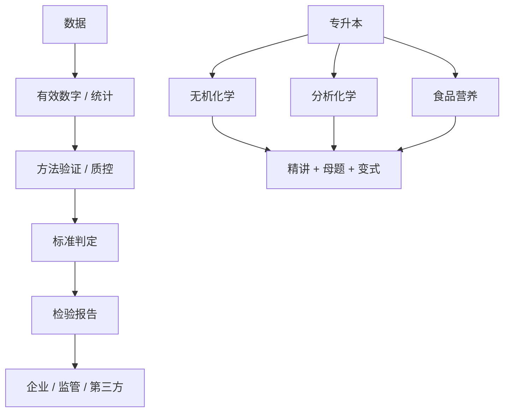

# 第 12 章：检验数据、法规标准、实验室管理与专升本

- **难度**：★★☆ | **预估学时**：3.5 小时 | **前置**：第 4、9、10、11 章
- **本章作用**：这一章把“会做实验”变成“会出报告、会判合格、会应试”。数据不会处理，结果等于白测；法规不熟，数字不会判。

## 学习目标
学完本章，你能：
1. 计算平均值、标准差、RSD，判断离群值；
2. 说明方法验证的准确度、精密度、线性、LOD/LOQ、特异性；
3. 说出食品安全标准体系的层级和常用标准编号；
4. 说明 CMA、CNAS、HACCP、ISO 22000 的基本含义；
5. 写一份结构完整的检验报告；
6. 排出专升本最后 30 天的复习计划。

## 一句话核心
检验报告 = 样品信息 + 方法依据 + 结果 + 限量 + 判定。少一项，报告就不完整。

## 12.1 数据处理

### 12.1.1 平均值与标准差

平均值：

$$\bar{x}=\frac{1}{n}\sum_{i=1}^{n}x_i$$

标准差：

$$s=\sqrt{\frac{\sum(x_i-\bar{x})^2}{n-1}}$$

相对标准偏差：

$$RSD=\frac{s}{\bar{x}}\times100\%$$

例：测定值 10.1、10.2、10.2、10.3 mg/kg，平均 10.2，s≈0.082，RSD≈0.80%。

### 12.1.2 离群值

常用 Grubbs 检验或 Q 检验判断离群值。不能因为“看着不顺眼”就删数据。剔除要有统计依据和记录。

### 12.1.3 有效数字与修约

- 加减法看小数位；
- 乘除法看有效位数；
- 修约按 GB/T 8170，四舍六入五成双；
- 最终结果的有效数字与方法、仪器精度匹配。

### 12.1.4 统计检验

- **t 检验**：比较两组均值是否有显著差异；
- **方差分析（ANOVA）**：比较三组及以上均值；
- **回归分析**：标准曲线、趋势分析；
- **控制图**：监控过程稳定性，常用 X̄-R 图、X̄-s 图。

专升本一般考基本概念和简单计算，不考复杂软件操作。

## 12.2 方法验证与质量控制

### 12.2.1 方法验证指标

| 指标 | 含义 | 常用接受标准 |
|---|---|---|
| 准确度 | 与真值接近程度 | 加标回收率 80%—120% |
| 精密度 | 重复测定的一致性 | RSD 符合方法要求 |
| 线性 | 浓度与响应的比例关系 | r≥0.995 或按方法 |
| 检出限 LOD | 能检出的最低量 | 信噪比 3:1 |
| 定量限 LOQ | 能准确定量的最低量 | 信噪比 10:1 |
| 特异性 | 排除干扰的能力 | 空白、基质、干扰试验 |
| 稳健性 | 小条件变化不影响结果 | 温度、pH、时间微调 |

### 12.2.2 日常质控

- 空白试验；
- 平行样；
- 加标回收；
- 标准物质/质控样；
- 人员比对；
- 仪器校准；
- 控制图。

### 12.2.3 测量不确定度

测量不确定度是对结果分散性的度量，不是“误差”。报告不确定度时，要说明来源：采样、前处理、标准品、仪器、重复性、校准等。

## 12.3 食品安全标准体系

### 12.3.1 层级

- 法律：《中华人民共和国食品安全法》；
- 行政法规；
- 部门规章；
- 食品安全国家标准（GB）；
- 行业标准、地方标准、企业标准；
- 国际标准（Codex、ISO 等）。

### 12.3.2 常用标准

| 标准 | 内容 |
|---|---|
| GB 2760 | 食品添加剂使用标准 |
| GB 2761 | 真菌毒素限量 |
| GB 2762 | 污染物限量 |
| GB 2763 | 农药最大残留限量 |
| GB 29921 | 预包装食品中致病菌限量 |
| GB 7718 | 预包装食品标签通则 |
| GB 28050 | 预包装食品营养标签通则 |
| GB 14881 | 食品生产通用卫生规范 |
| GB 4789 系列 | 食品微生物学检验 |
| GB 5009 系列 | 食品理化检验方法 |
| GB/T 27404 | 实验室质量控制规范 |

标准会更新，具体以现行版本为准。考试时记编号和适用范围，不要死记所有限量。

### 12.3.3 标准体系逻辑

- GB 2760/2761/2762/2763/29921 是“限量标准”；
- GB 4789/5009 是“方法标准”；
- GB 7718/28050 是“标签标准”；
- GB 14881 是“生产规范”；
- 产品标准规定产品的感官、理化、微生物指标。

判定时要把“产品标准 + 限量标准 + 方法标准”配套使用。

## 12.4 实验室管理

### 12.4.1 CMA

CMA（中国计量认证）是检验检测机构资质认定，证明机构具备向社会出具具有证明作用的数据和结果的能力。

### 12.4.2 CNAS

CNAS（中国合格评定国家认可委员会）认可，证明实验室能力符合国际标准 ISO/IEC 17025。CNAS 认可不是强制，但国际上互认。

### 12.4.3 HACCP 与 ISO 22000

- **HACCP**：危害分析关键控制点，预防食品安全危害；
- **ISO 22000**：食品安全管理体系，整合 HACCP 和前提方案；
- **ISO 9001**：质量管理体系。

### 12.4.4 实验室安全

- 化学品分类存放，酸碱分开，易燃品远离火源；
- 气瓶固定，避免泄漏；
- 微生物废弃物高压灭菌；
- 个人防护：实验服、手套、护目镜；
- 应急：洗眼器、紧急喷淋、灭火器、泄漏处理。

## 12.5 检验报告

### 12.5.1 报告结构

1. 标题、报告编号；
2. 样品信息：名称、编号、来源、状态、数量；
3. 采样信息：时间、地点、采样人；
4. 检验项目、方法依据；
5. 结果、单位、检出限/定量限；
6. 判定依据、结论；
7. 检验人、审核人、批准人；
8. 备注：偏离、异常、复检、分包。

### 12.5.2 结果表述

- 数值结果：写数值、单位、有效数字；
- 未检出：写“未检出”或“低于检出限”，并注明检出限；
- 超限：写明限量值和检测值；
- 判定：合格/不合格/不作判定。

### 12.5.3 常见错误

- 单位写错（mg/kg 写成 mg/g）；
- 有效数字过多；
- 方法依据写错；
- 限量值用错；
- 结论超出授权范围；
- 样品编号与记录不一致。

## 12.6 专升本最后 30 天

### 12.6.1 三科分配

- 无机化学：10 天，重点物质的量、四大平衡、元素性质；
- 分析化学：10 天，重点误差、滴定、分光、色谱；
- 食品营养：8 天，重点能量、蛋白质、脂类、碳水、维生素、矿物质、膳食指南；
- 综合模拟：2 天，按考试时间做套题。

### 12.6.2 每天节奏

- 40 分钟看精讲；
- 20 分钟做母题；
- 20 分钟做变式；
- 10 分钟回看错题。

错题要标注原因：概念错、计算错、条件看错、单位错。不同原因，回不同的章节。

### 12.6.3 考场策略

- 先做会做的，计算题留到最后；
- 单位统一，有效数字合理；
- 简答题分点写，先结论后解释；
- 不会的题不要空，写相关公式和思路；
- 时间分配：选择题快，计算题稳，简答题全。

## 图示

看图说明：数据、质控、标准、报告是一条链；专升本三科要并行复习，最后用套题收口。

## 例题

**例 1**：测定值 10.1、10.2、10.2、10.3，求平均值和 RSD（s≈0.082）。

解：平均 10.2；RSD=0.082/10.2×100%≈0.80%。

**例 2**：某方法 LOQ 为 0.05 mg/kg，样品结果为 0.03 mg/kg，怎么报告？

解：低于定量限，报告“低于定量限（LOQ=0.05 mg/kg）”，不能直接写 0.03 参与合格判定。

**例 3**：某食品 GB 2760 允许某添加剂最大使用量 0.2 g/kg，实测 0.25 g/kg，怎么判？

解：超限量，不合格。报告写明标准、限量、实测值和方法。

## 常见误解

- 别以为“标准编号越大约新”——标准编号是顺序，不是年份；要看发布和实施日期。
- 别以为“检出限就是限量”——检出限是方法能检出的最低量，限量是法规允许的最大量。
- 别以为“未检出就是零”——未检出是低于检出限，不是绝对没有。
- 别以为“CMA 和 CNAS 是一回事”——CMA 是资质认定，CNAS 是实验室认可。
- 别以为“报告结论可以随便写”——结论要在授权范围内，依据要明确。

## 自测题（答案）

1. 下列属于限量标准的是（ ）
   A. GB 4789
   B. GB 5009
   C. GB 2762
   D. GB 7718
   **答案：C**。解析：GB 2762 是污染物限量。

2. 加标回收率主要反映（ ）
   A. 精密度
   B. 准确度
   C. 检出限
   D. 线性
   **答案：B**。解析：加标回收率衡量准确度。

3. 某结果低于 LOQ，正确报告方式是（ ）
   A. 写 0
   B. 写“未检出”
   C. 写“低于定量限”，注明 LOQ
   D. 直接判合格
   **答案：C**。解析：低于定量限要注明 LOQ，不能写 0 或未检出。

4. CMA 是指（ ）
   A. 实验室认可
   B. 检验检测机构资质认定
   C. 食品安全认证
   D. 国际标准
   **答案：B**。解析：CMA 是资质认定，CNAS 是认可。

5. 专升本最后阶段最重要的做法是（ ）
   A. 只看新资料
   B. 只背答案
   C. 精讲 + 母题 + 变式 + 错题回链
   D. 放弃计算题
   **答案：C**。解析：理解、练习、迁移、纠错四件事缺一不可。

## 复习锚点

- 数据：平均、标准差、RSD、有效数字、离群值。
- 方法验证：准确度、精密度、线性、LOD/LOQ、特异性。
- 标准：GB 2760 添加剂、GB 2762 污染物、GB 2763 农残、GB 29921 致病菌、GB 4789/5009 方法。
- 管理：CMA 资质认定、CNAS 认可、HACCP、ISO 22000。
- 专升本：三科并行，精讲+母题+变式+错题回链。
