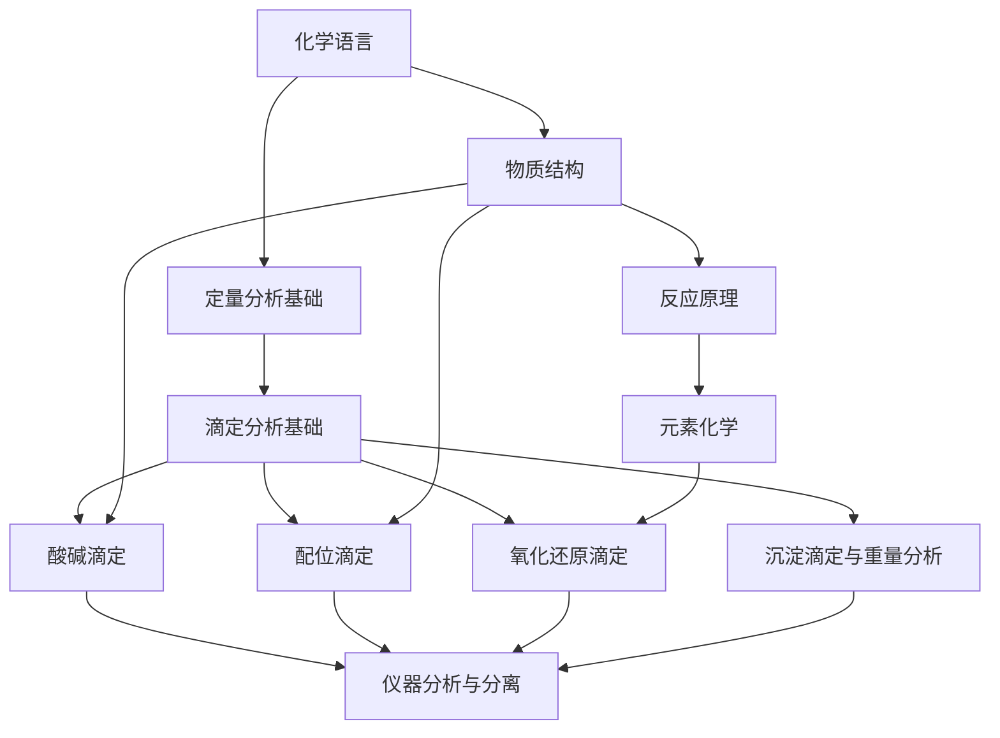

# 无机及分析化学：考纲主线

## 这本书在讲什么

按《无机及分析化学》教材与配套学习指导的考纲顺序，把化学常识、物质结构、反应原理、元素化学、定量分析、四大滴定、重量分析、分光光度法和电位分析串成一条线。目标不是复刻教材，而是让化学几乎零基础的人读完能做题。

- **题量**：每章 3 个例题 + 5 道母题 + 5 道变式（共 10 道自测），全书 130 题。

## 全书心智模型

## 学习路径

| 步骤 | 章节 | 主题 | 前置 | 检查点 |
|---|---|---|---|---|
| 01 | ch00 | 化学基础常识 | 无 | 能算 n、c、稀释 |
| 02 | ch01 | 物质结构 | ch00 | 能写电子排布、判断构型 |
| 03 | ch02 | 速率与平衡 | ch01 | 能写速率方程、算 K |
| 04 | ch03 | 元素化学 | ch01 | 能写常见元素反应 |
| 05 | ch04 | 定量分析基础 | ch00 | 误差、有效数字题全对 |
| 06 | ch05 | 滴定分析基础 | ch04 | 滴定计算全对 |
| 07 | ch06 | 酸碱滴定 | ch05、ch02 | pH、指示剂、混合碱 |
| 08 | ch07 | 配位滴定 | ch05、ch01 | K'、最低 pH |
| 09 | ch08 | 电极电势 | ch01、ch03 | Nernst、E°、K |
| 10 | ch09 | 氧化还原滴定 | ch08、ch05 | 三种方法条件与计算 |
| 11 | ch10 | 沉淀与重量分析 | ch06、ch05 | Ksp、三种沉淀滴定 |
| 12 | ch11 | 分光光度法 | ch04 | A=εbc、标准曲线 |
| 13 | ch12 | 电位分析与分离 | ch08、ch10 | 玻璃电极、萃取率 |

## 章节索引

- 第 0 章 化学基础常识（★☆☆）→ `chapters/ch00-化学基础常识.md`
- 第 1 章 物质结构（★★☆）→ `chapters/ch01-物质结构.md`
- 第 2 章 速率与平衡（★★★）→ `chapters/ch02-速率与平衡.md`
- 第 3 章 元素化学（★★★）→ `chapters/ch03-元素化学.md`
- 第 4 章 定量分析基础（★★☆）→ `chapters/ch04-定量分析基础.md`
- 第 5 章 滴定分析基础（★★☆）→ `chapters/ch05-滴定分析基础.md`
- 第 6 章 酸碱滴定（★★★）→ `chapters/ch06-酸碱滴定.md`
- 第 7 章 配位滴定（★★★）→ `chapters/ch07-配位滴定.md`
- 第 8 章 电极电势（★★★）→ `chapters/ch08-电极电势.md`
- 第 9 章 氧化还原滴定（★★★）→ `chapters/ch09-氧化还原滴定.md`
- 第 10 章 沉淀与重量分析（★★★）→ `chapters/ch10-沉淀与重量分析.md`
- 第 11 章 分光光度法（★★☆）→ `chapters/ch11-分光光度法.md`
- 第 12 章 电位分析与分离（★★★）→ `chapters/ch12-电位分析法与分离方法.md`

## 前置知识缺口补讲

| 缺口 | 补讲位置 | 学完标志 |
|---|---|---|
| 化学式、化合价、离子方程式 | 第 0 章 | 能拆写常见离子方程式 |
| 物质的量、浓度、稀释 | 第 0 章 | 四类计算不出错 |
| 原子结构、化学键 | 第 1 章；`01` 第 2、8 章 | 能写电子排布、判断构型 |
| 平衡与 K | 第 2 章；`02` 第 5 章 | 能算 K、判断 Q 方向 |

## 术语 / 模式 / 速查

- 术语表：`glossary.md`（87 条）
- 模式库：`patterns.md`（滴定选择、pH 计算、配位可行性、氧化还原、沉淀、分光）
- 速查表：`cheatsheet.md`（常用公式、指示剂、电极电势、单位换算）
