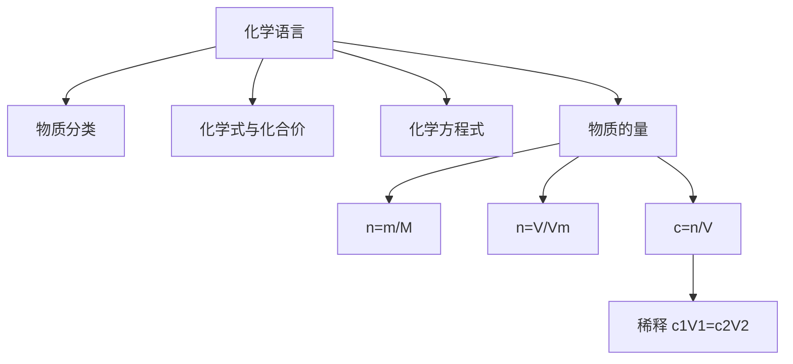

# 第 0 章：化学基础常识（零基础入口）

- **难度**：★☆☆ | **预估学时**：2 小时 | **前置**：无
- **考纲位置**：这一章不直接对应某道大题，但它决定你能不能看懂后面的所有内容。化学式读不懂、物质的量算不对，后面的滴定、电极、平衡都无从下手。

## 学习目标
学完本章，你能：
1. 分清混合物、纯净物、单质、化合物、酸、碱、盐、氧化物；
2. 看懂化学式，判断常见元素的化合价；
3. 配平简单的化学方程式，区分离子方程式；
4. 用物质的量、摩尔质量、气体摩尔体积、物质的量浓度做基本换算；
5. 说出实验室基本操作和常见安全常识。

## 一句话核心
化学用“符号”描述物质，用“方程式”描述变化，用“物质的量”把质量和数量连起来。这三件事通了，后面的内容才读得动。

## 0.1 物质怎么分类

### 0.1.1 按组成分

- **混合物**：由两种或多种物质组成，如空气、盐水、合金。各组分保持自己的性质。
- **纯净物**：只由一种物质组成，如氧气、蒸馏水、纯铜。
- **单质**：由同种元素组成的纯净物，如 O₂、Fe、C。
- **化合物**：由两种或多种元素组成的纯净物，如 H₂O、NaCl、H₂SO₄。

注意：O₂ 和 O₃ 都是单质，但它们是不同的物质；冰和水混合仍是纯净物（同一种物质的不同状态）。

### 0.1.2 按性质分

- **酸**：电离出的阳离子全部是 H⁺，如 HCl、H₂SO₄、CH₃COOH。
- **碱**：电离出的阴离子全部是 OH⁻，如 NaOH、Ca(OH)₂。
- **盐**：由金属阳离子（或 NH₄⁺）和酸根阴离子组成，如 NaCl、Na₂CO₃、NH₄Cl。
- **氧化物**：由两种元素组成，其中一种是氧，如 CO₂、CaO、SO₂。
  - 酸性氧化物：能与碱反应生成盐和水，如 CO₂、SO₂。
  - 碱性氧化物：能与酸反应生成盐和水，如 CaO、Na₂O。
  - 两性氧化物：既能与酸又能与碱反应，如 Al₂O₃。

## 0.2 原子、分子、离子

- **原子**：化学变化中的最小粒子，由质子、中子、电子组成。质子数决定元素种类。
- **分子**：保持物质化学性质的最小粒子，如 H₂O、CO₂。
- **离子**：带电的原子或原子团，如 Na⁺、Cl⁻、SO₄²⁻。

原子序数 = 质子数 = 核电荷数 = 中性原子的电子数。

同位素：质子数相同、中子数不同的原子，如 ¹H、²H、³H。同位素化学性质基本相同，物理性质有差异。

相对原子质量：以 ¹²C 的 1/12 为标准，元素的相对原子质量是各同位素按丰度加权的平均值。

## 0.3 化学式与化合价

化学式用元素符号和下标表示组成。NaCl 表示氯化钠，H₂O 表示水，Al₂(SO₄)₃ 表示硫酸铝。

化合价是元素在化合物中的氧化数（详见第 8 章）。常见化合价：
- H：+1（金属氢化物中 −1）
- O：−2（过氧化物中 −1）
- Na、K：+1
- Ca、Mg、Ba：+2
- Al：+3
- Cl：−1（ClO₃⁻ 中 +5，ClO₄⁻ 中 +7）
- S：−2（SO₂ 中 +4，SO₄²⁻ 中 +6）
- N：−3（NH₃）、+5（HNO₃）

写化学式时，正价在前、负价在后，交叉约简。如 Al³⁺ 与 SO₄²⁻ 写成 Al₂(SO₄)₃。

## 0.4 化学方程式与离子方程式

### 0.4.1 化学方程式

化学方程式必须配平：反应前后每种元素的原子数相等，电荷守恒（离子反应）。

例：Fe + CuSO₄ = FeSO₄ + Cu。

配平步骤：写骨架 → 配平金属 → 配平非金属 → 配平 H、O → 检查。

### 0.4.2 离子方程式

把可溶性强电解质拆成离子，难溶物、气体、弱电解质、水保留化学式。

例：HCl + NaOH = NaCl + H₂O 的离子方程式：

$$H^+ + OH^- = H_2O$$

例：CaCO₃ + 2HCl = CaCl₂ + H₂O + CO₂↑ 的离子方程式：

$$CaCO_3 + 2H^+ = Ca^{2+} + H_2O + CO_2\uparrow$$

注意：CaCO₃ 难溶，保留化学式；HCl 强酸，拆成 H⁺ 和 Cl⁻；Cl⁻ 没参加反应，删去。

## 0.5 物质的量

### 0.5.1 基本关系

物质的量 n 的单位是 mol。1 mol 含 6.022×10²³ 个粒子（阿伏加德罗常数 NA）。

$$n = \frac{m}{M}$$

$$n = \frac{N}{N_A}$$

$$n = \frac{V}{V_m}\ (\text{气体，标准状况 } V_m=22.4\ \text{L/mol})$$

$$c = \frac{n}{V}\ (\text{溶液，V 单位 L})$$

### 0.5.2 换算示例

例 1：18 g H₂O 的物质的量。M(H₂O)=18 g/mol，n=18/18=1 mol。

例 2：标准状况下 11.2 L O₂ 的物质的量。n=11.2/22.4=0.5 mol。

例 3：0.5 mol NaCl 溶于水配成 500 mL 溶液，浓度 c=0.5/0.5=1.0 mol/L。

### 0.5.3 稀释

稀释前后溶质的物质的量不变：

$$c_1V_1 = c_2V_2$$

例：用 18 mol/L 浓硫酸配 500 mL 1.0 mol/L 稀硫酸，需要浓硫酸体积：

$$V_1 = \frac{1.0\times500}{18} = 27.8\ \text{mL}$$

操作：把浓硫酸缓慢倒入水中，边加边搅拌，不能反过来。

## 0.6 实验室常识

- **取用药品**：不能用手直接接触，不能尝味道，不能把鼻子凑到瓶口闻。
- **加热**：试管加热先预热，液体不超过试管容积的 1/3，管口不对人。
- **过滤**：一贴二低三靠；滤纸边缘低于漏斗边缘，液面低于滤纸边缘。
- **蒸发**：蒸发皿中液体不超过 2/3，接近蒸干时停止加热，用余热蒸干。
- **洗涤**：玻璃仪器洗净标准是内壁不挂水珠，水膜均匀。
- **安全**：酸溅到皮肤先用大量水冲，再涂碳酸氢钠溶液；碱溅到皮肤先冲水，再涂硼酸溶液。

常见单位换算：1 L=1000 mL，1 mL=1 cm³，1 mol/L=1 mmol/mL，1 ppm=1 mg/L（稀溶液近似）。

## 例题

### 例 1：分类

下列物质中，属于纯净物的是（ ）。
A. 空气 B. 盐水 C. 冰水混合物 D. 合金

解：C。冰和水是同一种物质 H₂O 的不同状态，属于纯净物；其余都是混合物。

### 例 2：化合价

求 KMnO₄ 中 Mn 的化合价。

解：K 为 +1，O 为 −2，设 Mn 为 x：1+x+4×(−2)=0，x=+7。

### 例 3：浓度换算

将 5.85 g NaCl 溶于水配成 200 mL 溶液，求 c(NaCl)。M(NaCl)=58.5 g/mol。

解：n=5.85/58.5=0.100 mol；V=0.200 L；c=0.100/0.200=0.500 mol/L。

## 图示

看图说明：左边是“认识物质”，右边是“计算物质”。两条线在方程式和浓度处汇合。

## 常见误解
- 别以为“冰水混合物是混合物”——它是同一种物质的两种状态，属于纯净物。
- 别以为“1 mol 任何物质体积都是 22.4 L”——只适用于标准状况下的气体。
- 别以为“稀释时把水加到浓硫酸里”——必须把浓硫酸慢慢倒入水中，否则暴沸溅出。
- 别以为“离子方程式中所有物质都拆成离子”——难溶物、气体、弱电解质、水不能拆。

## 自测题（答案）
1. 下列物质属于化合物的是（ ）。
A. O₂ B. NaCl C. 空气 D. 铜
（答案：B；解析：NaCl 由两种元素组成，是化合物。）

2. K₂Cr₂O₇ 中 Cr 的化合价是（ ）。
A. +3 B. +6 C. +7 D. +2
（答案：B；解析：2×(+1)+2x+7×(−2)=0，x=+6。）

3. 标准状况下 2.24 L CO₂ 的物质的量是（ ）。
A. 0.1 mol B. 1 mol C. 2.24 mol D. 22.4 mol
（答案：A；解析：2.24/22.4=0.1 mol。）

4. 0.2 mol/L NaOH 溶液 100 mL 中含 NaOH 的物质的量是（ ）。
A. 0.02 mol B. 0.2 mol C. 2 mol D. 0.1 mol
（答案：A；解析：0.2×0.100=0.020 mol。）

5. 判断：将浓硫酸倒入水中并搅拌，是正确的稀释操作。
（答案：正确。浓硫酸密度大，倒入水中会下沉，搅拌散热；反过来会暴沸。）

下面 5 题是上面 5 题的变式：考点不变，只换数据、条件或问法。先自己做，再对照解析看“变了什么”。

6. 36 g H₂O 中含有的水分子数约为（ ）
   A. 6.022×10²³  B. 1.204×10²⁴  C. 3.011×10²³  D. 1.806×10²⁴
（答案：B；解析：n=36/18=2 mol，N=2×6.022×10²³=1.204×10²⁴。变式：质量翻倍，物质的量翻倍。）

7. KMnO₄ 中 Mn 的化合价是（ ）
   A. +3  B. +5  C. +7  D. +6
（答案：C；解析：K +1、O −2，1+x+4×(−2)=0，x=+7。变式：把 K₂Cr₂O₇ 换成 KMnO₄。）

8. 标准状况下 11.2 L N₂ 的物质的量是（ ）
   A. 0.25 mol  B. 0.50 mol  C. 1.0 mol  D. 2.0 mol
（答案：B；解析：n=11.2/22.4=0.50 mol。变式：气体体积翻倍，物质的量翻倍。）

9. 0.50 mol/L NaOH 溶液 200 mL 中 NaOH 的物质的量是（ ）
   A. 0.010 mol  B. 0.050 mol  C. 0.10 mol  D. 0.20 mol
（答案：C；解析：n=cV=0.50×0.200=0.10 mol。变式：浓度和体积同时改变，先统一单位再乘。）

10. 判断：将水缓慢倒入浓硫酸中并搅拌，是正确的稀释操作。
   A. 正确  B. 错误
（答案：错误；解析：错误。必须把浓硫酸缓慢倒入水中，边加边搅拌；反过来会暴沸溅出。变式：把操作顺序颠倒。）

## 复习锚点
- 物质分类：混合物/纯净物，单质/化合物，酸/碱/盐/氧化物。
- 化合价代数和为零；常见 H+1、O−2。
- 方程式配平看原子守恒，离子方程式只拆强电解质。
- 物质的量四公式：n=m/M、n=N/NA、n=V/Vm、c=n/V。
- 稀释：c₁V₁=c₂V₂，浓硫酸倒入水中。
