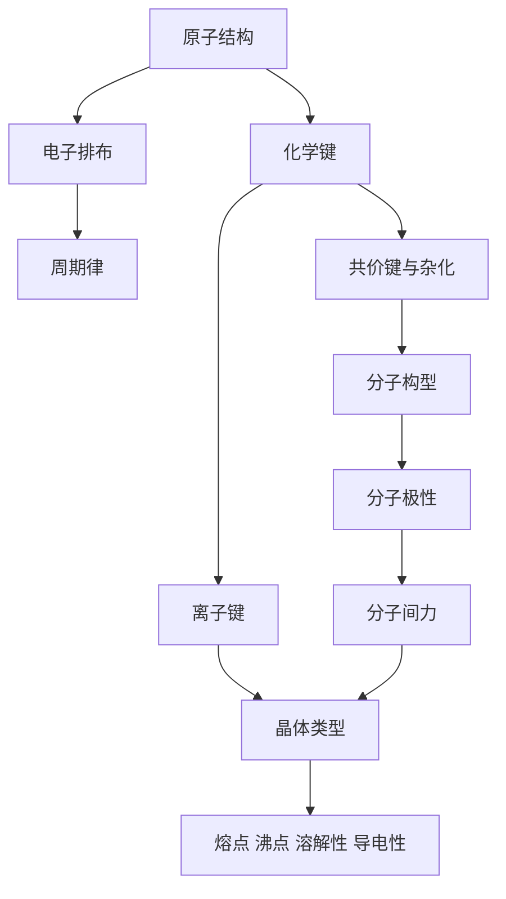

# 第 1 章：物质结构

- **难度**：★★★ | **预估学时**：2.5 小时 | **前置**：02 第 10、11 章
- **考纲位置**：原子结构、化学键、分子间力与晶体，是无机化学和分析化学的共同底座。元素性质、配位、电极电势都要用到这一章。

## 学习目标
学完本章，你能：
1. 用量子数写出指定元素的电子排布式，并解释 Cr、Cu 的“反常”；
2. 用 VSEPR 判断分子构型，再由构型反推杂化方式；
3. 比较分子极性、沸点、熔点和溶解性，说明氢键和分子间力的作用；
4. 区分四类晶体，判断导电性、硬度和熔点的大致高低。

## 一句话核心
物质的性质由“电子怎么排、原子怎么连、分子怎么堆”三层决定。做题时从结构往下推性质，不要背结论。

## 1.1 原子结构：电子住在哪里

### 1.1.1 四个量子数

描述一个电子的状态，需要四个量子数。把它们想成“宿舍地址”：

| 量子数 | 符号 | 取值 | 管什么 |
|---|---|---|---|
| 主量子数 | n | 1, 2, 3 … | 第几层，决定能量高低和离核远近 |
| 角量子数 | l | 0 到 n−1 | 第几类轨道：0=s，1=p，2=d，3=f |
| 磁量子数 | m | −l 到 +l | 轨道在空间中的取向 |
| 自旋量子数 | ms | +1/2 或 −1/2 | 电子自旋方向 |

一条轨道由 n、l、m 三个数确定，最多放 2 个电子，且自旋相反（泡利不相容原理）。

s 轨道球形，p 轨道哑铃形（三个方向 px、py、pz），d 轨道五种取向。考试常问“n=3 的轨道有几个、最多几个电子”：n=3 时有 3s、3p、3d，共 1+3+5=9 条轨道，最多 18 个电子。

### 1.1.2 电子排布三原则

1. **能量最低原理**：电子先占能量低的轨道。
2. **泡利不相容原理**：同一条轨道最多两个电子，自旋相反。
3. **洪特规则**：能量相同的轨道上，电子先单独占据，自旋平行。

能级顺序用“构造原理”记：1s < 2s < 2p < 3s < 3p < 4s < 3d < 4p < 5s < 4d < 5p < 6s < 4f < 5d < 6p。

注意 4s 在 3d 前面。原因是 4s 轨道穿透原子核附近的能力更强，能量略低。但形成离子时，先失去最外层 4s 电子，例如 Fe 排布为 [Ar]3d⁶4s²，Fe²⁺ 为 [Ar]3d⁶，不是 3d⁴4s²。

**两个常考反常**：
- Cr（Z=24）：[Ar]3d⁵4s¹，不是 3d⁴4s²。半充满 d⁵ 更稳定。
- Cu（Z=29）：[Ar]3d¹⁰4s¹，不是 3d⁹4s²。全充满 d¹⁰ 更稳定。

### 1.1.3 周期律

- **原子半径**：同周期从左到右减小（核电荷增加，引力增强）；同主族从上到下增大（电子层增加）。
- **电离能**：同周期总体增大，但 IIA 与 IIIA、VA 与 VIA 之间出现反常（半充满、全充满更稳定）。
- **电负性**：同周期从左到右增大，同主族从上到下减小。F 最大，Cs 最小（稀有气体不讨论）。
- **金属性/非金属性**：金属性从左到右减弱，非金属性增强。

考试常用“价电子构型”判断分区：s 区（IA、IIA）、p 区（IIIA–VIIIA）、d 区（IIIB–VIIIB）、ds 区（IB、IIB）、f 区（镧系、锕系）。

## 1.2 化学键：原子怎么连

### 1.2.1 离子键

活泼金属与活泼非金属之间，电子转移形成正、负离子，靠静电引力结合。离子键没有方向性和饱和性。

离子化合物的熔点与晶格能有关：电荷越高、半径越小，晶格能越大，熔点越高。例如 MgO 的熔点远高于 NaCl。

### 1.2.2 共价键与 VSEPR

共价键是原子间共用电子对。两原子电负性差不大时形成共价键；差值大时偏向离子键。键的极性看电负性差，分子的极性还要看构型是否对称。

**VSEPR（价层电子对互斥）** 的判断步骤：

1. 算中心原子的价层电子对数：
   - 电子对数 = σ 键数 + 孤对电子数。
   - 孤对数 = (中心原子价电子数 − 配位原子成键电子数之和 + 电荷)/2。
2. 电子对排布：2 对直线，3 对平面三角，4 对四面体，5 对三角双锥，6 对八面体。
3. 去掉孤对后看分子构型：孤对会压缩键角。

常见结果：

| 电子对数 | 电子对构型 | 分子构型 | 杂化 |
|---|---|---|---|
| 2 | 直线 | 直线 | sp |
| 3 | 平面三角 | 平面三角 | sp² |
| 3（1 对孤对） | 平面三角 | V 形 | sp² |
| 4 | 四面体 | 四面体 | sp³ |
| 4（1 对孤对） | 四面体 | 三角锥 | sp³ |
| 4（2 对孤对） | 四面体 | V 形 | sp³ |
| 5 | 三角双锥 | 三角双锥 | sp³d |
| 6 | 八面体 | 八面体 | sp³d² |

例子：NH₃ 中心 N 有 3 个 σ 键和 1 对孤对，电子对 4 对，sp³ 杂化，分子三角锥，键角约 107°。H₂O 有 2 对孤对，V 形，键角约 104.5°。

### 1.2.3 分子极性

键有极性不代表分子有极性。CO₂ 是直线形，两个 C=O 键极性方向相反，互相抵消，分子非极性；SO₂ 是 V 形，两个键不能抵消，分子有极性。

判断顺序：先画构型，再看键的极性向量是否抵消。对称构型（直线、平面三角、四面体、三角双锥、八面体）在配位原子相同的情况下通常非极性。

## 1.3 分子间力与晶体

### 1.3.1 分子间作用力

- **色散力**：所有分子都有，分子越大、越易变形，色散力越强。
- **诱导力**：极性分子与非极性分子之间。
- **取向力**：极性分子之间。
- **氢键**：与 N、O、F 相连的 H 与另一分子的 N、O、F 之间形成。氢键有方向性和饱和性，比分子间力强，比共价键弱。

沸点比较的一般顺序：能形成分子间氢键的 > 只有偶极作用的 > 只有色散力的；同类型分子，分子量越大，沸点越高。

例如：H₂O（氢键）沸点 100 ℃，H₂S 只有偶极作用，沸点 −60 ℃；HF 沸点 19.5 ℃，HCl 沸点 −85 ℃。

### 1.3.2 四类晶体

| 晶体 | 构成微粒 | 作用力 | 熔点 | 导电性 | 典型物质 |
|---|---|---|---|---|---|
| 离子晶体 | 正、负离子 | 离子键 | 较高 | 熔融或溶液导电 | NaCl、MgO |
| 原子晶体 | 原子 | 共价键 | 很高 | 不导电（除石墨等） | 金刚石、SiO₂ |
| 分子晶体 | 分子 | 分子间力/氢键 | 低 | 不导电 | 冰、CO₂、I₂ |
| 金属晶体 | 金属离子与自由电子 | 金属键 | 差别大 | 良导体 | Cu、Fe |

石墨是混合型晶体：层内共价键，层间范德华力，所以能导电、质软。

## 例题

### 例 1：写电子排布式

写出 Fe（Z=26）和 Fe³⁺ 的电子排布式。

解：Fe：[Ar]3d⁶4s²。失去电子时先失 4s，再失 3d，所以 Fe²⁺ 为 [Ar]3d⁶，Fe³⁺ 为 [Ar]3d⁵。

检验：3d⁵ 是半充满，稳定，这也是 Fe³⁺ 常见的原因之一。

### 例 2：判断构型与杂化

判断 SO₄²⁻ 的中心原子杂化方式和离子构型。

解：中心 S 的价电子数 6，配位原子 O 不提供成键电子，电荷 −2 使价电子数加 2。价层电子对数 = (6+2)/2 = 4，无孤对，sp³ 杂化，正四面体。

### 例 3：比较沸点

比较下列三组物质的沸点，并说明理由：
(1) CH₄ 与 H₂O；(2) HCl 与 HBr；(3) NaCl 与 I₂。

解：
(1) H₂O 有分子间氢键，CH₄ 只有色散力，H₂O 沸点高。
(2) HCl 与 HBr 都是极性分子，HBr 分子量更大、色散力更强，HBr 沸点高。
(3) NaCl 是离子晶体，I₂ 是分子晶体，NaCl 沸点高。

## 图示

看图说明：左边是“电子怎么排”，中间是“原子怎么连”，右边是“分子怎么堆”。性质题从下往上找原因，不要凭感觉。

## 常见误解
- 别以为“4s 一定比 3d 能量低，所以先填 4s，失电子也先失 4s”——填电子和失电子的顺序不同。Fe 先失 4s，但 Cr、Cu 的反常要单独记。
- 别以为“键有极性，分子就一定有极性”——CO₂、CCl₄ 的键有极性，但分子对称，整体非极性。
- 别以为“氢键是化学键”——氢键比共价键弱得多，属于分子间作用力，但会影响沸点、溶解度和生物大分子结构。
- 别以为“分子晶体一定不导电”——冰不导电，但某些分子晶体溶于水后可以导电，导电的是离子，不是分子本身。

## 自测题（答案）
1. 下列电子排布正确的是（ ）。
A. Cr [Ar]3d⁴4s² B. Cu [Ar]3d⁹4s² C. Fe³⁺ [Ar]3d⁵ D. Fe²⁺ [Ar]3d⁴4s²
（答案：C；解析：Cr 应为 3d⁵4s¹，Cu 应为 3d¹⁰4s¹，Fe²⁺ 应为 3d⁶。）

2. SO₂ 的中心原子杂化方式和分子构型是（ ）。
A. sp，直线 B. sp²，V 形 C. sp³，三角锥 D. sp²，平面三角
（答案：B；解析：S 有 1 对孤对、2 个 σ 键，电子对 3 对，sp²，V 形。）

3. 下列物质沸点最高的是（ ）。
A. CH₄ B. H₂O C. H₂S D. CO₂
（答案：B；解析：水有分子间氢键。）

4. 下列晶体中，熔融状态下能导电的是（ ）。
A. 金刚石 B. NaCl C. 冰 D. I₂
（答案：B；解析：离子晶体熔融产生自由移动的离子。）

5. 判断：电负性差值越大，形成的化学键一定越接近离子键。
（答案：不一定。还要看原子半径、极化作用等因素；BeCl₂ 等虽有较大差值，仍表现共价性。）

下面 5 题是上面 5 题的变式：考点不变，只换数据、条件或问法。先自己做，再对照解析看“变了什么”。

6. Cu 原子的基态电子排布为（ ）
   A. [Ar]3d⁹4s²  B. [Ar]3d¹⁰4s¹  C. [Ar]3d⁸4s²  D. [Ar]3d¹⁰4s²
（答案：B；解析：Cu 为 3d¹⁰4s¹ 的半充满/全充满稳定结构。变式：从 Cr 换成 Cu，反常规则相同。）

7. H₂O 分子的中心原子杂化方式和空间构型是（ ）
   A. sp²，平面三角形  B. sp³，V 形  C. sp，直线形  D. sp³，三角锥
（答案：B；解析：O 有 2 个成键电子对和 2 对孤对电子，sp³ 杂化，V 形。变式：从 SO₂ 换成 H₂O，孤对电子数不同。）

8. 下列物质中沸点最高的是（ ）
   A. HCl  B. HBr  C. HF  D. HI
（答案：C；解析：HF 分子间有氢键，沸点最高。变式：把卤化氢放在一起，先找氢键。）

9. 下列晶体中，固态能导电的是（ ）
   A. NaCl  B. 石墨  C. 金刚石  D. 冰
（答案：B；解析：石墨层内有离域电子，固态能导电；其余固态不导电。变式：把“熔融导电”改成“固态导电”。）

10. 判断：离子键一定由金属元素和非金属元素形成。
   A. 正确  B. 错误
（答案：错误；解析：错误。NH₄Cl 中 NH₄⁺ 与 Cl⁻ 之间是离子键，但没有金属元素。变式：把“电负性差值”换成“金属—非金属”。）

## 复习锚点
- 四个量子数决定轨道；电子排布先填 4s 后填 3d，失电子先失 4s。
- VSEPR 三步：算电子对、排电子对、去孤对看构型。
- 分子极性 = 键极性 + 构型对称性。
- 四类晶体按构成微粒和作用力区分，性质从结构推。
