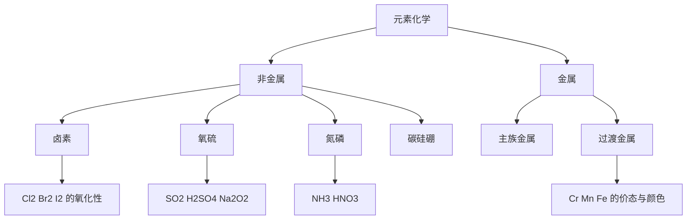

# 第 3 章：重要元素及其化合物

- **难度**：★★★ | **预估学时**：3 小时 | **前置**：03 第 1 章、02 第 8 章
- **考纲位置**：元素化学是无机部分的得分主力。考法集中在“写反应、判现象、做鉴别、比较性质”。

## 学习目标
学完本章，你能：
1. 按周期表分区说出主族元素、过渡元素的性质递变；
2. 写出卤素、氧硫、氮磷、碳硅硼的 20 个高频反应；
3. 记住常见离子和沉淀的颜色，设计简单鉴别方案；
4. 解释 Na₂O₂、Al(OH)₃、Fe³⁺/Fe²⁺ 等常考物质的特殊性质。

## 一句话核心
元素化学不靠死背，靠“价态—环境—产物”三条线：同一元素不同价态，遇到酸、碱、氧化剂、还原剂，产物不同。

## 3.1 元素在周期表中的位置

- **s 区**：IA、IIA，最外层 1–2 个电子，易失电子，金属性强。
- **p 区**：IIIA–VIIIA，非金属和部分金属，最外层 3–8 个电子。
- **d 区**：IIIB–VIIIB，过渡元素，价电子包括 d 轨道，多变价、易形成配合物、常显色。
- **ds 区**：IB、IIB，Cu、Ag、Zn、Hg 等，价电子 (n−1)d¹⁰ns¹⁻²。
- **f 区**：镧系、锕系。

同周期从左到右，金属性减弱、非金属性增强；同主族从上到下，金属性增强、非金属性减弱。这个是“性质比较题”的总依据。

## 3.2 非金属元素

### 3.2.1 卤素

**氯**：黄绿色气体，有刺激性气味，有毒。

- 与水反应：Cl₂ + H₂O ⇌ HCl + HClO。HClO 有漂白性、杀菌性。
- 与碱反应（冷、稀）：Cl₂ + 2NaOH = NaCl + NaClO + H₂O。
- 与碱反应（热、浓）：3Cl₂ + 6NaOH = 5NaCl + NaClO₃ + 3H₂O。
- 与变价金属：2Fe + 3Cl₂ = 2FeCl₃；Cu + Cl₂ = CuCl₂。
- 氯水成分：Cl₂、H₂O、HCl、HClO；久置氯水变成稀盐酸，漂白性消失。

**氟**：最活泼的非金属，与水的反应：2F₂ + 2H₂O = 4HF + O₂。HF 能腐蚀玻璃：SiO₂ + 4HF = SiF₄↑ + 2H₂O。

**溴、碘**：Br₂ 红棕色液体，I₂ 紫黑色固体，易升华。I₂ 遇淀粉变蓝，这是碘量法的指示剂原理。

卤素离子鉴别：
- Cl⁻ + AgNO₃ → AgCl↓（白），溶于氨水。
- Br⁻ + AgNO₃ → AgBr↓（淡黄），部分溶于氨水。
- I⁻ + AgNO₃ → AgI↓（黄），不溶于氨水。

### 3.2.2 氧、硫

**氧气**：支持燃烧，与大多数元素反应。实验室制法制氧：2KClO₃ = 2KCl + 3O₂（MnO₂ 催化）；2H₂O₂ = 2H₂O + O₂（MnO₂ 催化）。

**臭氧**：O₃ 强氧化性，可漂白、消毒。

**过氧化钠**：Na₂O₂ 中 O 为 −1，既是氧化剂又是还原剂。

- 与水：2Na₂O₂ + 2H₂O = 4NaOH + O₂↑。
- 与 CO₂：2Na₂O₂ + 2CO₂ = 2Na₂CO₃ + O₂。
- 与酸：Na₂O₂ + 2HCl = 2NaCl + H₂O₂，H₂O₂ 再分解。

**硫**：黄色固体，与金属反应生成硫化物。SO₂ 无色有刺激性气味，溶于水生成 H₂SO₃（弱酸，中强还原性）。

- SO₂ + H₂O ⇌ H₂SO₃。
- 2SO₂ + O₂ ⇌ 2SO₃（V₂O₅ 催化）。
- SO₂ + 2H₂S = 3S↓ + 2H₂O（SO₂ 的氧化性）。
- SO₂ 使品红溶液褪色，加热后颜色恢复；这是 SO₂ 的检验方法，区别于 Cl₂ 的永久漂白。

**硫酸**：浓硫酸有吸水性、脱水性、强氧化性。

- Cu + 2H₂SO₄（浓）= CuSO₄ + SO₂↑ + 2H₂O。
- C + 2H₂SO₄（浓）= CO₂↑ + 2SO₂↑ + 2H₂O。
- 稀硫酸与金属：Zn + H₂SO₄ = ZnSO₄ + H₂↑。

### 3.2.3 氮、磷

**氨**：无色有刺激性气味，极易溶于水，水溶液显弱碱性。

- NH₃ + H₂O ⇌ NH₃·H₂O ⇌ NH₄⁺ + OH⁻。
- NH₃ + HCl = NH₄Cl（白烟）。
- NH₄⁺ + OH⁻ = NH₃↑ + H₂O（加热）。
- 实验室制氨：2NH₄Cl + Ca(OH)₂ = CaCl₂ + 2NH₃↑ + 2H₂O。

**氮的氧化物**：
- N₂ + O₂ = 2NO（放电）。
- 2NO + O₂ = 2NO₂。
- 3NO₂ + H₂O = 2HNO₃ + NO。
- NO₂ 红棕色，NO 无色。

**硝酸**：强氧化性、酸性。

- Cu + 4HNO₃（浓）= Cu(NO₃)₂ + 2NO₂↑ + 2H₂O。
- 3Cu + 8HNO₃（稀）= 3Cu(NO₃)₂ + 2NO↑ + 4H₂O。
- 硝酸见光分解：4HNO₃ = 4NO₂↑ + O₂↑ + 2H₂O。

**磷**：白磷（P₄）剧毒、易自燃；红磷稳定。P₂O₅ 是酸性氧化物，与水反应生成磷酸。

### 3.2.4 碳、硅、硼

- CO₂ + Ca(OH)₂ = CaCO₃↓ + H₂O（检验 CO₂）。
- CO₂ + H₂O ⇌ H₂CO₃。
- SiO₂ + 4HF = SiF₄↑ + 2H₂O（刻蚀玻璃）。
- SiO₂ + 2NaOH = Na₂SiO₃ + H₂O（玻璃被碱腐蚀）。
- Na₂SiO₃ + CO₂ + H₂O = H₂SiO₃↓ + Na₂CO₃。
- 硼酸 H₃BO₃ 是一元弱酸，不是三元酸：B(OH)₃ + H₂O ⇌ B(OH)₄⁻ + H⁺。

## 3.3 金属元素

### 3.3.1 钠、镁、铝

**钠**：银白色软金属，与水剧烈反应：2Na + 2H₂O = 2NaOH + H₂↑。保存在煤油中。

**镁**：与 CO₂ 反应：2Mg + CO₂ = 2MgO + C。镁条燃烧发耀眼白光。

**铝**：表面有致密氧化膜，耐腐蚀；但内部活泼。

- 与酸：2Al + 6HCl = 2AlCl₃ + 3H₂↑。
- 与碱：2Al + 2NaOH + 2H₂O = 2NaAlO₂ + 3H₂↑。
- 铝热反应：2Al + Fe₂O₃ = Al₂O₃ + 2Fe。
- Al₂O₃ 两性：Al₂O₃ + 6H⁺ = 2Al³⁺ + 3H₂O；Al₂O₃ + 2OH⁻ + 3H₂O = 2[Al(OH)₄]⁻。
- Al(OH)₃ 两性：Al(OH)₃ + 3H⁺ = Al³⁺ + 3H₂O；Al(OH)₃ + OH⁻ = [Al(OH)₄]⁻。

### 3.3.2 铜、银、锌、汞

- Cu²⁺ 蓝色，与过量氨水生成深蓝色 [Cu(NH₃)₄]²⁺。
- CuSO₄·5H₂O 蓝色晶体，加热变白：CuSO₄·5H₂O = CuSO₄ + 5H₂O。
- Ag⁺ + Cl⁻ = AgCl↓（白）；AgCl 见光分解：2AgCl = 2Ag + Cl₂。
- Zn²⁺ 无色；Zn(OH)₂ 白色两性：Zn(OH)₂ + 2OH⁻ = [Zn(OH)₄]²⁻。
- Hg²⁺ 与过量 KI 生成 [HgI₄]²⁻，可用于鉴别。
- HgS 黑色（或红色），王水溶解：3HgS + 2HNO₃ + 12HCl = 3H₂[HgCl₄] + 3S↓ + 2NO↑ + 4H₂O。

### 3.3.3 铬、锰、铁

**铬**：
- Cr³⁺ 绿色或紫色，CrO₄²⁻ 黄色，Cr₂O₇²⁻ 橙色。
- 2CrO₄²⁻ + 2H⁺ ⇌ Cr₂O₇²⁻ + H₂O。
- 酸性条件下 Cr₂O₇²⁻ 强氧化性：Cr₂O₇²⁻ + 14H⁺ + 6e⁻ = 2Cr³⁺ + 7H₂O。
- 碱性条件下 CrO₄²⁻ 可被氧化为 CrO₄²⁻（Cr(III)→Cr(VI)）：2Cr(OH)₃ + 4OH⁻ + 3H₂O₂ = 2CrO₄²⁻ + 8H₂O。

**锰**：
- MnO₄⁻ 紫色，Mn²⁺ 浅粉色，MnO₂ 棕色。
- 酸性：MnO₄⁻ + 8H⁺ + 5e⁻ = Mn²⁺ + 4H₂O。
- 中性/弱碱性：MnO₄⁻ + 2H₂O + 3e⁻ = MnO₂↓ + 4OH⁻。
- 强碱性：MnO₄⁻ + e⁻ = MnO₄²⁻（绿色）。

**铁**：
- Fe²⁺ 浅绿色，Fe³⁺ 黄色。
- Fe³⁺ + 3SCN⁻ ⇌ Fe(SCN)₃（血红色）。
- Fe²⁺ + K₃[Fe(CN)₆] → KFe[Fe(CN)₆]↓（蓝色，滕氏蓝）。
- Fe³⁺ + K₄[Fe(CN)₆] → KFe[Fe(CN)₆]↓（蓝色，普鲁士蓝）。
- Fe³⁺ 与过量氨水：Fe(OH)₃ 红褐色沉淀，不溶于过量氨水。
- Fe²⁺ 与 OH⁻：Fe(OH)₂ 白色，迅速被氧化为灰绿，最终红褐色。

## 例题

### 例 1：写反应并说明现象

向 Na₂O₂ 固体中加水，再将产生的气体通入澄清石灰水，写出反应和现象。

解：2Na₂O₂ + 2H₂O = 4NaOH + O₂↑。产生无色气体，带火星木条复燃。通入澄清石灰水，若气体是 O₂，石灰水不变浑浊；若同时有 CO₂，才会变浑浊。这个实验说明 Na₂O₂ 与水反应放氧，不生成 CO₂。

### 例 2：鉴别 Fe²⁺ 和 Fe³⁺

设计两种方法鉴别 Fe²⁺ 和 Fe³⁺。

解：
方法一：加 KSCN 溶液，变血红色的是 Fe³⁺，无明显变化的是 Fe²⁺。
方法二：加 K₃[Fe(CN)₆] 溶液，生成蓝色沉淀的是 Fe²⁺；加 K₄[Fe(CN)₆]，生成蓝色沉淀的是 Fe³⁺。
也可用 NaOH：Fe²⁺ 生成白色沉淀，迅速变灰绿、红褐；Fe³⁺ 直接生成红褐色沉淀。

### 例 3：比较碱性

比较 NaOH、Mg(OH)₂、Al(OH)₃ 的碱性，并说明理由。

解：碱性 NaOH > Mg(OH)₂ > Al(OH)₃。同周期从左到右，金属性减弱，最高价氢氧化物的碱性减弱。Al(OH)₃ 是两性氢氧化物，既能溶于酸又能溶于强碱。

## 图示

看图说明：横轴是元素族，纵轴是“单质—氧化物—酸/碱—盐”。做题时先定价态，再定环境，最后定产物。

## 常见误解
- 别以为“Na₂O₂ 是碱性氧化物”——它是过氧化物，O 为 −1，与水反应放氧。
- 别以为“Al 不活泼”——铝表面有致密氧化膜，内部很活泼，所以既能与酸反应又能与碱反应。
- 别以为“Fe³⁺ 与过量氨水生成配合物”——Fe³⁺ 生成红褐色 Fe(OH)₃ 沉淀，不溶于过量氨水；Cu²⁺、Zn²⁺ 才能形成氨配合物。
- 别以为“SO₂ 使品红褪色和 Cl₂ 一样”——SO₂ 褪色可逆，加热恢复；Cl₂ 是氧化漂白，不可逆。

## 自测题（答案）
1. 下列物质中，O 的化合价为 −1 的是（ ）。
A. H₂O B. H₂O₂ C. O₂ D. OF₂
（答案：B；解析：H₂O₂ 中 O 为 −1，H 为 +1。）

2. 能与 NaOH 溶液反应放出氢气的是（ ）。
A. Cu B. Fe C. Al D. Ag
（答案：C；解析：Al 与强碱反应：2Al + 2NaOH + 2H₂O = 2NaAlO₂ + 3H₂↑。）

3. 鉴别 Fe³⁺ 最灵敏的试剂是（ ）。
A. NaOH B. KSCN C. HCl D. BaCl₂
（答案：B；解析：Fe³⁺ 与 SCN⁻ 生成血红色配合物。）

4. 下列反应中，SO₂ 作氧化剂的是（ ）。
A. SO₂ + H₂O B. 2SO₂ + O₂ C. SO₂ + 2H₂S D. SO₂ + NaOH
（答案：C；解析：SO₂ 中 S 为 +4，与 H₂S 反应生成 S（0），SO₂ 被还原，作氧化剂。）

5. 判断：浓硫酸与铜反应生成 SO₂，说明浓硫酸有强氧化性。
（答案：正确。Cu 被氧化为 Cu²⁺，S(+6) 被还原为 S(+4)，浓硫酸作氧化剂。）

下面 5 题是上面 5 题的变式：考点不变，只换数据、条件或问法。先自己做，再对照解析看“变了什么”。

6. 下列物质中，O 的化合价为 −1 的是（ ）
   A. H₂O  B. Na₂O₂  C. OF₂  D. CO₂
（答案：B；解析：Na₂O₂ 是过氧化物，O 为 −1；H₂O、CO₂ 中 −2，OF₂ 中 +2。变式：从 H₂O₂ 换成 Na₂O₂。）

7. 下列金属中，不与 NaOH 溶液反应放出氢气的是（ ）
   A. Al  B. Zn  C. Cu  D. Mg
（答案：C；解析：Cu 不与 NaOH 反应；Al、Zn 是两性金属，能反应放 H₂。变式：从“能反应”改成“不能反应”。）

8. 检验 Fe²⁺ 最灵敏的试剂是（ ）
   A. KSCN  B. K₃[Fe(CN)₆]  C. NaOH  D. HCl
（答案：B；解析：Fe²⁺ 与 K₃[Fe(CN)₆] 生成滕氏蓝；KSCN 主要检验 Fe³⁺。变式：从 Fe³⁺ 换成 Fe²⁺，指示剂要换。）

9. 下列反应中，SO₂ 作还原剂的是（ ）
   A. SO₂ + 2H₂S = 3S + 2H₂O  B. SO₂ + H₂O = H₂SO₃  C. SO₂ + Cl₂ + 2H₂O = H₂SO₄ + 2HCl  D. SO₂ + CaO = CaSO₃
（答案：C；解析：SO₂ 被 Cl₂ 氧化为 H₂SO₄，作还原剂；与 H₂S 反应时 SO₂ 作氧化剂。变式：从“作氧化剂”改成“作还原剂”。）

10. 判断：浓硫酸与铜反应需要加热。
   A. 正确  B. 错误
（答案：正确；解析：正确。常温下浓硫酸与铜不反应，加热才反应生成 SO₂。变式：把“能反应”改成“反应条件”。）

## 复习锚点
- 元素化学三线：价态、环境、产物。
- 卤素：Cl₂ 与冷水/热碱产物不同；I₂ 遇淀粉变蓝。
- 硫：SO₂ 可逆漂白；浓硫酸强氧化性。
- 氮：NH₃ 碱性、HNO₃ 氧化性。
- 过渡金属：Cr、Mn、Fe 的价态与颜色是鉴别题核心。
