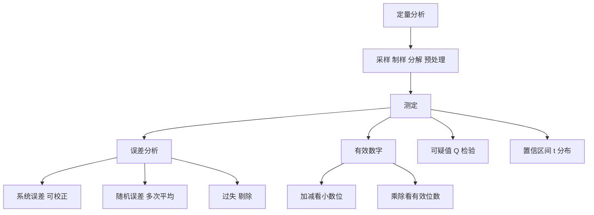

# 第 4 章：定量分析基础与误差

- **难度**：★★☆ | **预估学时**：2.5 小时 | **前置**：03 第 2 章
- **考纲位置**：分析化学的第一道关。误差、有效数字、数据处理是每次考试必考的小题，也是实验报告的基础。

## 学习目标
学完本章，你能：
1. 说出定量分析的一般程序，区分化学分析与仪器分析；
2. 区分系统误差、随机误差和过失，判断准确度与精密度；
3. 计算绝对误差、相对误差、平均偏差、标准偏差和相对标准偏差；
4. 按有效数字规则记录数据、进行加减乘除运算；
5. 用 Q 检验判断可疑值，用 t 分布给出置信区间。

## 一句话核心
误差不可避免，但可以评估和减小；数据不能随便改，只能按规则取舍。

## 4.1 定量分析在做什么

分析化学的任务分三类：
- **定性分析**：物质由什么组成。
- **定量分析**：各组分的含量是多少。
- **结构分析**：分子结构、晶体结构。

按原理分：
- **化学分析**：以化学反应为基础，如滴定分析、重量分析。
- **仪器分析**：以物理或物理化学性质为基础，如分光光度、电位分析、色谱。

按试样量分：常量（>0.1 g）、半微量（0.01–0.1 g）、微量（<0.01 g）。

定量分析的一般程序：
1. 采样：样品要有代表性。
2. 制样：粉碎、混匀、缩分。
3. 分解：酸溶、碱熔、灰化等。
4. 预处理：消除干扰、调整价态、掩蔽。
5. 测定：滴定、称量、测吸光度等。
6. 数据处理：计算含量、误差、报告。

每一步都可能引入误差。采样不具代表性，后面测得再准也没用。

## 4.2 误差的种类

### 4.2.1 系统误差

系统误差有固定方向，重复测定会重复出现。来源：
- 方法误差：反应不完全、指示剂终点与计量点不一致。
- 仪器误差：天平未校准、滴定管刻度不准。
- 试剂误差：试剂含杂质、蒸馏水不合格。
- 操作误差：读数习惯偏高、终点判断偏早。

系统误差可以校正：空白试验、对照试验、校准仪器、改进方法。

### 4.2.2 随机误差

随机误差大小和方向都不固定，由不可控的微小因素引起。服从正态分布，可以通过多次测定取平均减小。

### 4.2.3 过失

过失是操作失误，如加错试剂、读错刻度、记录错误。过失数据必须剔除，不能靠平均“救回来”。

## 4.3 准确度与精密度

- **准确度**：测定值与真实值的接近程度，用误差表示。
- **精密度**：多次测定值之间的接近程度，用偏差表示。

准确度高一定要求精密度高；精密度高不一定准确度高（可能系统误差大）。

误差计算：

$$\text{绝对误差} = x - \mu$$

$$\text{相对误差} = \frac{x-\mu}{\mu}\times100\%$$

偏差计算：

$$\bar{x} = \frac{1}{n}\sum x_i,\quad d_i = x_i - \bar{x}$$

$$\bar{d} = \frac{1}{n}\sum |d_i|$$

样本标准偏差：

$$s = \sqrt{\frac{\sum (x_i-\bar{x})^2}{n-1}}$$

相对标准偏差：

$$RSD = \frac{s}{\bar{x}}\times100\%$$

注意：总体标准偏差用 n，样本标准偏差用 n−1。分析化学里通常测的是样本，用 n−1。

## 4.4 有效数字

### 4.4.1 位数怎么数

- 非零数字都是有效数字。
- 0 在非零数字之间是有效数字，如 1.008 有 4 位。
- 0 在小数点前、非零数字前不是有效数字，如 0.0120 的 0.0 不算，1、2、0 算，共 3 位。
- 0 在小数点后、非零数字后是有效数字，如 1.200 有 4 位。
- 整数末尾的 0 含义模糊，如 1200 可能是 2、3、4 位，写成 1.2×10³（2 位）或 1.200×10³（4 位）才明确。

### 4.4.2 运算规则

- 加减：结果的小数位数与参与运算中**小数位数最少**的一致。
- 乘除：结果的有效数字位数与参与运算中**有效数字最少**的一致。
- 对数：结果的小数位数等于真数的有效数字位数。pH = 4.35 是 2 位小数，对应 [H⁺] 2 位有效数字。
- 修约：遵循“四舍六入五成双”。5 后面还有非零数字就进 1；5 后面全是 0，看前一位奇偶，偶舍奇进。

例：1.234 + 5.6 = 6.8（小数位最少 1 位）；1.234 × 5.6 = 6.9（有效数字最少 2 位）。

## 4.5 可疑值与置信区间

### 4.5.1 Q 检验

步骤：
1. 将数据从小到大排列。
2. 计算 Q = |可疑值 − 邻近值| / (最大值 − 最小值)。
3. 查 Q 表，若 Q计算 > Q表，舍弃；否则保留。

例：数据 10.10、10.12、10.15、10.60，怀疑 10.60。
Q = (10.60 − 10.15)/(10.60 − 10.10) = 0.45/0.50 = 0.90。
n=4 时 Q0.90 = 0.94（90% 置信度），0.90 < 0.94，保留。

### 4.5.2 置信区间

$$\mu = \bar{x} \pm \frac{t s}{\sqrt{n}}$$

t 由置信度和自由度 f=n−1 查表。n 越大，区间越窄；置信度越高，区间越宽。

例：测定 4 次，均值 10.20，s=0.05，查 t(95%, f=3)=3.18。
置信区间 = 10.20 ± 3.18×0.05/√4 = 10.20 ± 0.08。

## 例题

### 例 1：误差与偏差

某标准试样含铁 10.00%，测得 10.10%、10.12%、10.08%、10.10%。求平均值、绝对误差、相对误差、平均偏差、标准偏差和 RSD。

解：
平均值 = (10.10+10.12+10.08+10.10)/4 = 10.10。
绝对误差 = 10.10 − 10.00 = +0.10。
相对误差 = 0.10/10.00 × 100% = 1.0%。
偏差：0.00、+0.02、−0.02、0.00；平均偏差 = (0+0.02+0.02+0)/4 = 0.010。
s = √[(0+0.0004+0.0004+0)/(4−1)] = √0.000267 = 0.016。
RSD = 0.016/10.10 × 100% = 0.16%。

结论：精密度较好（RSD 0.16%），但准确度有 +1.0% 的系统误差。

### 例 2：有效数字

计算 (2.34 + 0.123) × 3.0，结果保留几位？

解：2.34 + 0.123 = 2.46（2 位小数，因为 2.34 只有 2 位小数）。2.46 有 3 位有效数字，3.0 有 2 位，乘法结果保留 2 位：2.46×3.0 = 7.4。

### 例 3：Q 检验

数据 1.25、1.27、1.26、1.40，问 1.40 是否应舍弃（n=4，Q0.90=0.94）。

解：Q = (1.40−1.27)/(1.40−1.25) = 0.13/0.15 = 0.87 < 0.94，保留。

## 图示

看图说明：误差分析和数据处理是两条平行线。先判断误差性质，再决定是校正、平均还是剔除。

## 常见误解
- 别以为“精密度高就一定准确”——可能所有数据都偏高，系统误差大。
- 别以为“有效数字越多越精确”——仪器的精度决定有效数字，不能凭空多写。
- 别以为“可疑值一定要删”——先做 Q 检验，不能因为“看着不顺眼”就删。
- 别以为“相对误差和相对偏差是一回事”——误差对真值，偏差对平均值。

## 自测题（答案）
1. 下列数据中，有效数字为 3 位的是（ ）。
A. 0.0120 B. 1.200 C. 1200 D. 0.1200
（答案：A；解析：0.0120 中 1、2、0 为有效数字，共 3 位；1.200 与 0.1200 都是 4 位；1200 位数模糊。）

2. 下列情况属于系统误差的是（ ）。
A. 天平未校准 B. 读数时偶尔看错 C. 加错试剂 D. 温度微小波动
（答案：A；解析：仪器未校准有固定方向，属系统误差。）

3. 测定值为 10.20，真实值为 10.00，相对误差为（ ）。
A. 0.20% B. 2.0% C. 2.0 D. 0.020%
（答案：B；解析：0.20/10.00×100%=2.0%。）

4. 计算 12.34 + 1.2，结果应写成（ ）。
A. 13.54 B. 13.5 C. 13.6 D. 14
（答案：B；解析：1.2 只有 1 位小数，结果保留 1 位小数。）

5. 判断：置信度越高，置信区间越窄。
（答案：错误。置信度越高，区间越宽；n 越大，区间越窄。）

下面 5 题是上面 5 题的变式：考点不变，只换数据、条件或问法。先自己做，再对照解析看“变了什么”。

6. 下列数据中，有效数字为 4 位的是（ ）
   A. 0.012  B. 1.20  C. 1200  D. 0.1200
（答案：D；解析：0.1200 中 1、2、0、0 都是有效数字，共 4 位；0.012 是 2 位，1.20 是 3 位，1200 位数模糊。变式：把“3 位”改成“4 位”。）

7. 下列情况属于随机误差的是（ ）
   A. 天平未校准  B. 读数时偶尔偏大  C. 试剂含杂质  D. 方法本身有缺陷
（答案：B；解析：偶然的读数偏大属于随机误差；其余是系统误差。变式：从“系统误差”改成“随机误差”。）

8. 测定值为 9.80，真实值为 10.00，相对误差为（ ）
   A. +2.0%  B. −2.0%  C. +0.2%  D. −0.2%
（答案：B；解析：相对误差=(9.80−10.00)/10.00×100%=−2.0%。变式：把测定值从偏大改成偏小，符号变负。）

9. 计算 12.34 × 1.2，结果应写成（ ）
   A. 14.8  B. 15  C. 14.81  D. 15.0
（答案：B；解析：乘除按有效数字位数最少，1.2 是 2 位，结果保留 2 位：15。变式：从加法换成乘法，规则变了。）

10. 判断：置信度越低，置信区间越窄。
   A. 正确  B. 错误
（答案：正确；解析：正确。置信度降低，要求的区间变窄；置信度越高，区间越宽。变式：把“越高”改成“越低”。）

## 复习锚点
- 误差对真值，偏差对平均值；准确度看误差，精密度看偏差。
- 系统误差可校正，随机误差可平均，过失必须剔除。
- 加减看小数位，乘除看有效位数，对数看小数位。
- Q 检验判断可疑值，t 分布给出置信区间。
