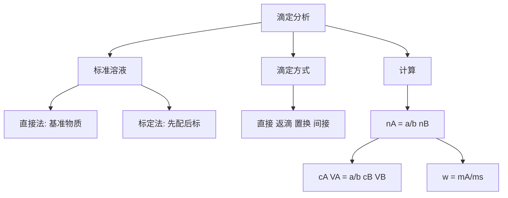

# 第 5 章：滴定分析基础

- **难度**：★★☆ | **预估学时**：2 小时 | **前置**：03 第 4 章
- **考纲位置**：滴定分析的计算题几乎每年都考。核心是“标准溶液怎么配、浓度怎么标定、结果怎么算”。

## 学习目标
学完本章，你能：
1. 说清滴定、滴定剂、化学计量点、指示剂和终点的区别；
2. 判断一个反应能否用于滴定；
3. 区分直接配制法和标定法，列举基准物质的条件；
4. 用 cV = n 和计量系数关系完成滴定计算；
5. 在物质的量浓度、滴定度、质量分数之间换算。

## 一句话核心
滴定分析就是“用已知浓度的溶液，去消耗未知量的被测物”。所有计算都回到一个等式：n(待测) 与 n(滴定剂) 的计量系数比。

## 5.1 基本概念

- **滴定**：将标准溶液从滴定管逐滴加入待测溶液，直到反应完全。
- **滴定剂**：已知准确浓度的标准溶液。
- **被测物**：待测组分。
- **化学计量点（理论终点）**：按化学计量关系恰好反应完全的点。
- **指示剂**：在计量点附近发生颜色变化的物质。
- **滴定终点**：指示剂变色时停止滴定的点。

滴定终点与化学计量点往往有微小差别，由此产生**终点误差**。指示剂选择得当，终点误差可以很小。

## 5.2 滴定反应的条件

一个反应要用于滴定，必须满足：
1. **按确定计量关系进行**，不能有副反应。
2. **反应完全**，平衡常数足够大（一般 K > 10⁸）。
3. **反应快**，或可通过加热、催化加快。
4. **有合适的指示剂**，或能用仪器判断终点。

## 5.3 滴定方式

- **直接滴定**：滴定剂直接与待测物反应。如 NaOH 滴定 HCl。
- **返滴定**：先加过量标准溶液，反应后再用另一种标准溶液滴定剩余部分。适用于反应慢、难溶物、挥发性物质。
- **置换滴定**：先用一种试剂置换出定量产物，再滴定产物。如碘量法测氧化性物质。
- **间接滴定**：待测物不能直接与滴定剂反应，先转化为可滴定的物质。

## 5.4 标准溶液

### 5.4.1 基准物质

基准物质必须满足：
- 组成与化学式完全一致，纯度 ≥99.9%；
- 稳定，不吸水、不挥发、不被空气氧化；
- 参与反应时按确定计量关系进行；
- 摩尔质量较大，减小称量误差。

常见基准物质：邻苯二甲酸氢钾（标定 NaOH）、无水碳酸钠（标定 HCl）、重铬酸钾（标定 Na₂S₂O₃）、草酸钠（标定 KMnO₄）、氯化钠（标定 AgNO₃）。

### 5.4.2 配制方法

- **直接法**：准确称量基准物质，溶解后定容。适用于基准物质本身。
- **标定法**：先配近似浓度，再用基准物质或已知浓度的标准溶液标定。NaOH、HCl、KMnO₄、Na₂S₂O₃ 都不能直接配，因为会吸收 CO₂、挥发、分解或变质。

标定要求：平行测定 3 次以上，相对偏差 ≤0.1%。

## 5.5 浓度表示与滴定度

物质的量浓度：

$$c = \frac{n}{V}$$

滴定度 T 表示每毫升滴定剂相当于多少克待测物：

$$T_{A/B} = \frac{m_A}{V_B}$$

例如 T(NaOH/HCl) = 0.004000 g/mL，表示 1 mL NaOH 标准溶液相当于 0.004000 g HCl。

滴定度与浓度换算：

$$T_{A/B} = c_B \times \frac{a}{b} \times M_A \times 10^{-3}$$

其中 a/b 是待测物与滴定剂的计量系数比，M_A 用 g/mol，V 用 mL。

## 5.6 滴定计算通式

对反应：

$$aA + bB \rightarrow cC + dD$$

待测物 A 与滴定剂 B 的物质的量关系：

$$n_A = \frac{a}{b} n_B$$

若 A、B 都取溶液体积：

$$c_A V_A = \frac{a}{b} c_B V_B$$

这是所有滴定计算的核心。注意：
- 计量系数比是 a/b，不是 b/a；
- V 的单位要统一，通常用 mL，但浓度是 mol/L，计算时换算成 L 或引入 10⁻³；
- 待测物质量 m = n_A × M_A。

质量分数：

$$w = \frac{m_A}{m_s}\times100\%$$

m_s 是试样质量。

## 例题

### 例 1：标定 NaOH

称取邻苯二甲酸氢钾（KHC₈H₄O₄，M=204.22 g/mol）0.4084 g，溶于水，用待标定的 NaOH 溶液滴定，消耗 20.00 mL。求 c(NaOH)。

解：邻苯二甲酸氢钾与 NaOH 按 1:1 反应。

$$n = \frac{0.4084}{204.22} = 2.000\times10^{-3}\ \text{mol}$$

$$c = \frac{n}{V} = \frac{2.000\times10^{-3}}{20.00\times10^{-3}} = 0.1000\ \text{mol/L}$$

### 例 2：测盐酸浓度

取盐酸 25.00 mL，用 0.1000 mol/L NaOH 滴定，终点消耗 24.00 mL。求盐酸浓度。

解：HCl + NaOH = NaCl + H₂O，1:1。

$$c(HCl) = \frac{c(NaOH)V(NaOH)}{V(HCl)} = \frac{0.1000\times24.00}{25.00} = 0.09600\ \text{mol/L}$$

### 例 3：计算质量分数

称取含 Na₂CO₃ 试样 0.2000 g，溶于水后用 0.1000 mol/L HCl 滴定，消耗 20.00 mL。求 Na₂CO₃ 的质量分数（M=106.0 g/mol）。

解：Na₂CO₃ + 2HCl = 2NaCl + H₂O + CO₂，a/b = 1/2。

$$n(Na_2CO_3) = \frac{1}{2}n(HCl) = \frac{1}{2}\times0.1000\times20.00\times10^{-3} = 1.000\times10^{-3}\ \text{mol}$$

$$m = 1.000\times10^{-3}\times106.0 = 0.1060\ \text{g}$$

$$w = \frac{0.1060}{0.2000}\times100\% = 53.00\%$$

## 图示

看图说明：左边解决“滴定剂准不准”，右边解决“结果怎么算”。两条线都离不开计量系数。

## 常见误解
- 别以为“化学计量点就是滴定终点”——计量点是理论值，终点是指示剂变色，两者有误差。
- 别以为“NaOH 可以直接配成标准溶液”——NaOH 吸水和 CO₂，必须标定。
- 别以为“计量系数比可以随便写”——必须按配平方程式的系数，a/b 的方向不能反。
- 别以为“滴定度就是浓度”——滴定度是每毫升相当于多少克待测物，单位 g/mL。

## 自测题（答案）
1. 下列物质可以直接配制标准溶液的是（ ）。
A. NaOH B. HCl C. K₂Cr₂O₇ D. KMnO₄
（答案：C；解析：K₂Cr₂O₇ 是基准物质，稳定、纯度高；其余需标定。）

2. 滴定反应要求 K 一般大于（ ）。
A. 10² B. 10⁴ C. 10⁸ D. 10¹⁰
（答案：C；解析：反应要完全，平衡常数一般要求 10⁸ 以上。）

3. 用 0.1000 mol/L NaOH 滴定 25.00 mL HCl，消耗 20.00 mL，c(HCl) 为（ ）。
A. 0.08000 B. 0.1000 C. 0.1250 D. 0.2000
（答案：A；解析：0.1000×20.00/25.00=0.08000 mol/L。）

4. Na₂CO₃ 与 HCl 的计量系数比 a/b（Na₂CO₃/HCl）是（ ）。
A. 1:1 B. 1:2 C. 2:1 D. 1:3
（答案：B；解析：Na₂CO₃ + 2HCl，1 mol Na₂CO₃ 消耗 2 mol HCl。）

5. 判断：标定标准溶液时，平行测定 3 次，相对偏差应不超过 0.1%。
（答案：正确。这是分析化学对标准溶液标定的常规要求。）

下面 5 题是上面 5 题的变式：考点不变，只换数据、条件或问法。先自己做，再对照解析看“变了什么”。

6. 下列物质中，必须标定后才能配制标准溶液的是（ ）
   A. NaCl  B. K₂Cr₂O₇  C. NaOH  D. Na₂CO₃
（答案：C；解析：NaOH 吸水和 CO₂，不能直接配；K₂Cr₂O₇、NaCl、Na₂CO₃ 可作基准物质。变式：从“可直接配”改成“必须标定”。）

7. 滴定反应要求平衡常数一般不小于（ ）
   A. 10²  B. 10⁴  C. 10⁶  D. 10⁸
（答案：D；解析：反应要完全，K 一般要求 10⁸ 以上。变式：把“大于”改成“不小于”，数值不变。）

8. 用 0.1000 mol/L NaOH 滴定 20.00 mL HCl，消耗 25.00 mL，c(HCl) 为（ ）
   A. 0.08000 mol/L  B. 0.1000 mol/L  C. 0.1250 mol/L  D. 0.2000 mol/L
（答案：C；解析：c=0.1000×25.00/20.00=0.1250 mol/L。变式：把酸、碱体积对调。）

9. H₂C₂O₄ 与 NaOH 的计量系数比 n(H₂C₂O₄):n(NaOH) 为（ ）
   A. 1:1  B. 1:2  C. 2:1  D. 1:3
（答案：B；解析：H₂C₂O₄ + 2NaOH = Na₂C₂O₄ + 2H₂O，1 mol 草酸消耗 2 mol NaOH。变式：从 Na₂CO₃/HCl 换成草酸/NaOH。）

10. 判断：标定标准溶液时，平行测定 3 次，相对偏差应不超过 0.2%。
   A. 正确  B. 错误
（答案：错误；解析：错误。常规要求相对偏差不超过 0.1%，0.2% 放宽了一倍。变式：把 0.1% 改成 0.2%。）

## 复习锚点
- 四个名词：滴定剂、计量点、指示剂、终点。
- 基准物质四条件：纯、稳、按计量反应、摩尔质量大。
- 计算核心：n_A = (a/b)n_B；c_A V_A = (a/b)c_B V_B。
- 直接法用于基准物质，标定法用于 NaOH、HCl、KMnO₄、Na₂S₂O₃。
