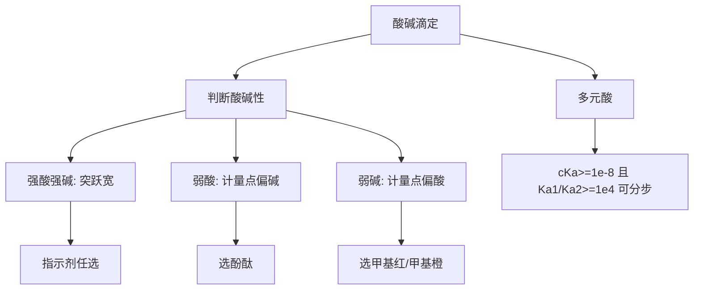

# 第 6 章：酸碱平衡与酸碱滴定

- **难度**：★★★ | **预估学时**：3 小时 | **前置**：03 第 5 章、02 第 6 章
- **考纲位置**：四大滴定之首。pH 计算、缓冲溶液、指示剂选择、混合碱测定是高频考点。

## 学习目标
学完本章，你能：
1. 用质子理论判断共轭酸碱对，写出 Ka、Kb 关系；
2. 计算强酸、弱酸、缓冲溶液、两性物质的 pH；
3. 解释滴定曲线的形状和突跃范围，选择合适的指示剂；
4. 判断一元弱酸、多元酸能否分步滴定；
5. 用双指示剂法测定混合碱，用甲醛法测定铵盐。

## 一句话核心
酸碱滴定能不能做、终点准不准，取决于“酸有多弱、浓度多大、突跃有多宽、指示剂落在哪”。

## 6.1 酸碱质子理论

**酸**是能给出质子的物质，**碱**是能接受质子的物质。给出质子后剩下的部分叫共轭碱，接受质子后叫共轭酸。

例如：HAc ⇌ H⁺ + Ac⁻，HAc 是酸，Ac⁻ 是共轭碱；NH₄⁺ ⇌ H⁺ + NH₃，NH₄⁺ 是酸，NH₃ 是共轭碱。

酸常数和碱常数：

$$K_a = \frac{[H^+][A^-]}{[HA]},\quad K_b = \frac{[BH^+][OH^-]}{[B]}$$

共轭酸碱对满足：

$$K_a \cdot K_b = K_w = 1.0\times10^{-14}\ (25℃)$$

所以酸越强，共轭碱越弱；反之亦然。

### 6.1.1 分布系数

弱酸在溶液中以 HA 和 A⁻ 两种形式存在。分布系数表示某物种占总浓度的分数：

$$\delta_{HA} = \frac{[HA]}{c},\quad \delta_{A^-} = \frac{[A^-]}{c}$$

$$\delta_{HA} = \frac{[H^+]}{[H^+]+K_a},\quad \delta_{A^-} = \frac{K_a}{[H^+]+K_a}$$

当 pH = pKa 时，δHA = δA⁻ = 0.5；pH < pKa 时，HA 为主；pH > pKa 时，A⁻ 为主。这是选择缓冲 pH 和判断指示剂变色的基础。

## 6.2 pH 计算

### 6.2.1 强酸、强碱

强酸完全电离：$[H^+] = c$，pH = −lg c。
强碱完全电离：$[OH^-] = c$，pOH = −lg c，pH = 14 − pOH。

### 6.2.2 一元弱酸、弱碱

近似式（c/Ka > 500，忽略水的电离）：

$$[H^+] = \sqrt{K_a c}$$

$$pH = \frac{1}{2}(pK_a - \lg c)$$

弱碱：

$$[OH^-] = \sqrt{K_b c}$$

例：0.10 mol/L HAc，Ka=1.8×10⁻⁵。

$$[H^+] = \sqrt{1.8\times10^{-5}\times0.10} = 1.34\times10^{-3}\ \text{mol/L}$$

pH = 2.87。

### 6.2.3 缓冲溶液

缓冲溶液由弱酸及其共轭碱（或弱碱及其共轭酸）组成。pH 用 Henderson–Hasselbalch 方程：

$$pH = pK_a + \lg\frac{[A^-]}{[HA]}$$

例：0.10 mol/L HAc 与 0.10 mol/L NaAc 等体积混合，pH = pKa = 4.74。

缓冲能力在 pH = pKa ± 1 范围内最强；总浓度越大，缓冲容量越大。

### 6.2.4 两性物质

如 NaHCO₃，既能给出质子又能接受质子。近似：

$$pH \approx \frac{1}{2}(pK_{a1} + pK_{a2})$$

例如 HCO₃⁻ 的 pKa1=6.35（H₂CO₃），pKa2=10.33（HCO₃⁻），pH ≈ 8.34。

## 6.3 酸碱滴定曲线

### 6.3.1 强酸强碱滴定

以 0.1000 mol/L NaOH 滴定 20.00 mL 0.1000 mol/L HCl 为例：

- 滴定前：pH = 1.00。
- 加入 19.98 mL（99.9%）：剩余 H⁺ 浓度约 5×10⁻⁵ mol/L，pH ≈ 4.3。
- 计量点：pH = 7.00。
- 加入 20.02 mL（100.1%）：过量 OH⁻ 约 5×10⁻⁵ mol/L，pH ≈ 9.7。

突跃范围约 pH 4.3–9.7。甲基橙（3.1–4.4）、甲基红（4.4–6.2）、酚酞（8.2–10.0）都能用，但甲基橙在 4.4 附近变色，接近突跃下端，误差稍大；实际常用酚酞或甲基红。

### 6.3.2 弱酸弱碱滴定

0.1000 mol/L NaOH 滴定 0.1000 mol/L HAc：计量点生成 NaAc，溶液显碱性，pH ≈ 8.7。突跃范围约 pH 7.7–10.7，只能选酚酞（8.2–10.0），不能选甲基橙。

强酸滴定弱碱（如 NH₃·H₂O），计量点显酸性，突跃在酸性区，选甲基红或甲基橙。

**结论**：指示剂的变色范围要落在突跃范围内，且尽量靠近计量点 pH。

### 6.3.3 多元酸的分步滴定

二元弱酸 H₂A 能分步滴定的条件：
1. 每一步的 cKa ≥ 10⁻⁸，保证反应完全；
2. Ka1/Ka2 ≥ 10⁴，保证第一步先完成，不干扰第二步。

例如 H₂C₂O₄ 的 Ka1=5.9×10⁻²，Ka2=6.4×10⁻⁵，Ka1/Ka2≈920 < 10⁴，不能分步滴定，只能一次滴到终点。

## 6.4 指示剂

酸碱指示剂是有机弱酸或弱碱，酸式和碱式颜色不同。变色范围约 pH = pKa ± 1。

常用指示剂：

| 指示剂 | 变色范围 | 酸色 | 碱色 |
|---|---|---|---|
| 甲基橙 | 3.1–4.4 | 红 | 黄 |
| 甲基红 | 4.4–6.2 | 红 | 黄 |
| 酚酞 | 8.2–10.0 | 无色 | 红 |
| 百里酚酞 | 9.4–10.6 | 无色 | 蓝 |

混合指示剂由两种指示剂混合，变色范围更窄，终点更敏锐。

## 6.5 应用

### 6.5.1 混合碱的测定（双指示剂法）

混合碱可能含 NaOH、Na₂CO₃、NaHCO₃。

- 第一步：加酚酞，用 HCl 滴定到红色消失。此时 NaOH 全部被中和，Na₂CO₃ 只被中和到 NaHCO₃：
  - NaOH + HCl = NaCl + H₂O
  - Na₂CO₃ + HCl = NaHCO₃ + NaCl
- 第二步：加甲基橙，继续用 HCl 滴定到黄色变橙红。此时 NaHCO₃ 全部变成 CO₂：
  - NaHCO₃ + HCl = NaCl + H₂O + CO₂↑

设第一步消耗 V₁，第二步消耗 V₂（均指同一浓度 HCl）：
- 若只有 Na₂CO₃：V₁ = V₂。
- 若只有 NaHCO₃：V₁ = 0，V₂ > 0。
- 若 NaOH + Na₂CO₃：V₁ > V₂。
- 若 Na₂CO₃ + NaHCO₃：V₂ > V₁。

### 6.5.2 铵盐的测定（甲醛法）

NH₄⁺ 是弱酸，不能直接用 NaOH 滴定。加入甲醛，生成六亚甲基四胺和定量的 H⁺：

$$4NH_4^+ + 6HCHO \rightarrow (CH_2)_6N_4H^+ + 3H^+ + 6H_2O$$

再用 NaOH 滴定生成的 H⁺，用酚酞指示。1 mol NH₄⁺ 相当于 1 mol H⁺（按计量关系换算）。

### 6.5.3 非水滴定

弱酸弱碱在水溶液中突跃不明显，可改用非水溶剂。非水滴定能增强酸碱性、扩大突跃，常用于药物分析。

## 例题

### 例 1：弱酸 pH

计算 0.050 mol/L HAc 的 pH（Ka=1.8×10⁻⁵）。

解：

$$[H^+] = \sqrt{1.8\times10^{-5}\times0.050} = 9.49\times10^{-4}$$

pH = 3.02。

检验近似条件：c/Ka = 0.050/1.8×10⁻⁵ = 2778 > 500，近似成立。

### 例 2：缓冲溶液

将 0.20 mol/L HAc 和 0.10 mol/L NaAc 等体积混合，求 pH（pKa=4.74）。

解：等体积混合后浓度减半，但比值不变：

$$pH = 4.74 + \lg\frac{0.10}{0.20} = 4.74 - 0.30 = 4.44$$

### 例 3：混合碱判断

某混合碱用双指示剂法测定，酚酞终点消耗 HCl V₁=15.00 mL，甲基橙终点又消耗 V₂=10.00 mL。判断组成。

解：V₁ > V₂，说明第一步除中和 NaOH 外，还把部分 Na₂CO₃ 变成 NaHCO₃；第二步只中和 NaHCO₃。组成是 NaOH + Na₂CO₃。

设 NaOH 消耗 x，Na₂CO₃ 消耗 y（第一步），则：
x + y = 15.00，y = 10.00，所以 x = 5.00。NaOH 与 Na₂CO₃ 的物质的量比为 5:10 = 1:2。

## 图示

看图说明：先判断计量点的酸碱性，再选指示剂。不要背“酚酞一定行”或“甲基橙一定行”。

## 常见误解
- 别以为“弱酸滴定到计量点时 pH=7”——弱酸强碱滴定的计量点生成弱酸强碱盐，水解显碱性。
- 别以为“指示剂变色范围越宽越好”——越宽终点越不敏锐，应选变色范围窄、靠近计量点的。
- 别以为“多元酸一定能分步滴定”——必须同时满足 cKa 和 Ka1/Ka2 两个条件。
- 别以为“缓冲溶液 pH 不随稀释改变”——稀释时 [A⁻]/[HA] 不变，pH 基本不变，但缓冲容量下降。

## 自测题（答案）
1. 0.10 mol/L HAc（Ka=1.8×10⁻⁵）的 pH 约为（ ）。
A. 1.00 B. 2.87 C. 4.74 D. 7.00
（答案：B；解析：sqrt(1.8×10⁻⁶)=1.34×10⁻³，pH=2.87。）

2. 强酸滴定弱碱，计量点显（ ）。
A. 酸性 B. 中性 C. 碱性 D. 无法判断
（答案：A；解析：生成强酸弱碱盐，阳离子水解显酸性。）

3. 下列指示剂适合强酸强碱滴定的是（ ）。
A. 酚酞 B. 甲基橙 C. 甲基红 D. 都可以
（答案：D；解析：强酸强碱突跃宽，三种指示剂都能用。）

4. 二元弱酸分步滴定的条件是（ ）。
A. cKa ≥ 10⁻⁸ 且 Ka1/Ka2 ≥ 10⁴ B. cKa ≥ 10⁻⁶ 且 Ka1/Ka2 ≥ 10² C. 只要 Ka1 > Ka2 D. 只要浓度大
（答案：A；解析：两步都要完全，且第一步与第二步差别足够大。）

5. 双指示剂法测定混合碱，V₁ > V₂，组成可能是（ ）。
A. Na₂CO₃ B. NaHCO₃ C. NaOH + Na₂CO₃ D. Na₂CO₃ + NaHCO₃
（答案：C；解析：V₁ > V₂ 说明有 NaOH，且部分 Na₂CO₃ 在第一步被中和到 NaHCO₃。）

下面 5 题是上面 5 题的变式：考点不变，只换数据、条件或问法。先自己做，再对照解析看“变了什么”。

6. 0.010 mol/L HAc（Ka=1.8×10⁻⁵）的 pH 约为（ ）
   A. 2.87  B. 3.37  C. 4.74  D. 2.37
（答案：B；解析：[H⁺]=√(1.8×10⁻⁷)=4.24×10⁻⁴，pH=3.37。变式：浓度从 0.10 降到 0.010。）

7. 强碱滴定弱酸，计量点显（ ）
   A. 酸性  B. 中性  C. 碱性  D. 无法判断
（答案：C；解析：生成弱酸强碱盐，酸根水解显碱性。变式：把“强酸滴定弱碱”反过来。）

8. 强酸滴定弱碱，计量点附近应选（ ）
   A. 酚酞  B. 甲基橙  C. 百里酚酞  D. 石蕊
（答案：B；解析：计量点显酸性，突跃在酸性区，选甲基橙或甲基红。变式：把“强碱滴定弱酸”反过来。）

9. H₂C₂O₄ 的 Ka₁=5.9×10⁻²、Ka₂=6.4×10⁻⁵，用 NaOH 滴定可（ ）
   A. 一步滴定到第二计量点  B. 两步分别滴定  C. 只有第一步可滴定  D. 不能滴定
（答案：A；解析：Ka₁/Ka₂≈920<10⁴，不能分步；cKa₂ 足够，可一次滴到第二计量点。变式：把 H₃PO₄ 换回草酸，先算 Ka 比值。）

10. 双指示剂法测定混合碱，V₁ < V₂，组成可能是（ ）
   A. NaOH  B. Na₂CO₃  C. NaOH+Na₂CO₃  D. Na₂CO₃+NaHCO₃
（答案：D；解析：V₁<V₂ 说明第二步有额外的 NaHCO₃，组成为 Na₂CO₃+NaHCO₃。变式：把 V₁>V₂ 改成 V₁<V₂。）

## 复习锚点
- Ka·Kb = Kw；酸越强，共轭碱越弱。
- 弱酸 pH = 1/2(pKa − lg c)；缓冲 pH = pKa + lg([A⁻]/[HA])。
- 指示剂变色范围要落在突跃内，靠近计量点。
- 混合碱：V₁ > V₂ 含 NaOH；V₂ > V₁ 含 NaHCO₃；V₁ = V₂ 只有 Na₂CO₃。
