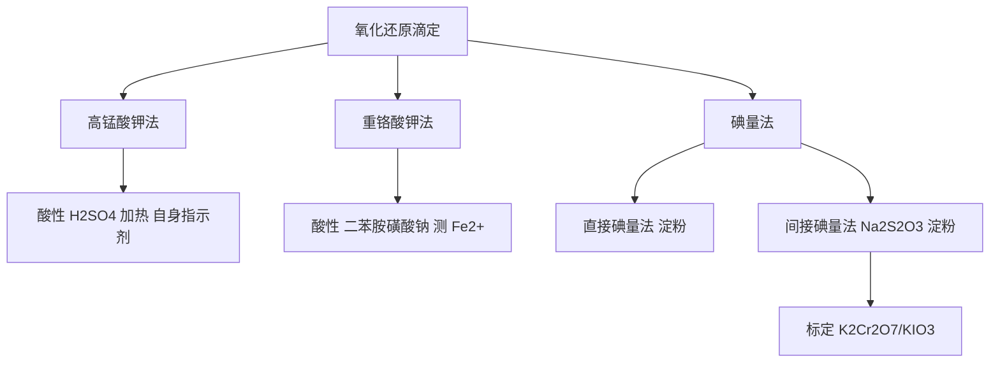

# 第 9 章：氧化还原滴定法

- **难度**：★★★★ | **预估学时**：3 小时 | **前置**：03 第 8 章
- **考纲位置**：四大滴定之一。高锰酸钾法、重铬酸钾法、碘量法的条件、指示剂和计算是必考点。

## 学习目标
学完本章，你能：
1. 说出氧化还原滴定对反应的要求和滴定曲线的特点；
2. 写出高锰酸钾法、重铬酸钾法、碘量法的核心反应；
3. 选择指示剂，说明为什么高锰酸钾法不能用盐酸酸化；
4. 用电子守恒完成氧化还原滴定的计算；
5. 解释碘量法的直接法和间接法，以及淀粉指示剂的使用时机。

## 一句话核心
氧化还原滴定算的是电子：n(氧化剂)×每个分子得电子数 = n(还原剂)×每个分子失电子数。

## 9.1 氧化还原滴定的特点

氧化还原滴定以氧化还原反应为基础。滴定剂是氧化剂或还原剂，待测物是还原剂或氧化剂。

反应要求：
- 平衡常数足够大（一般 K > 10⁶），反应完全；
- 反应速率快，慢反应要加热、催化或返滴定；
- 有合适的指示剂或仪器终点；
- 避免副反应和诱导反应。

滴定曲线是电势—滴定体积曲线。计量点附近电势突跃，突跃范围由两个电对的 E° 决定。两个电对的 E° 差越大，突跃越宽，终点越容易判断。

## 9.2 高锰酸钾法

### 9.2.1 特点

KMnO₄ 是强氧化剂，酸性条件下还原为 Mn²⁺：

$$MnO_4^- + 8H^+ + 5e^- \rightarrow Mn^{2+} + 4H_2O\quad E^\circ=1.51\ V$$

优点：氧化性强，可测多种还原性物质；自身呈紫红色，过量半滴即可显粉红色，可作自身指示剂。

缺点：KMnO₄ 不稳定，易分解，必须标定；选择性差；不能用于盐酸介质（Cl⁻ 会被氧化）。

### 9.2.2 条件

- 强酸性：用 H₂SO₄ 酸化，不用 HCl、HNO₃。
- 温度：常温下反应慢，通常加热到 70–80℃ 滴定。
- 滴定速度：先慢后快，第一滴褪色后再加快，避免过量 KMnO₄ 分解。
- 终点：微过量 KMnO₄ 呈粉红色，30 秒不褪色。

### 9.2.3 标定

基准物质：Na₂C₂O₄（草酸钠）或 H₂C₂O₄·2H₂O。

$$2MnO_4^- + 5C_2O_4^{2-} + 16H^+ \rightarrow 2Mn^{2+} + 10CO_2\uparrow + 8H_2O$$

计量关系：2 mol MnO₄⁻ 对应 5 mol C₂O₄²⁻。

### 9.2.4 应用

- 测 H₂O₂：2MnO₄⁻ + 5H₂O₂ + 6H⁺ → 2Mn²⁺ + 5O₂↑ + 8H₂O。
- 测 Fe²⁺：MnO₄⁻ + 5Fe²⁺ + 8H⁺ → Mn²⁺ + 5Fe³⁺ + 4H₂O。
- 测 Ca²⁺：先沉淀为 CaC₂O₄，再用 KMnO₄ 滴定草酸根（间接法）。

## 9.3 重铬酸钾法

K₂Cr₂O₇ 是强氧化剂，酸性条件下还原为 Cr³⁺：

$$Cr_2O_7^{2-} + 14H^+ + 6e^- \rightarrow 2Cr^{3+} + 7H_2O\quad E^\circ=1.33\ V$$

优点：K₂Cr₂O₇ 稳定，可直接配制标准溶液；可在盐酸介质中滴定（Cl⁻ 不被氧化）；选择性比 KMnO₄ 好。

缺点：E° 比 KMnO₄ 低，氧化能力稍弱；本身颜色变化不明显，需要指示剂。

常用指示剂：二苯胺磺酸钠（终点由无色变紫红）。

测 Fe²⁺：

$$Cr_2O_7^{2-} + 6Fe^{2+} + 14H^+ \rightarrow 2Cr^{3+} + 6Fe^{3+} + 7H_2O$$

计量关系：1 mol Cr₂O₇²⁻ 对应 6 mol Fe²⁺。

## 9.4 碘量法

碘量法基于 I₂ 的氧化性和 I⁻ 的还原性。

$$I_2 + 2e^- \rightleftharpoons 2I^-\quad E^\circ=0.54\ V$$

### 9.4.1 直接碘量法

用 I₂ 标准溶液直接滴定还原性物质，如维生素 C、SO₂、S²⁻。

指示剂：淀粉。淀粉遇 I₂ 变蓝，终点为蓝色出现。

注意：淀粉指示剂应在滴定到接近终点时加入，过早加入会吸附 I₂，导致误差。

### 9.4.2 间接碘量法

先让待测氧化性物质氧化 I⁻，生成定量 I₂，再用 Na₂S₂O₃ 标准溶液滴定 I₂。

$$I_2 + 2S_2O_3^{2-} \rightarrow 2I^- + S_4O_6^{2-}$$

指示剂：淀粉。终点为蓝色消失。

适用：Cu²⁺、H₂O₂、Cl₂、MnO₄⁻等氧化性物质。

### 9.4.3 Na₂S₂O₃ 的标定

Na₂S₂O₃ 不稳定，需标定。常用基准物质：K₂Cr₂O₇、KIO₃。

K₂Cr₂O₇ 与 KI 在酸性条件下反应：

$$Cr_2O_7^{2-} + 6I^- + 14H^+ \rightarrow 2Cr^{3+} + 3I_2 + 7H_2O$$

生成的 I₂ 用 Na₂S₂O₃ 滴定。1 mol Cr₂O₇²⁻ 对应 3 mol I₂，对应 6 mol S₂O₃²⁻。

### 9.4.4 误差来源

- I₂ 挥发：应低温、避光、快速滴定，使用碘量瓶。
- I⁻ 被空气氧化：酸性条件下更明显，避免长时间放置。
- 淀粉加入过早：吸附 I₂，终点拖后。
- 指示剂灵敏度：淀粉在 5×10⁻⁶ mol/L I₂ 时才显蓝色。

## 9.5 亚硝酸钠法

NaNO₂ 在酸性条件下生成 HNO₂，可与芳香伯胺发生重氮化反应：

$$Ar-NH_2 + NaNO_2 + 2HCl \rightarrow Ar-N_2^+Cl^- + NaCl + 2H_2O$$

用于测定磺胺类药物。指示剂：淀粉—KI 试纸，终点时过量 HNO₂ 氧化 I⁻ 生成 I₂，遇淀粉变蓝。

## 例题

### 例 1：标定 KMnO₄

称取 Na₂C₂O₄ 0.1340 g，溶于水，酸化后用 KMnO₄ 滴定，消耗 20.00 mL。求 c(KMnO₄)。M(Na₂C₂O₄)=134.0 g/mol。

解：

$$n(C_2O_4^{2-}) = \frac{0.1340}{134.0} = 1.000\times10^{-3}\ \text{mol}$$

$$n(MnO_4^-) = \frac{2}{5}n(C_2O_4^{2-}) = 4.000\times10^{-4}\ \text{mol}$$

$$c = \frac{4.000\times10^{-4}}{20.00\times10^{-3}} = 0.02000\ \text{mol/L}$$

### 例 2：测 H₂O₂

取 H₂O₂ 试样 1.000 g，稀释后用 0.02000 mol/L KMnO₄ 滴定，消耗 25.00 mL。求 H₂O₂ 的质量分数。M(H₂O₂)=34.02 g/mol。

解：

$$n(MnO_4^-) = 0.02000\times25.00\times10^{-3} = 5.000\times10^{-4}\ \text{mol}$$

$$n(H_2O_2) = \frac{5}{2}n(MnO_4^-) = 1.250\times10^{-3}\ \text{mol}$$

$$m = 1.250\times10^{-3}\times34.02 = 0.04253\ \text{g}$$

$$w = \frac{0.04253}{1.000}\times100\% = 4.253\%$$

### 例 3：碘量法测铜

称取铜合金 0.2000 g，溶解后调节条件，加入过量 KI，析出的 I₂ 用 0.1000 mol/L Na₂S₂O₃ 滴定，消耗 20.00 mL。求铜的质量分数。M(Cu)=63.55 g/mol。

解：2Cu²⁺ + 4I⁻ → 2CuI↓ + I₂；I₂ + 2S₂O₃²⁻ → 2I⁻ + S₄O₆²⁻。

计量关系：1 mol Cu²⁺ 对应 1 mol S₂O₃²⁻。

$$n(Cu) = 0.1000\times20.00\times10^{-3} = 2.000\times10^{-3}\ \text{mol}$$

$$m = 2.000\times10^{-3}\times63.55 = 0.1271\ \text{g}$$

$$w = \frac{0.1271}{0.2000}\times100\% = 63.55\%$$

## 图示

看图说明：三条分支对应三类滴定剂。先记条件和指示剂，再记计量关系。

## 常见误解
- 别以为“KMnO₄ 可以在盐酸中滴定”——Cl⁻ 会被 MnO₄⁻ 氧化，消耗滴定剂，必须用 H₂SO₄。
- 别以为“淀粉指示剂一开始就加最好”——过早加入会吸附 I₂，终点拖后，应接近终点再加。
- 别以为“K₂Cr₂O₇ 法不需要指示剂”——Cr³⁺ 绿色变化不明显，需要二苯胺磺酸钠。
- 别以为“碘量法只能测还原性物质”——直接法测还原性物质，间接法可测氧化性物质。

## 自测题（答案）
1. KMnO₄ 滴定不能在（ ）介质中进行。
A. H₂SO₄ B. HCl C. H₃PO₄ D. 水
（答案：B；解析：Cl⁻ 会被 KMnO₄ 氧化。）

2. 碘量法常用的指示剂是（ ）。
A. 酚酞 B. 甲基橙 C. 淀粉 D. 铬黑 T
（答案：C；解析：淀粉遇 I₂ 变蓝。）

3. 用 Na₂C₂O₄ 标定 KMnO₄，n(MnO₄⁻):n(C₂O₄²⁻) 为（ ）。
A. 1:1 B. 2:5 C. 5:2 D. 1:2
（答案：B；解析：2MnO₄⁻ 对应 5C₂O₄²⁻。）

4. 间接碘量法测 Cu²⁺，1 mol Cu²⁺ 对应 Na₂S₂O₃ 的物质的量为（ ）。
A. 0.5 B. 1 C. 2 D. 3
（答案：B；解析：2Cu²⁺ 生成 1I₂，1I₂ 消耗 2S₂O₃²⁻，所以 1Cu²⁺ 对应 1S₂O₃²⁻。）

5. 判断：K₂Cr₂O₇ 可以直接配制标准溶液。
（答案：正确。K₂Cr₂O₇ 纯度高、稳定，是基准物质。）

下面 5 题是上面 5 题的变式：考点不变，只换数据、条件或问法。先自己做，再对照解析看“变了什么”。

6. KMnO₄ 法常用的酸化剂是（ ）
   A. HCl  B. HNO₃  C. H₂SO₄  D. HAc
（答案：C；解析：用 H₂SO₄；HCl 中 Cl⁻ 会被氧化，HNO₃ 本身有氧化性。变式：从“不能用什么”改成“用什么”。）

7. K₂Cr₂O₇ 法常用的指示剂是（ ）
   A. 淀粉  B. 二苯胺磺酸钠  C. 酚酞  D. 铬黑 T
（答案：B；解析：K₂Cr₂O₇ 法用二苯胺磺酸钠，终点无色变紫红。变式：从碘量法换成重铬酸钾法。）

8. 用 K₂Cr₂O₇ 滴定 Fe²⁺，n(Cr₂O₇²⁻):n(Fe²⁺) 为（ ）
   A. 1:1  B. 1:3  C. 1:6  D. 6:1
（答案：C；解析：Cr₂O₇²⁻ + 6Fe²⁺ + 14H⁺ = 2Cr³⁺ + 6Fe³⁺ + 7H₂O，1:6。变式：从 MnO₄⁻/C₂O₄²⁻ 换成 Cr₂O₇²⁻/Fe²⁺。）

9. 间接碘量法测 H₂O₂，1 mol H₂O₂ 对应 Na₂S₂O₃ 的物质的量为（ ）
   A. 1 mol  B. 2 mol  C. 3 mol  D. 4 mol
（答案：B；解析：H₂O₂ 氧化 2I⁻ 生成 1I₂，1I₂ 消耗 2S₂O₃²⁻，所以 1:2。变式：从 Cu²⁺ 换成 H₂O₂。）

10. 判断：Na₂S₂O₃ 可以直接配制标准溶液。
   A. 正确  B. 错误
（答案：错误；解析：错误。Na₂S₂O₃ 不稳定，需用 K₂Cr₂O₇ 或 KIO₃ 标定。变式：把 K₂Cr₂O₇ 换成 Na₂S₂O₃。）

## 复习锚点
- KMnO₄：酸性 H₂SO₄、加热、自身指示剂、先慢后快。
- K₂Cr₂O₇：酸性、二苯胺磺酸钠、测 Fe²⁺、1:6。
- 碘量法：直接法测还原剂，间接法测氧化剂；淀粉近终点加入。
- 计算核心：电子守恒，按半反应确定 n。
