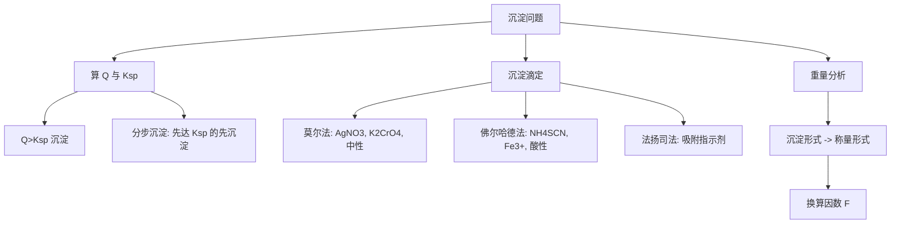

# 第 10 章：沉淀溶解平衡、沉淀滴定与重量分析

- **难度**：★★★ | **预估学时**：3 小时 | **前置**：03 第 6 章
- **考纲位置**：Ksp 计算、分步沉淀、三种沉淀滴定法、重量分析换算因数，都是高频考点。

## 学习目标
学完本章，你能：
1. 写 Ksp 表达式，由 Ksp 算溶解度，考虑同离子效应和盐效应；
2. 判断分步沉淀顺序，解释沉淀转化；
3. 说出莫尔法、佛尔哈德法、法扬司法的条件、指示剂和适用范围；
4. 区分沉淀形式与称量形式，计算重量分析的换算因数和含量；
5. 解释共沉淀、后沉淀及其对结果的影响。

## 一句话核心
沉淀问题先算离子积 Q，再和 Ksp 比：Q > Ksp 才沉淀；两种离子共存时，先达到 Ksp 的先沉淀。

## 10.1 溶度积

对难溶电解质：

$$A_mB_n(s) \rightleftharpoons mA^{n+} + nB^{m-}$$

$$K_{sp} = [A^{n+}]^m[B^{m-}]^n$$

Ksp 只与温度有关，与离子浓度无关。

### 10.1.1 溶解度与 Ksp

对 AB 型（如 AgCl）：

$$s = \sqrt{K_{sp}}$$

对 A₂B 型（如 Ag₂CrO₄）：

$$K_{sp} = (2s)^2 s = 4s^3,\quad s = \sqrt[3]{K_{sp}/4}$$

对 AB₂ 型同理：Ksp = 4s³。

注意：不同类型的 Ksp 不能直接比溶解度，必须换算成 s 再比。

### 10.1.2 同离子效应与盐效应

**同离子效应**：加入含有相同离子的强电解质，平衡逆向移动，溶解度降低。

例：AgCl 在 0.10 mol/L NaCl 中的溶解度：

$$s = \frac{K_{sp}}{[Cl^-]} = \frac{1.8\times10^{-10}}{0.10} = 1.8\times10^{-9}\ \text{mol/L}$$

比纯水中（1.34×10⁻⁵）小很多。

**盐效应**：加入不含相同离子的强电解质，离子强度增大，活度降低，溶解度略有增大。盐效应通常较小，同离子效应为主。

### 10.1.3 分步沉淀

溶液中同时含 Cl⁻ 和 I⁻，逐滴加 AgNO₃。AgI 的 Ksp（8.5×10⁻¹⁷）远小于 AgCl（1.8×10⁻¹⁰），所以 AgI 先沉淀。当 [Ag⁺] 达到 AgCl 的 Ksp/[Cl⁻] 时，AgCl 才开始沉淀。

判断顺序：比较各离子开始沉淀所需的 [沉淀剂] 浓度，所需浓度小的先沉淀。

### 10.1.4 沉淀转化

Ksp 大的沉淀可以转化为 Ksp 小的沉淀。例如：

$$AgCl(s) + I^- \rightarrow AgI(s) + Cl^-$$

Ksp(AgI) 更小，平衡向右。转化程度由两者 Ksp 之比决定。

## 10.2 沉淀滴定法

### 10.2.1 莫尔法（Mohr）

用 AgNO₃ 标准溶液滴定 Cl⁻，K₂CrO₄ 作指示剂。

$$Ag^+ + Cl^- \rightarrow AgCl\downarrow\ (\text{白})$$

终点时过量 Ag⁺ 与 CrO₄²⁻ 生成 Ag₂CrO₄ 砖红色沉淀：

$$2Ag^+ + CrO_4^{2-} \rightarrow Ag_2CrO_4\downarrow\ (\text{砖红})$$

条件：
- 中性或弱碱性，pH 6.5–10.5。
- 酸性太强：CrO₄²⁻ 转化为 Cr₂O₇²⁻，灵敏度下降。
- 碱性太强：Ag⁺ 生成 Ag₂O 沉淀。
- 不能有与 Ag⁺ 生成沉淀的阴离子（如 PO₄³⁻、S²⁻）。

适用：Cl⁻、Br⁻，不适用于 I⁻（AgI 吸附 I⁻，终点不准）。

### 10.2.2 佛尔哈德法（Volhard）

用 NH₄SCN 标准溶液滴定 Ag⁺，铁铵矾作指示剂，酸性条件下进行。

$$Ag^+ + SCN^- \rightarrow AgSCN\downarrow\ (\text{白})$$

终点时过量 SCN⁻ 与 Fe³⁺ 生成血红色配合物：

$$Fe^{3+} + SCN^- \rightleftharpoons FeSCN^{2+}\ (\text{红})$$

测 Cl⁻ 时用返滴定：先加过量 AgNO₃，再用 SCN⁻ 滴定剩余 Ag⁺。AgCl 的溶解度比 AgSCN 大，滴定过程中 AgCl 会转化为 AgSCN，使结果偏低。可加硝基苯或过滤除去 AgCl。

适用：酸性溶液，测 Ag⁺、Cl⁻、Br⁻、I⁻、SCN⁻。

### 10.2.3 法扬司法（Fajans）

用吸附指示剂，如荧光黄、曙红。滴定过程中 AgCl 沉淀吸附指示剂，终点时颜色改变。

条件：
- 沉淀要胶体状，有较大表面积；
- 控制 pH，使指示剂以阴离子形式存在；
- 避光，防止 AgCl 见光分解。

适用：Cl⁻、Br⁻、I⁻，常用荧光黄测 Cl⁻（pH 7–10）。

## 10.3 重量分析法

### 10.3.1 沉淀形式与称量形式

- **沉淀形式**：沉淀剂与待测物反应生成的沉淀，如 AgCl、BaSO₄、Fe(OH)₃。
- **称量形式**：沉淀经过滤、洗涤、烘干或灼烧后，实际称量的物质。可能与沉淀形式相同（AgCl、BaSO₄），也可能不同（Fe(OH)₃ 灼烧后为 Fe₂O₃）。

对称量形式的要求：组成固定、性质稳定、摩尔质量大（减小称量误差）。

### 10.3.2 换算因数

$$F = \frac{a \times M(\text{待测物})}{b \times M(\text{称量形式})}$$

a、b 是配平后待测物与称量形式的计量系数。

待测物质量：

$$m = m_{\text{称量}} \times F$$

质量分数：

$$w = \frac{m}{m_s}\times100\%$$

例：由 Fe₂O₃ 称量形式求 Fe 的含量，F = 2M(Fe)/M(Fe₂O₃)。

### 10.3.3 沉淀条件

- **稀**：沉淀剂缓慢加入，降低过饱和度。
- **热**：加热促进晶核生长，减少晶形缺陷。
- **慢**：缓慢滴加，搅拌。
- **搅**：防止局部过浓。
- **陈化**：沉淀放置一段时间，小晶体溶解、大晶体长大，减少杂质吸附。

### 10.3.4 共沉淀与后沉淀

- **共沉淀**：沉淀时，某些可溶性杂质被沉淀吸附、夹带或混晶，一起沉淀下来。如 BaSO₄ 吸附 Fe³⁺。
- **后沉淀**：沉淀放置后，某些杂质在沉淀表面继续沉淀。如 CaC₂O₄ 放置后吸附 MgC₂O₄。

减少方法：洗涤、重结晶、陈化、加掩蔽剂、控制 pH。

## 例题

### 例 1：由 Ksp 算溶解度

已知 Ksp(Ag₂CrO₄)=1.1×10⁻¹²，求其溶解度 s（mol/L）。

解：Ag₂CrO₄ ⇌ 2Ag⁺ + CrO₄²⁻，[Ag⁺]=2s，[CrO₄²⁻]=s。

$$K_{sp} = (2s)^2 s = 4s^3 = 1.1\times10^{-12}$$

$$s = \sqrt[3]{1.1\times10^{-12}/4} = 6.5\times10^{-5}\ \text{mol/L}$$

### 例 2：分步沉淀

溶液含 0.10 mol/L Cl⁻ 和 0.10 mol/L I⁻，逐滴加 AgNO₃。哪种先沉淀？当第二种开始沉淀时，第一种离子的浓度是多少？

解：AgI 的 Ksp=8.5×10⁻¹⁷，AgCl 的 Ksp=1.8×10⁻¹⁰。

AgI 开始沉淀所需 [Ag⁺] = 8.5×10⁻¹⁷/0.10 = 8.5×10⁻¹⁶ mol/L。
AgCl 开始沉淀所需 [Ag⁺] = 1.8×10⁻¹⁰/0.10 = 1.8×10⁻⁹ mol/L。
AgI 先沉淀。

当 AgCl 开始沉淀时，[Ag⁺]=1.8×10⁻⁹，此时 [I⁻]=Ksp(AgI)/[Ag⁺]=8.5×10⁻¹⁷/1.8×10⁻⁹=4.7×10⁻⁸ mol/L。I⁻ 已基本沉淀完全。

### 例 3：重量分析换算

称取试样 0.5000 g，沉淀为 Fe(OH)₃，灼烧后称得 Fe₂O₃ 0.1200 g。求试样中 Fe 的质量分数。M(Fe)=55.85，M(Fe₂O₃)=159.7。

解：F = 2×55.85/159.7 = 0.6994。

m(Fe)=0.1200×0.6994=0.08393 g。
w=0.08393/0.5000×100%=16.79%。

## 图示

看图说明：左边是沉淀平衡，中间是三种滴定，右边是重量分析。三者共同点是“先判断沉淀是否生成，再算量”。

## 常见误解
- 别以为“Ksp 越小溶解度一定越小”——不同类型要换算成 s 才能比。
- 别以为“同离子效应和盐效应可以忽略一个”——同离子效应通常为主，但盐效应也会使溶解度略增。
- 别以为“莫尔法可以在强酸或强碱中进行”——pH 必须 6.5–10.5。
- 别以为“沉淀形式就是称量形式”——Fe(OH)₃ 灼烧后称量的是 Fe₂O₃，两者不同。

## 自测题（答案）
1. AgCl 在纯水中的溶解度约为（ ）mol/L（Ksp=1.8×10⁻¹⁰）。
A. 1.3×10⁻⁵ B. 1.8×10⁻¹⁰ C. 9.0×10⁻¹¹ D. 1.8×10⁻⁵
（答案：A；解析：s=sqrt(1.8×10⁻¹⁰)=1.34×10⁻⁵。）

2. 莫尔法使用的指示剂是（ ）。
A. K₂CrO₄ B. 铁铵矾 C. 荧光黄 D. 淀粉
（答案：A；解析：Ag⁺ 与 CrO₄²⁻ 生成砖红色 Ag₂CrO₄。）

3. 佛尔哈德法通常在（ ）条件下进行。
A. 强碱性 B. 中性 C. 酸性 D. 任意
（答案：C；解析：铁铵矾指示剂在酸性条件下使用，避免 Fe³⁺ 水解。）

4. 由 Fe₂O₃ 称量形式求 Fe 的换算因数是（ ）。
A. M(Fe)/M(Fe₂O₃) B. 2M(Fe)/M(Fe₂O₃) C. M(Fe₂O₃)/2M(Fe) D. 3M(Fe)/M(Fe₂O₃)
（答案：B；解析：1 mol Fe₂O₃ 含 2 mol Fe。）

5. 判断：分步沉淀时，Ksp 小的物质一定先沉淀。
（答案：错误。还要看离子浓度，比较开始沉淀所需沉淀剂浓度，不能只看 Ksp。）

下面 5 题是上面 5 题的变式：考点不变，只换数据、条件或问法。先自己做，再对照解析看“变了什么”。

6. AgBr 的 Ksp=5.0×10⁻¹³，其在纯水中的溶解度约为（ ）
   A. 7.1×10⁻⁷ mol/L  B. 7.1×10⁻⁶ mol/L  C. 2.5×10⁻¹³ mol/L  D. 5.0×10⁻¹³ mol/L
（答案：A；解析：AB 型 s=√Ksp=√(5.0×10⁻¹³)=7.1×10⁻⁷。变式：把 AgCl 换成 AgBr，公式不变。）

7. 佛尔哈德法使用的指示剂是（ ）
   A. K₂CrO₄  B. 铁铵矾  C. 荧光黄  D. 淀粉
（答案：B；解析：佛尔哈德法用铁铵矾，终点出现血红色 FeSCN²⁺。变式：从莫尔法换成佛尔哈德法。）

8. 莫尔法适用的 pH 范围是（ ）
   A. 1–3  B. 3–5  C. 6.5–10.5  D. 12–14
（答案：C；解析：中性或弱碱性，pH 6.5–10.5；酸性 CrO₄²⁻ 变 Cr₂O₇²⁻，碱性 Ag⁺ 生成 Ag₂O。变式：从佛尔哈德法的酸性改成莫尔法的 pH。）

9. 由 BaSO₄ 称量形式求 Ba 的换算因数为（ ）
   A. M(Ba)/M(BaSO₄)  B. 2M(Ba)/M(BaSO₄)  C. M(BaSO₄)/M(Ba)  D. M(Ba)/2M(BaSO₄)
（答案：A；解析：1 mol BaSO₄ 含 1 mol Ba，F=M(Ba)/M(BaSO₄)。变式：从 Fe₂O₃/Fe 换成 BaSO₄/Ba，系数变了。）

10. 判断：分步沉淀时，开始沉淀所需沉淀剂浓度小的物质先沉淀。
   A. 正确  B. 错误
（答案：正确；解析：正确。比较的是开始沉淀所需的沉淀剂浓度，不是只看 Ksp。变式：把“Ksp 小”改成“所需浓度小”。）

## 复习锚点
- Ksp 表达式；AB 型 s=√Ksp，A₂B/AB₂ 型 s=∛(Ksp/4)。
- 分步沉淀看“开始沉淀所需沉淀剂浓度”，不是只看 Ksp。
- 莫尔法中性/弱碱，佛尔哈德法酸性，法扬司法吸附指示剂。
- 重量分析：沉淀形式≠称量形式，换算因数 F 别忘计量系数。
