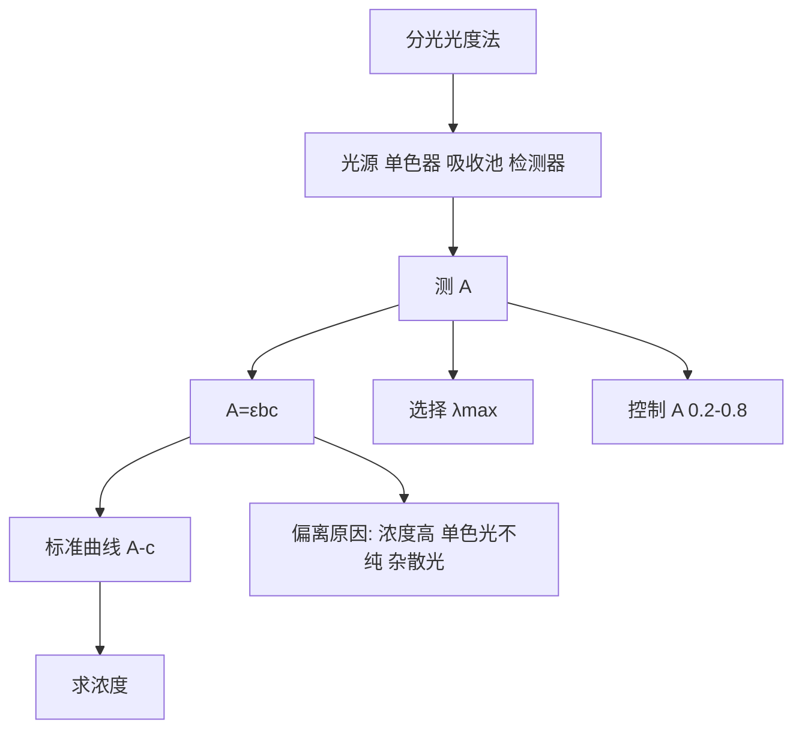

# 第 11 章：紫外-可见分光光度法

- **难度**：★★★ | **预估学时**：2.5 小时 | **前置**：03 第 4 章
- **考纲位置**：仪器分析中最常考的一章。朗伯-比尔定律、标准曲线、误差来源必须会。

## 学习目标
学完本章，你能：
1. 写出朗伯-比尔定律，说明 A、T、ε、b、c 的关系；
2. 解释最大吸收波长和标准曲线的做法；
3. 计算摩尔吸光系数、浓度、含量；
4. 说明偏离比尔定律的原因和吸光度最佳范围；
5. 设计一个分光光度法测定方案，处理干扰。

## 一句话核心
颜色深浅与浓度成正比：A = εbc。但只在稀溶液、单色光、均匀介质下成立。

## 11.1 光吸收的基本定律

当一束单色光通过溶液，部分光被吸收，透光率：

$$T = \frac{I}{I_0}$$

吸光度：

$$A = -\lg T = \lg\frac{I_0}{I}$$

朗伯-比尔定律：

$$A = \varepsilon b c$$

- ε：摩尔吸光系数，L/(mol·cm)，与物质、波长、温度有关；
- b：光程，cm，通常 1 cm；
- c：浓度，mol/L。

A 无单位。A=1 时 T=10%，A=2 时 T=1%。

### 11.1.1 摩尔吸光系数

ε 是物质在特定波长下的特征常数。ε 越大，灵敏度越高。ε > 10⁴ 通常为高灵敏度。

桑德尔灵敏度 S 表示 A=0.001 时每平方厘米截面积上能检出的物质质量（μg/cm²）：

$$S = \frac{M}{\varepsilon}$$

### 11.1.2 最大吸收波长

物质的吸收光谱是一条 A–λ 曲线，最大吸收处的波长叫 λmax。在 λmax 处测量，灵敏度最高，且附近吸光度随波长变化小，误差小。

选择原则：选 λmax，但也要避开共存物的吸收；有时选次峰。

## 11.2 定量方法

### 11.2.1 标准曲线法

配制一系列已知浓度的标准溶液，在 λmax 测 A，以 A 对 c 作图，得到直线：

$$A = kc + b$$

再测未知样的 A，由曲线查浓度。要求：
- 标准系列与试样基体尽量一致；
- 标准曲线线性范围覆盖试样；
- 每次实验重新做曲线，不能长期套用。

### 11.2.2 标准加入法

试样基体复杂、标准曲线法误差大时，用标准加入法。取若干份等量试样，分别加入不同量的标准品，测 A，外推求浓度。可消除基体效应。

## 11.3 偏离比尔定律的原因

### 11.3.1 化学因素

- 溶液浓度过高：分子间作用增强，ε 改变。
- 显色反应不完全、配合物逐级形成：不同浓度下配合物组成不同。
- pH 改变：影响显色剂离解、配合物组成。
- 共存离子、溶剂、温度。

### 11.3.2 仪器因素

- 单色光不纯：包含非吸收波长，导致负偏离。
- 杂散光：低吸光度时影响小，高吸光度时严重。
- 吸收池不匹配、光源漂移。

### 11.3.3 最佳测量范围

A 在 0.2–0.8 之间误差较小；A 太小，信号弱；A 太大，透光率低，杂散光影响大。可通过稀释、改变光程调整。

## 11.4 显色反应与条件

显色反应要求：
- 选择性好，只与待测组分反应；
- 灵敏度高，ε 大；
- 配合物组成稳定，颜色与浓度线性好；
- 颜色对比明显，λmax 差别大。

条件：
- 显色剂用量：过量但不过多；
- pH：影响显色剂和配合物；
- 温度、时间；
- 掩蔽干扰离子。

## 例题

### 例 1：由 A 求浓度

某溶液在 λmax 处 A=0.500，b=1.0 cm，ε=1.20×10⁴ L/(mol·cm)。求 c。

解：

$$c = \frac{A}{\varepsilon b} = \frac{0.500}{1.20\times10^4\times1.0} = 4.17\times10^{-5}\ \text{mol/L}$$

### 例 2：标准曲线

用标准曲线法测铁，数据如下：

| c (μg/mL) | 0 | 2.0 | 4.0 | 6.0 | 8.0 |
|---|---|---|---|---|---|
| A | 0 | 0.120 | 0.240 | 0.360 | 0.480 |

测得试样 A=0.300，求试样浓度。

解：A 与 c 成正比，斜率 k=0.120/2.0=0.060 mL/μg。c=A/k=0.300/0.060=5.0 μg/mL。

### 例 3：透光率

某溶液 A=0.700，求 T。

解：

$$T = 10^{-A} = 10^{-0.700} = 0.200 = 20.0\%$$

## 图示

看图说明：左边是仪器流程，中间是定量关系，右边是误差控制。做题先看 A 是否在合理范围。

## 常见误解
- 别以为“A 越大越好”——A 太大透光率低，杂散光影响大，最佳 0.2–0.8。
- 别以为“标准曲线可以长期使用”——仪器状态、试剂、温度都会变，每次实验重做。
- 别以为“ε 与浓度有关”——ε 是物质和波长决定的常数，浓度改变 A，不改变 ε（稀溶液）。
- 别以为“任何颜色都能用分光光度法”——需要稳定的显色反应和明显的吸收峰。

## 自测题（答案）
1. 朗伯-比尔定律的表达式是（ ）。
A. A=εbc B. A=ε/bc C. A=bc/ε D. A=εb/c
（答案：A；解析：吸光度与浓度、光程成正比。）

2. 某溶液 A=1.0，透光率 T 为（ ）。
A. 10% B. 20% C. 50% D. 90%
（答案：A；解析：T=10^-1=0.10。）

3. 分光光度法最佳吸光度范围一般是（ ）。
A. 0–0.1 B. 0.2–0.8 C. 1.0–2.0 D. 任意
（答案：B；解析：此范围相对误差较小。）

4. 下列不属于偏离比尔定律的化学因素的是（ ）。
A. 溶液浓度过高 B. 显色反应不完全 C. 单色光不纯 D. pH 改变
（答案：C；解析：单色光不纯是仪器因素。）

5. 判断：摩尔吸光系数 ε 越大，方法灵敏度越高。
（答案：正确。ε 越大，单位浓度产生的 A 越大。）

下面 5 题是上面 5 题的变式：考点不变，只换数据、条件或问法。先自己做，再对照解析看“变了什么”。

6. 透光率 T 与吸光度 A 的关系是（ ）
   A. T=10⁻ᴬ  B. T=A  C. T=1/A  D. T=10ᴬ
（答案：A；解析：A=−lgT，所以 T=10⁻ᴬ。变式：从 A=εbc 换成 A 与 T 的关系。）

7. 某溶液 A=0.301，透光率 T 约为（ ）
   A. 10%  B. 50%  C. 30%  D. 70%
（答案：B；解析：T=10⁻⁰·³⁰¹≈0.50=50%。变式：把 A=1.0 换成 A=0.301。）

8. 某溶液 A=1.5，最合理的处理是（ ）
   A. 直接测量  B. 稀释后重测  C. 换更浓的溶液  D. 关掉光源
（答案：B；解析：A 超出 0.2–0.8 最佳范围，应稀释使 A 落入范围。变式：从“最佳范围”改成“超出范围怎么办”。）

9. 下列属于偏离比尔定律的仪器因素的是（ ）
   A. 溶液浓度过高  B. 显色反应不完全  C. 单色光不纯  D. pH 改变
（答案：C；解析：单色光不纯是仪器因素；其余是化学因素。变式：把“化学因素”改成“仪器因素”。）

10. 判断：标准曲线的斜率越大，方法灵敏度越高。
   A. 正确  B. 错误
（答案：正确；解析：正确。斜率大表示单位浓度产生的 A 大，灵敏度高。变式：把“ε 大”换成“斜率大”。）

## 复习锚点
- A=εbc，T=10^-A，A=−lgT。
- λmax 处灵敏度最高；标准曲线每次重做。
- 最佳 A 0.2–0.8；偏离原因分化学和仪器两类。
- 显色反应要稳定、选择性好、灵敏度高。
