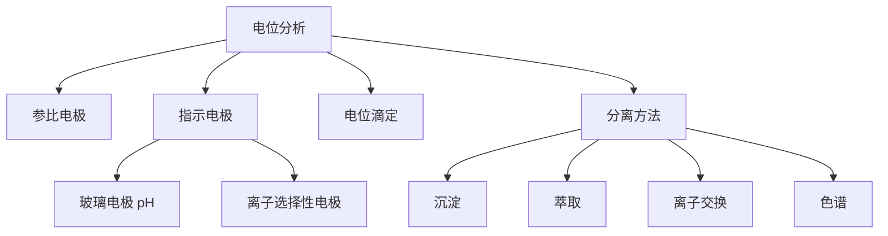

# 第 12 章：电位分析法与分离方法

- **难度**：★★★ | **预估学时**：2.5 小时 | **前置**：03 第 8 章、03 第 10 章
- **考纲位置**：pH 玻璃电极、离子选择性电极、电位滴定，以及萃取、离子交换、色谱分离，是仪器分析和分离富集部分的常考点。

## 学习目标
学完本章，你能：
1. 说出参比电极和指示电极的区别，写出玻璃电极的响应原理；
2. 用 Nernst 方程计算 pH 和离子浓度；
3. 说明电位滴定终点的判断方法；
4. 计算分配系数、分配比和萃取率；
5. 区分沉淀分离、萃取分离、离子交换和色谱分离的适用场景。

## 一句话核心
电位分析测的是“电极电势随浓度变化”，分离方法解决的是“干扰太多、浓度太低”这两个问题。

## 12.1 电位分析法

### 12.1.1 参比电极与指示电极

- **参比电极**：电极电势已知且稳定，不随待测离子浓度变化。常用饱和甘汞电极（SCE）和 Ag/AgCl 电极。
- **指示电极**：电极电势随待测离子浓度变化，用来指示浓度。常用玻璃电极、离子选择性电极、金属电极。

电池电动势：

$$E_{cell} = E_{指示} - E_{参比}$$

### 12.1.2 玻璃电极与 pH

玻璃电极对 H⁺ 有选择性响应。电极电势：

$$E = K + \frac{2.303RT}{F}\lg[H^+] = K - \frac{2.303RT}{F}pH$$

25℃ 时 2.303RT/F = 0.0592 V，所以：

$$E = K - 0.0592\,pH$$

pH 每改变 1 个单位，电势改变约 59 mV。

实际测量用 pH 计，先用标准缓冲溶液校准（两点校准），再测未知溶液。校准是为了确定 K 值。

玻璃电极使用注意：
- 使用前在纯水中浸泡 24 小时，活化电极；
- 避免碰撞、干燥；
- 强酸、强碱、含氟溶液会腐蚀玻璃，需用特殊电极。

### 12.1.3 离子选择性电极

离子选择性电极对某种离子有选择性响应，如氟离子电极（LaF₃ 单晶）、钙电极、氨气敏电极。

电极电势与离子活度的关系服从 Nernst 方程：

$$E = K \pm \frac{0.0592}{n}\lg a_i$$

阳离子取正号，阴离子取负号。实际测量需控制离子强度，用总离子强度调节缓冲液（TISAB）。

### 12.1.4 电位滴定

电位滴定用指示电极的电势突跃判断终点，不依赖指示剂颜色。适用于有色、浑浊溶液，或没有合适指示剂的反应。

终点判断：
- 作 E–V 曲线，取拐点；
- 作 ΔE/ΔV–V 曲线，取极大值；
- 作二阶导数，取零点；
- 用 Gran 作图法外推。

电位滴定的优点：客观、准确、可用于自动化；缺点是设备比指示剂法复杂。

## 12.2 分离方法

### 12.2.1 沉淀分离

利用溶解度差异，加入沉淀剂使目标组分或干扰组分沉淀。包括：
- 沉淀目标离子，过滤后测定；
- 沉淀干扰离子，保留目标离子在溶液中；
- 共沉淀富集微量组分。

注意控制 pH、沉淀剂用量、温度，减少共沉淀。

### 12.2.2 萃取分离

利用物质在两种互不相溶溶剂中分配系数不同，把目标组分从一相转移到另一相。

分配系数：

$$K_D = \frac{[A]_{有机}}{[A]_{水}}$$

分配比：

$$D = \frac{c_{有机}}{c_{水}}$$

萃取率：

$$E = \frac{D}{D + V_{水}/V_{有机}}\times100\%$$

例：D=10，V水=V有机，则 E=10/(10+1)=90.9%。多次少量萃取比一次大量萃取效率高。

萃取常用螯合萃取（如双硫腙测重金属）、离子缔合萃取。萃取后可用反萃取把目标物转回水相。

### 12.2.3 离子交换

离子交换树脂分为阳离子交换树脂和阴离子交换树脂。溶液中离子与树脂上的可交换离子发生交换。

- 阳离子交换：R–SO₃H + M⁺ → R–SO₃M + H⁺。
- 阴离子交换：R–N(CH₃)₃OH + X⁻ → R–N(CH₃)₃X + OH⁻。

应用：去离子水制备、痕量元素富集、干扰离子分离、氨基酸分离。

### 12.2.4 色谱分离

色谱利用不同组分在固定相和流动相之间分配系数不同，反复分配实现分离。

- 气相色谱（GC）：流动相为气体，适合挥发性物质。
- 液相色谱（HPLC）：流动相为液体，适合不挥发、热不稳定物质。
- 离子色谱（IC）：专门测阴离子、阳离子。

色谱的优点是分离效率高、可定量；缺点是需要标准品、仪器昂贵。

## 例题

### 例 1：pH 与电势

25℃ 时玻璃电极测得某溶液 E=0.200 V，已知 K=0.400 V，求 pH。

解：

$$E = K - 0.0592pH$$

$$0.200 = 0.400 - 0.0592pH$$

$$pH = \frac{0.400-0.200}{0.0592} = 3.38$$

### 例 2：萃取率

某物质在水和有机溶剂中的分配比 D=8.0，取 50.0 mL 水样，用 25.0 mL 有机溶剂萃取一次。求萃取率。

解：

$$E = \frac{D}{D + V_{水}/V_{有机}}\times100\% = \frac{8.0}{8.0 + 50.0/25.0}\times100\% = \frac{8.0}{10.0}\times100\% = 80.0\%$$

若分两次，每次 12.5 mL：
第一次 E=8/(8+4)=66.7%，剩余 33.3%；第二次再萃 66.7%，总萃取率 = 1−(1−0.667)² = 88.9%。分多次萃取效率更高。

### 例 3：电位滴定终点

用 NaOH 滴定 HCl，电位滴定数据在计量点附近 ΔE/ΔV 最大。如何确定终点？

解：作 ΔE/ΔV 对 V 的曲线，极大值对应的体积就是终点；或作二阶导数，取零点；也可用 Gran 作图，把计量点前后的线性段外推交点。

## 图示

看图说明：上半张是“测什么”，下半张是“怎么分”。电位分析解决测定，分离方法解决干扰和富集。

## 常见误解
- 别以为“参比电极的电势会随待测离子变化”——参比电极电势固定，指示电极才随浓度变化。
- 别以为“pH 电极可以测任意溶液”——强酸、强碱、含氟溶液会损坏玻璃膜。
- 别以为“萃取一次就够”——多次少量萃取总效率更高。
- 别以为“色谱只能定性”——色谱既能分离也能定量，峰面积与浓度相关。

## 自测题（答案）
1. 25℃ 时，pH 每改变 1 个单位，玻璃电极电势改变约（ ）。
A. 0.0592 V B. 0.592 V C. 5.92 V D. 0.00592 V
（答案：A；解析：能斯特斜率 2.303RT/F=0.0592 V。）

2. 下列属于参比电极的是（ ）。
A. 玻璃电极 B. 氟离子电极 C. 饱和甘汞电极 D. 铂电极
（答案：C；解析：SCE 电势稳定，作参比。）

3. 分配比 D=4，V水=2V有机，一次萃取率为（ ）。
A. 33% B. 50% C. 67% D. 80%
（答案：C；解析：E=4/(4+2)=0.667。）

4. 离子交换树脂去除水中阳离子，使用的是（ ）。
A. 阳离子交换树脂 B. 阴离子交换树脂 C. 活性炭 D. 硅胶
（答案：A；解析：阳离子交换树脂以 H⁺ 交换阳离子。）

5. 判断：电位滴定不需要指示剂，适用于有色或浑浊溶液。
（答案：正确。电位滴定用电势突跃判断终点。）

下面 5 题是上面 5 题的变式：考点不变，只换数据、条件或问法。先自己做，再对照解析看“变了什么”。

6. 25℃ 时，pH 改变 2 个单位，玻璃电极电势改变约（ ）
   A. 59 mV  B. 118 mV  C. 29.5 mV  D. 5.9 mV
（答案：B；解析：每 pH 单位约 59 mV，2 个单位约 118 mV。变式：把“1 个单位”改成“2 个单位”。）

7. 下列属于指示电极的是（ ）
   A. 饱和甘汞电极  B. Ag/AgCl 电极  C. 玻璃电极  D. 标准氢电极
（答案：C；解析：玻璃电极的电势随 H⁺ 浓度变化，是指示电极；其余可作参比。变式：从“参比”改成“指示”。）

8. 分配比 D=4，V有机=2V水，一次萃取率为（ ）
   A. 50%  B. 67%  C. 80%  D. 88.9%
（答案：D；解析：E=4/(4+0.5)=88.9%。变式：把“V水=2V有机”反过来。）

9. 阴离子交换树脂主要用于去除水中的（ ）
   A. 阳离子  B. 阴离子  C. 有机物  D. 气体
（答案：B；解析：阴离子交换树脂以 OH⁻ 交换阴离子。变式：从阳离子交换改成阴离子交换。）

10. 判断：Gran 作图法可用于确定电位滴定终点。
   A. 正确  B. 错误
（答案：正确；解析：正确。Gran 作图把计量点前后的线性段外推，交点即终点。变式：从“电位滴定适用有色溶液”换成“终点判断方法”。）

## 复习锚点
- 参比电极电势固定，指示电极随浓度变；Ecell=E指示−E参比。
- 玻璃电极 E=K−0.0592pH，使用前浸泡活化。
- 萃取率 E=D/(D+V水/V有机)，多次少量更高效。
- 分离四法：沉淀、萃取、离子交换、色谱。
