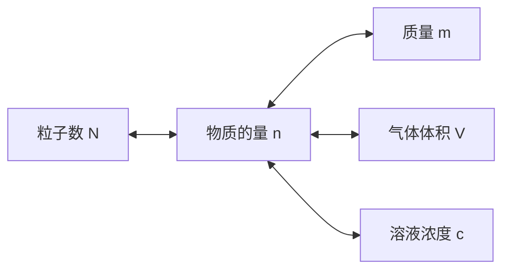

# 物质的量

- **难度**：进阶 | **涉及章节**：第 0、4、5 章

## 一句话定义
物质的量是一个“粒子计数单位”：1 mol 就是 6.022×10²³ 个粒子，它把看不见的原子、分子、离子，换算成能称、能量、能配溶液的宏观量。

## 为什么重要
化学方程式给的是粒子个数比，天平称的是质量，量筒量的是体积。三者之间没有物质的量就接不上。滴定计算、浓度配制、气体体积换算，全都从 n 出发。

## 图示

看图说明：n 是中心枢纽，四条边对应四个常用公式。做题时先判断已知的是哪条边，再选公式。

## 详解

**摩尔**：1 mol 物质含阿伏加德罗常数个指定粒子，NA=6.022×10²³ mol⁻¹。粒子可以是原子、分子、离子、电子，说“1 mol 氧”必须说明是 O 原子还是 O₂ 分子。

**摩尔质量 M**：1 mol 物质的质量，单位 g/mol。数值上等于相对分子质量或相对原子质量。例如 M(H₂O)=18.0 g/mol。

四个基本公式：

$$n=\frac{m}{M},\quad n=\frac{N}{N_A},\quad n=\frac{V}{V_m},\quad c=\frac{n}{V}$$

标准状况（0℃、101.3 kPa）下气体摩尔体积 Vm=22.4 L/mol。注意只对气体成立，且必须是标准状况。

**类比**：一打鸡蛋是 12 个，1 mol 是 6.022×10²³ 个。区别在于“一打”这个数太小，化学粒子太多，所以换成一个巨大的数，让宏观质量正好以克为单位。

类比失效边界：一打鸡蛋每个都一样重，化学粒子不同，所以 1 mol 不同物质的质量不同，必须查 M。

**实例**：18 g 水是多少 mol？n=18/18=1 mol；含多少水分子？N=1×6.022×10²³=6.022×10²³ 个。

## 常见误解
- 别以为“1 mol 任何气体都是 22.4 L”——只适用于标准状况，且必须是气体。
- 别以为“摩尔质量就是分子质量”——M 的单位是 g/mol，单个分子的质量要用 M/NA。
- 别以为“物质的量就是质量”——n 的单位是 mol，m 的单位是 g，两者差一个 M。

## 相关概念
- 前置：无
- 后续：[化学平衡与平衡常数](#/concept/c02)、[酸碱质子理论与 pH](#/concept/c03)、[朗伯-比尔定律](#/concept/c06)
