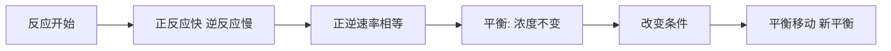

# 化学平衡与平衡常数

- **难度**：进阶 | **涉及章节**：第 2 章

## 一句话定义
化学平衡是可逆反应的正、逆反应速率相等时，反应物和生成物浓度不再改变的状态；平衡常数 K 是这个状态下各物质浓度的固定比值。

## 为什么重要
平衡决定“反应能进行到什么程度”，速率决定“多久到”。滴定终点的判断、沉淀的生成、弱酸的电离、配位物的稳定，背后都是平衡。K 还是判断反应方向、计算转化率的工具。

## 图示

看图说明：平衡不是“反应停止”，而是“正逆反应仍在进行，净结果为零”。改变条件后，旧平衡被打破，建立新平衡。

## 详解

对一般反应：

$$aA + bB \rightleftharpoons cC + dD$$

浓度平衡常数：

$$K_c = \frac{[C]^c[D]^d}{[A]^a[B]^b}$$

纯固体、纯液体不写进 K 表达式。气体用分压表示的 Kp 与 Kc 的关系：

$$K_p = K_c(RT)^{\Delta n}$$

Δn 是生成物气体总系数减反应物气体总系数。

**平衡的标志**：正逆反应速率相等；各组分浓度不再随时间改变；有固定 K。不能只看“颜色不变”“压强不变”，有些反应前后气体分子数相等，压强始终不变。

**反应商 Q**：

$$Q = \frac{[C]^c[D]^d}{[A]^a[B]^b}\ (\text{任意时刻})$$

比较 Q 与 K：
- Q < K：反应正向进行；
- Q = K：平衡；
- Q > K：反应逆向进行。

**勒夏特列原理**：改变影响平衡的条件，平衡向减弱这种改变的方向移动。
- 增大浓度：向消耗该物质的方向移动；
- 增大压强：向气体分子数减少的方向移动；
- 升高温度：向吸热方向移动；
- 催化剂：不改变平衡，只加快达到平衡。

**转化率**：

$$\alpha = \frac{\text{已转化的量}}{\text{起始量}}\times100\%$$

**实例**：合成氨 N₂ + 3H₂ ⇌ 2NH₃，ΔH<0。增大压强，平衡正向；升高温度，平衡逆向。工业上选 400–500℃、20–30 MPa、铁触媒，是速率、平衡、成本的折中。

## 常见误解
- 别以为“平衡时反应物浓度等于生成物浓度”——只要求比值固定，不要求相等。
- 别以为“催化剂能提高转化率”——催化剂只缩短到达平衡的时间，不改变 K 和平衡转化率。
- 别以为“平衡移动就是 K 改变”——只有温度改变 K；浓度、压强改变的是 Q，平衡移动但 K 不变。
- 别以为“Δn=0 时加压平衡一定移动”——压强改变对 Δn=0 的气体反应，平衡不移动。

## 相关概念
- 前置：[物质的量](#/concept/c01)
- 后续：[酸碱质子理论与 pH](#/concept/c03)、[条件稳定常数](#/concept/c04)
