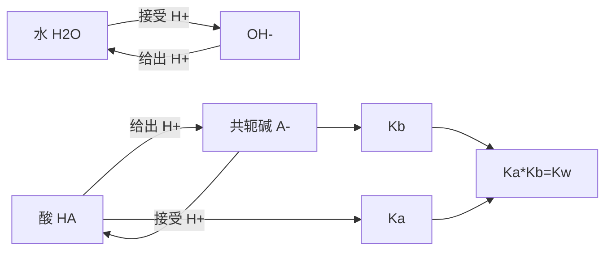

# 酸碱质子理论与 pH

- **难度**：进阶 | **涉及章节**：第 6 章

## 一句话定义
酸是给出质子的物质，碱是接受质子的物质；pH 是氢离子浓度的负对数，用来衡量溶液的酸碱性。

## 为什么重要
酸碱滴定、缓冲溶液、配位滴定、电极电势都离不开 pH。pH 决定弱酸以什么形式存在、EDTA 能否有效配位、金属指示剂能否变色。

## 图示

看图说明：酸和共轭碱是一对，水既能当酸又能当碱。Ka 与 Kb 通过 Kw 绑定，知道一个就知道另一个。

## 详解

**pH**：

$$pH = -\lg[H^+],\quad [H^+]=10^{-pH}$$

25℃ 时中性溶液 [H⁺]=10⁻⁷ mol/L，pH=7；pH<7 酸性，pH>7 碱性。

**弱酸电离**：

$$HA \rightleftharpoons H^+ + A^-,\quad K_a=\frac{[H^+][A^-]}{[HA]}$$

近似式（c/Ka>500）：

$$[H^+]=\sqrt{K_a c},\quad pH=\frac{1}{2}(pK_a-\lg c)$$

**缓冲溶液**：

$$pH=pK_a+\lg\frac{[A^-]}{[HA]}$$

缓冲能力在 pH=pKa±1 最强，总浓度越大，缓冲容量越大。

**两性物质**：

$$pH\approx\frac{1}{2}(pK_{a1}+pK_{a2})$$

**实例**：0.10 mol/L HAc，Ka=1.8×10⁻⁵，[H⁺]=1.34×10⁻³，pH=2.87。加等量 NaAc 后，pH=pKa=4.74，酸性明显减弱，因为同离子效应抑制了 HAc 电离。

## 常见误解
- 别以为“pH 差 1 就是浓度差 1 倍”——pH 差 1 是 [H⁺] 差 10 倍。
- 别以为“弱酸稀释 pH 按比例升高”——稀释时 c 变小，但电离度增大，pH 变化小于 1。
- 别以为“缓冲溶液能无限缓冲”——加酸加碱超过缓冲容量，pH 会突变。
- 别以为“pH=7 一定是中性”——只在 25℃ 成立；温度改变 Kw，中性 pH 也变。

## 相关概念
- 前置：[化学平衡与平衡常数](#/concept/c02)
- 后续：[条件稳定常数](#/concept/c04)
