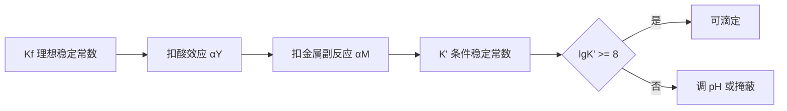

# 条件稳定常数

- **难度**：高难 | **涉及章节**：第 7 章

## 一句话定义
条件稳定常数 K' 是把酸效应、配位效应、沉淀效应等副反应都扣掉之后，配合物在真实溶液中的“有效稳定常数”。

## 为什么重要
Kf 是在理想条件下测的，真实溶液里 EDTA 会被 H⁺ 抢走，金属离子会水解，配体会被其他离子占用。只看 Kf 会误判“能滴定”，实际却滴不出来。K' 才是判断配位滴定可行性的依据。

## 图示

看图说明：Kf 是上限，每扣一种副反应，有效稳定度下降一截。K' 落在 10⁸ 以上，滴定突跃才够明显。

## 详解

配合物生成：

$$M+Y\rightleftharpoons MY,\quad K_{MY}=\frac{[MY]}{[M][Y]}$$

酸效应系数：

$$\alpha_{Y(H)}=\frac{c_Y}{[Y^{4-}]}\ \ge 1$$

pH 越低，αY(H) 越大，游离 Y⁴⁻ 越少。只考虑酸效应时：

$$K'_{MY}=\frac{K_{MY}}{\alpha_{Y(H)}}$$

$$\lg K'=\lg K_{MY}-\lg\alpha_{Y(H)}$$

所以 pH 越低，lgK' 越小。

若金属离子也有副反应（水解、配位），再乘 αM：

$$K'=\frac{K_{MY}}{\alpha_M\alpha_Y}$$

**最低 pH**：要求 lgK'≥8，即：

$$\lg\alpha_{Y(H)}\le\lg K_{MY}-8$$

由 lgαY(H) 与 pH 的关系（酸效应曲线）查得最低 pH。

**实例**：lgK(ZnY)=16.5，pH=5 时 lgαY(H)=6.45，lgK'=10.05，可滴定。若 pH 降到 4，lgαY(H)=8.44，lgK'=8.06，刚好在临界；再低就不行。

## 常见误解
- 别以为“Kf 大就一定能滴定”——酸度太高，K' 会掉到 10⁸ 以下。
- 别以为“αY(H) 越大表示 EDTA 越有效”——它是副反应系数，越大表示被 H⁺ 占用的越多，有效 Y⁴⁻ 越少。
- 别以为“pH 越高越好”——pH 太高金属水解，αM 下降，K' 也会掉。
- 别以为“K' 只跟 pH 有关”——还有配位、沉淀、共存离子效应。

## 相关概念
- 前置：[酸碱质子理论与 pH](#/concept/c03)
- 后续：[电极电势与 Nernst 方程](#/concept/c05)
