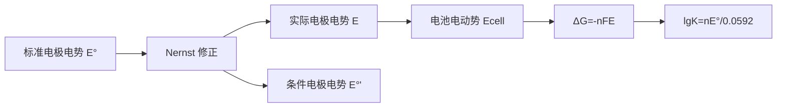

# 电极电势与 Nernst 方程

- **难度**：高难 | **涉及章节**：第 8 章

## 一句话定义
电极电势是电极中氧化型得电子能力的量度；Nernst 方程把浓度（分压）对电极电势的影响写成一个可计算的式子。

## 为什么重要
判断氧化还原反应方向、计算电池电动势、求平衡常数、解释为什么酸性增强 KMnO₄ 氧化性增强，都靠电极电势。氧化还原滴定的突跃范围也由两个电对的电势差决定。

## 图示

看图说明：E° 是基准，Nernst 把浓度影响加进去，条件电势再把配位、沉淀等副反应加进去。三层逐步接近真实。

## 详解

**电极电势**：以标准氢电极（E°=0）为基准测得的电势。E° 越大，氧化型得电子能力越强。

**电池电动势**：

$$E_{cell}=E_{正}-E_{负}$$

Ecell>0 时反应自发。

**Nernst 方程**（25℃）：

$$E=E^\circ+\frac{0.0592}{n}\lg\frac{[Ox]}{[Red]}$$

纯固体、纯液体不写；气体写分压。n 是半反应转移的电子数。

**与自由能、平衡常数**：

$$\Delta G^\circ=-nFE^\circ$$

$$\lg K=\frac{nE^\circ}{0.0592}$$

**条件电极电势 E°'**：把配位、沉淀、酸碱等副反应扣掉后的实际电势。配位剂使游离金属离子浓度降低，E°' 下降。

**实例**：Zn²⁺/Zn 的 E°=−0.76 V。若 [Zn²⁺]=0.10 mol/L：

$$E=-0.76+\frac{0.0592}{2}\lg(0.10)=-0.79\ \text{V}$$

浓度降低，氧化型减少，电势下降，Zn 的还原能力增强。

## 常见误解
- 别以为“E° 随方程式系数翻倍”——E° 是强度性质，与物质数量无关。
- 别以为“E° 大就一定反应”——非标准态要用 Nernst，实际体系还要用条件电势。
- 别以为“Nernst 方程里纯固体要写浓度”——纯固体活度为 1，不写。
- 别以为“ΔG° 和 E° 符号相同”——ΔG°=−nFE°，两者符号相反。

## 相关概念
- 前置：[物质的量](#/concept/c01)
- 后续：[条件稳定常数](#/concept/c04)
