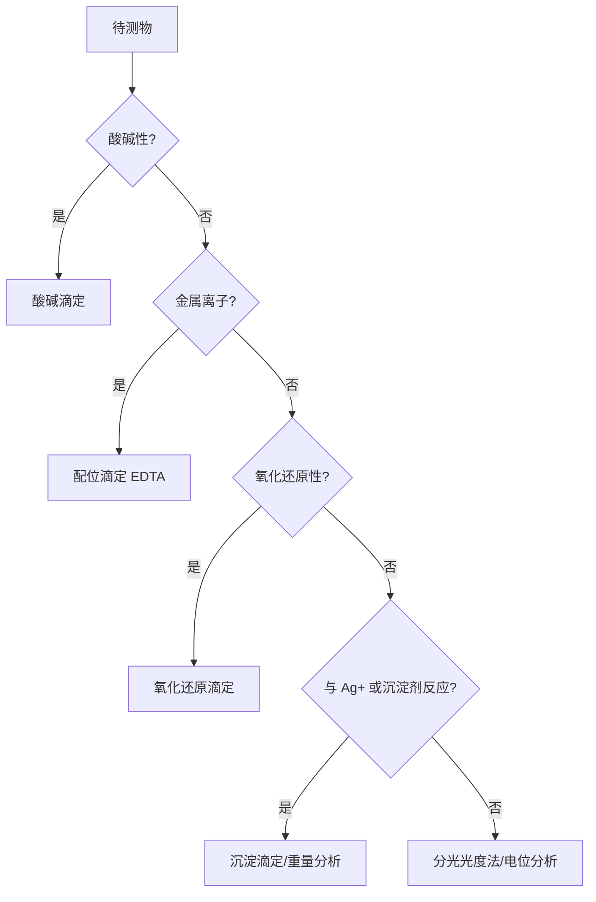

# 模式与框架库

## 框架 1：滴定方法选择

拿到一个待测物，先问四个问题：

1. 待测物是酸/碱、金属离子、氧化剂/还原剂、还是能与 Ag⁺/沉淀剂反应的离子？
2. 有没有可用的指示剂或仪器终点？
3. 反应有没有干扰（共存离子、颜色、沉淀）？
4. 需不需要富集或分离？

对应路线：

## 框架 2：酸碱计算四步

1. 判断体系：强酸/弱酸/缓冲/两性/混合。
2. 写主反应和平衡式。
3. 选公式，检查近似条件（c/Ka>500）。
4. 算 pH 或 [H⁺]，回代检查。

不要一上来套 pH=1/2(pKa−lg c)。先看是不是缓冲，是不是两性。

## 框架 3：配位滴定可行性

1. 查 lgKf。
2. 查该 pH 下的 lgαY(H)。
3. 算 lgK'=lgKf−lgαY(H)−lgαM。
4. lgK'≥8 才可滴定；不够就调 pH、掩蔽或换方法。
5. 再看指示剂是否合适、有无封闭。

## 框架 4：氧化还原方向与电池

1. 标氧化数，找氧化剂、还原剂。
2. 查 E°；E° 大的电对作正极。
3. Ecell=E正−E负；Ecell>0 自发。
4. 非标准态用 Nernst；有配位、沉淀用条件电势。
5. 求 K 用 lgK=nE°/0.0592。

## 框架 5：沉淀问题

1. 写 Ksp 表达式。
2. 算 Q，和 Ksp 比：Q>Ksp 沉淀。
3. 多离子共存：算各自开始沉淀所需沉淀剂浓度，小的先沉淀。
4. 沉淀转化：Ksp 大的转成 Ksp 小的。
5. 重量分析：沉淀形式→称量形式→换算因数→质量分数。

## 框架 6：分光光度法

1. 选 λmax。
2. 做标准曲线，确认线性范围。
3. 测 A，控制在 0.2–0.8。
4. 由 A 求 c；含量用 cV/M 或标准曲线。
5. 检查偏离：浓度、pH、显色时间、共存离子、单色光。

## 决策规则：先算物质的量

几乎所有计算题的第一步都是 n=m/M 或 n=cV。先把 n 算出来，再按计量系数转，最后回到质量或浓度。不要在单位没统一时硬套公式。

## 反模式

- 不判断体系，直接套一个公式。
- 不写配平方程式，凭感觉写计量比。
- 把滴定终点当化学计量点。
- 有效数字一路写到小数点后六位。
- 单位混用：mL 直接代进 mol/L 的公式，忘了 10⁻³。
- 分光光度法 A 超过 1 还硬用标准曲线。

## 考场策略

1. 先做选择题和判断题，拿稳基础分。
2. 计算题先写公式，再代数据，步骤分比结果分多。
3. 单位单独写一行，换算不错。
4. 结果检查：pH 是否在 0–14、浓度是否合理、质量分数是否超过 100%。
5. 不会的题先写相关公式，能拿步骤分。
